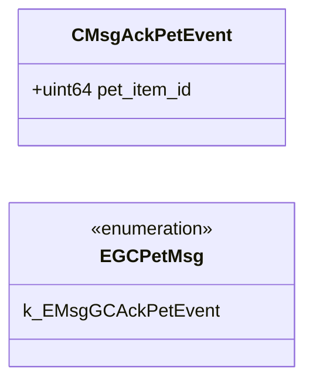

# `pet_gcmessages.proto`

## Diagram

## Enums

### `EGCPetMsg`

| Name | Value |
|------|-------|
| `k_EMsgGCAckPetEvent` | 2538 |

## Messages

### `CMsgAckPetEvent`

| Field | Number | Type | Label | Description |
|-------|--------|------|-------|-------------|
| `pet_item_id` | 1 | uint64 | optional |  |
