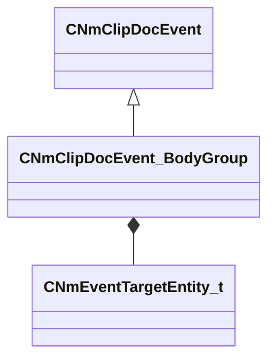

[Schemas](../../schemas.md) / [animdoclib](../animdoclib.md) / CNmClipDocEvent_BodyGroup

# CNmClipDocEvent_BodyGroup

> Source: **Build 25966348** · 2026-10-15 · `windows-x86_64` · schema `0.12.0`

**Kind:** class · **Size:** 48 bytes (`0x30`) · **Align:** 8 · **Module:** animdoclib

**Inherits from:** [CNmClipDocEvent](../animdoclib/CNmClipDocEvent.md)

**Relationships:**

## Memory layout

5 fields (3 declared here, 2 inherited). Offsets are absolute from the object base.

| Offset | Field | Type | From | Annotations |
|--------|-------|------|------|-------------|
| `0x8` | `m_flStartTime` | float32 | [CNmClipDocEvent](../animdoclib/CNmClipDocEvent.md) |  |
| `0xc` | `m_flDuration` | float32 | [CNmClipDocEvent](../animdoclib/CNmClipDocEvent.md) |  |
| `0x18` | `m_target` | [CNmEventTargetEntity_t](../animlib/CNmEventTargetEntity_t.md) |  |  |
| `0x20` | `m_bodygroup` | CUtlString |  | `MPropertyFriendlyName Body Group` |
| `0x28` | `m_choice` | CUtlString |  | `MPropertyFriendlyName Choice Name` |

KV3 class defaults

<pre>{
	&quot;_class&quot;: &quot;CNmClipDocEvent_BodyGroup&quot;,
	&quot;m_flStartTime&quot;: 0.000000,
	&quot;m_flDuration&quot;: 0.000000,
	&quot;m_target&quot;: &quot;Self&quot;,
	&quot;m_bodygroup&quot;: &quot;&quot;,
	&quot;m_choice&quot;: &quot;&quot;
}</pre>

