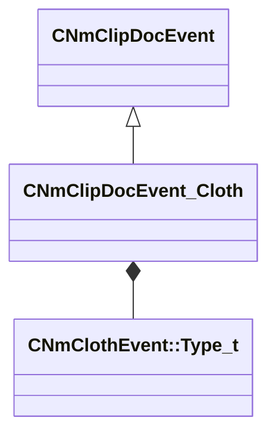

[Schemas](../../schemas.md) / [animdoclib](../animdoclib.md) / CNmClipDocEvent_Cloth

# CNmClipDocEvent_Cloth

> Source: **Build 25947352** · 2026-10-15 · `windows-x86_64` · schema `0.12.0`

**Kind:** class · **Size:** 64 bytes (`0x40`) · **Align:** 8 · **Module:** animdoclib

**Inherits from:** [CNmClipDocEvent](../animdoclib/CNmClipDocEvent.md)

**Relationships:**

## Memory layout

9 fields (7 declared here, 2 inherited). Offsets are absolute from the object base.

| Offset | Field | Type | From | Annotations |
|--------|-------|------|------|-------------|
| `0x8` | `m_flStartTime` | float32 | [CNmClipDocEvent](../animdoclib/CNmClipDocEvent.md) |  |
| `0xc` | `m_flDuration` | float32 | [CNmClipDocEvent](../animdoclib/CNmClipDocEvent.md) |  |
| `0x18` | `m_type` | [CNmClothEvent::Type_t](../animlib/CNmClothEvent.Type_t.md) |  | `MPropertyAutoRebuildOnChange` |
| `0x1c` | `m_flStiffness` | float32 |  | `MPropertyAttrStateCallback` |
| `0x20` | `m_flSpeedIn` | float32 |  | `MPropertyAttrStateCallback` |
| `0x24` | `m_flSpeedOut` | float32 |  | `MPropertyAttrStateCallback` |
| `0x28` | `m_flLengthSeconds` | float32 |  | `MPropertyAttrStateCallback` |
| `0x30` | `m_vertexSetName` | CUtlString |  | `MPropertyAttrStateCallback` |
| `0x38` | `m_effectName` | CUtlString |  | `MPropertyAttrStateCallback` |

KV3 class defaults

<pre>{
	&quot;_class&quot;: &quot;CNmClipDocEvent_Cloth&quot;,
	&quot;m_flStartTime&quot;: 0.000000,
	&quot;m_flDuration&quot;: 0.000000,
	&quot;m_type&quot;: &quot;Stiffen&quot;,
	&quot;m_flStiffness&quot;: 1.000000,
	&quot;m_flSpeedIn&quot;: 10.000000,
	&quot;m_flSpeedOut&quot;: 10.000000,
	&quot;m_flLengthSeconds&quot;: 1.000000,
	&quot;m_vertexSetName&quot;: &quot;&quot;,
	&quot;m_effectName&quot;: &quot;&quot;
}</pre>

