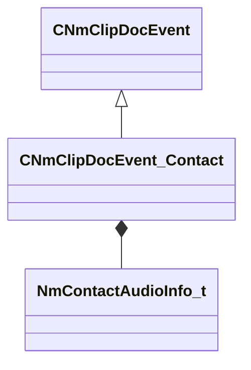

[Schemas](../../schemas.md) / [animdoclib](../animdoclib.md) / CNmClipDocEvent_Contact

# CNmClipDocEvent_Contact

> Source: **Build 25947352** · 2026-10-15 · `windows-x86_64` · schema `0.12.0`

**Kind:** class · **Size:** 80 bytes (`0x50`) · **Align:** 8 · **Module:** animdoclib

**Inherits from:** [CNmClipDocEvent](../animdoclib/CNmClipDocEvent.md)

**Relationships:**

## Memory layout

7 fields (5 declared here, 2 inherited). Offsets are absolute from the object base.

| Offset | Field | Type | From | Annotations |
|--------|-------|------|------|-------------|
| `0x8` | `m_flStartTime` | float32 | [CNmClipDocEvent](../animdoclib/CNmClipDocEvent.md) |  |
| `0xc` | `m_flDuration` | float32 | [CNmClipDocEvent](../animdoclib/CNmClipDocEvent.md) |  |
| `0x18` | `m_configID` | CGlobalSymbol |  | `MPropertyAutoRebuildOnChange` |
| `0x20` | `m_probeBoneID` | CGlobalSymbol |  | `MPropertyAttrStateCallback` |
| `0x28` | `m_vBoneLocalProbeDir` | Vector |  | `MPropertyAttrStateCallback` |
| `0x34` | `m_flProbeMaxDist` | float32 |  | `MPropertyAttrStateCallback` |
| `0x38` | `m_audioInfo` | [NmContactAudioInfo_t](../animlib/NmContactAudioInfo_t.md) |  | `MPropertyAttrStateCallback` `MPropertyFriendlyName Audio` |

KV3 class defaults

<pre>{
	&quot;_class&quot;: &quot;CNmClipDocEvent_Contact&quot;,
	&quot;m_flStartTime&quot;: 0.000000,
	&quot;m_flDuration&quot;: 0.000000,
	&quot;m_configID&quot;: &quot;&quot;,
	&quot;m_probeBoneID&quot;: &quot;&quot;,
	&quot;m_vBoneLocalProbeDir&quot;:
	[
		1.000000,
		0.000000,
		0.000000
	],
	&quot;m_flProbeMaxDist&quot;: 3.000000,
	&quot;m_audioInfo&quot;:
	{
		&quot;m_audioActionID&quot;: &quot;&quot;,
		&quot;m_audioTypeID&quot;: &quot;&quot;,
		&quot;m_soundeventOverrideID&quot;: &quot;&quot;
	}
}</pre>

