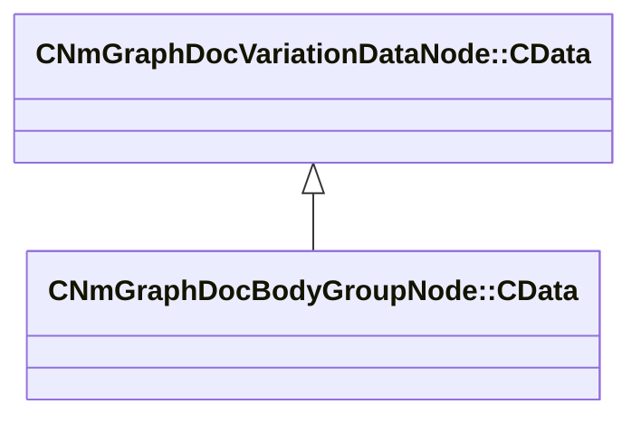

[Schemas](../../schemas.md) / [animdoclib](../animdoclib.md) / CNmGraphDocBodyGroupNode::CData

# CNmGraphDocBodyGroupNode::CData

> Source: **Build 26281801** · 2026-10-28 · `windows-x86_64` · schema `0.13.0`

**Kind:** class · **Size:** 24 bytes (`0x18`) · **Align:** 8 · **Module:** animdoclib

**Inherits from:** [CNmGraphDocVariationDataNode::CData](../animdoclib/CNmGraphDocVariationDataNode.CData.md)

**Relationships:**

## Memory layout

2 fields (2 declared here, 0 inherited). Offsets are absolute from the object base.

| Offset | Field | Type | From | Annotations |
|--------|-------|------|------|-------------|
| `0x8` | `m_groupName` | CUtlString |  |  |
| `0x10` | `m_choiceName` | CUtlString |  |  |

KV3 class defaults

<pre>{
	&quot;_class&quot;: &quot;CNmGraphDocBodyGroupNode::CData&quot;,
	&quot;m_groupName&quot;: &quot;&quot;,
	&quot;m_choiceName&quot;: &quot;&quot;
}</pre>

