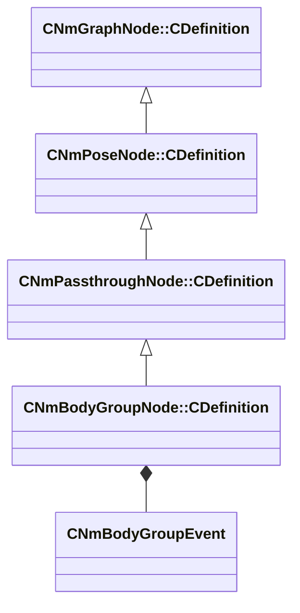

[Schemas](../../schemas.md) / [animlib](../animlib.md) / CNmBodyGroupNode::CDefinition

# CNmBodyGroupNode::CDefinition

> Source: **Build 25966348** · 2026-10-15 · `windows-x86_64` · schema `0.12.0`

**Kind:** class · **Size:** 80 bytes (`0x50`) · **Align:** 8 · **Module:** animlib

**Inherits from:** [CNmPassthroughNode::CDefinition](../animlib/CNmPassthroughNode.CDefinition.md)

**Relationships:**

## Memory layout

4 fields (2 declared here, 2 inherited). Offsets are absolute from the object base.

| Offset | Field | Type | From | Annotations |
|--------|-------|------|------|-------------|
| `0x8` | `m_nNodeIdx` | int16 | [CNmGraphNode::CDefinition](../animlib/CNmGraphNode.CDefinition.md) |  |
| `0x10` | `m_nChildNodeIdx` | int16 | [CNmPassthroughNode::CDefinition](../animlib/CNmPassthroughNode.CDefinition.md) |  |
| `0x18` | `m_nEnabledNodeIdx` | int16 |  |  |
| `0x20` | `m_event` | [CNmBodyGroupEvent](../animlib/CNmBodyGroupEvent.md) |  |  |

KV3 class defaults

<pre>{
	&quot;_class&quot;: &quot;CNmBodyGroupNode::CDefinition&quot;,
	&quot;m_nNodeIdx&quot;: -1,
	&quot;m_nChildNodeIdx&quot;: -1,
	&quot;m_nEnabledNodeIdx&quot;: -1,
	&quot;m_event&quot;:
	{
		&quot;_class&quot;: &quot;CNmBodyGroupEvent&quot;,
		&quot;m_flStartTime&quot;:
		{
			&quot;m_flValue&quot;: 0.000000
		},
		&quot;m_flDuration&quot;:
		{
			&quot;m_flValue&quot;: 0.000000
		},
		&quot;m_syncID&quot;: &quot;&quot;,
		&quot;m_target&quot;: &quot;Self&quot;,
		&quot;m_groupName&quot;: &quot;&quot;,
		&quot;m_choiceName&quot;: &quot;&quot;
	}
}</pre>

