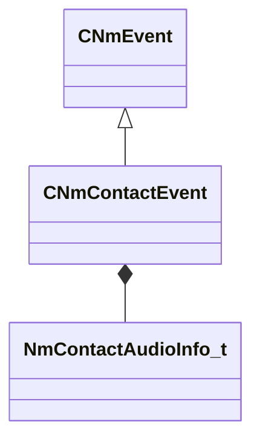

[Schemas](../../schemas.md) / [animlib](../animlib.md) / CNmContactEvent

# CNmContactEvent

> Source: **Build 26334290** · 2026-10-30 · `windows-x86_64` · schema `0.13.0`

**Kind:** class · **Size:** 80 bytes (`0x50`) · **Align:** 8 · **Module:** animlib

**Inherits from:** [CNmEvent](../animlib/CNmEvent.md)

**Relationships:**

## Memory layout

8 fields (5 declared here, 3 inherited). Offsets are absolute from the object base.

| Offset | Field | Type | From | Annotations |
|--------|-------|------|------|-------------|
| `0x8` | `m_flStartTime` | [NmPercent_t](../animlib/NmPercent_t.md) | [CNmEvent](../animlib/CNmEvent.md) |  |
| `0xc` | `m_flDuration` | [NmPercent_t](../animlib/NmPercent_t.md) | [CNmEvent](../animlib/CNmEvent.md) |  |
| `0x10` | `m_syncID` | CGlobalSymbol | [CNmEvent](../animlib/CNmEvent.md) |  |
| `0x18` | `m_configID` | CGlobalSymbol |  |  |
| `0x20` | `m_probeBoneID` | CGlobalSymbol |  |  |
| `0x28` | `m_vBoneLocalProbeDir` | Vector |  |  |
| `0x34` | `m_flProbeMaxDist` | float32 |  |  |
| `0x38` | `m_audioInfo` | [NmContactAudioInfo_t](../animlib/NmContactAudioInfo_t.md) |  |  |

KV3 class defaults

<pre>{
	&quot;_class&quot;: &quot;CNmContactEvent&quot;,
	&quot;m_flStartTime&quot;:
	{
		&quot;m_flValue&quot;: 0.000000
	},
	&quot;m_flDuration&quot;:
	{
		&quot;m_flValue&quot;: 0.000000
	},
	&quot;m_syncID&quot;: &quot;&quot;,
	&quot;m_configID&quot;: &quot;&quot;,
	&quot;m_probeBoneID&quot;: &quot;&quot;,
	&quot;m_vBoneLocalProbeDir&quot;:
	[
		1.000000,
		0.000000,
		0.000000
	],
	&quot;m_flProbeMaxDist&quot;: 3.000000,
	&quot;m_audioInfo&quot;:
	{
		&quot;m_audioActionID&quot;: &quot;&quot;,
		&quot;m_audioTypeID&quot;: &quot;&quot;,
		&quot;m_soundeventOverrideID&quot;: &quot;&quot;
	}
}</pre>

