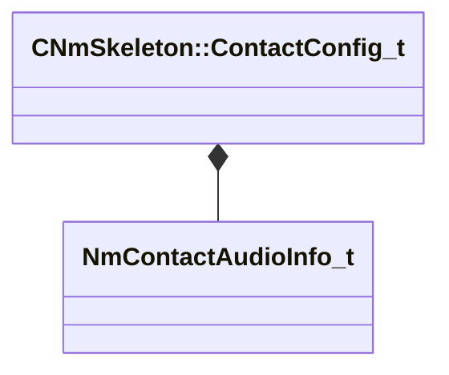

[Schemas](../../schemas.md) / [animlib](../animlib.md) / CNmSkeleton::ContactConfig_t

# CNmSkeleton::ContactConfig_t

> Source: **Build 25947352** · 2026-10-15 · `windows-x86_64` · schema `0.12.0`

**Kind:** class · **Size:** 56 bytes (`0x38`) · **Align:** 8 · **Module:** animlib

**Relationships:**

## Memory layout

5 fields (5 declared here, 0 inherited). Offsets are absolute from the object base.

| Offset | Field | Type | From | Annotations |
|--------|-------|------|------|-------------|
| `0x0` | `m_ID` | CGlobalSymbol |  |  |
| `0x8` | `m_nBoneIdx` | int32 |  |  |
| `0xc` | `m_vBoneLocalProbeDir` | Vector |  |  |
| `0x18` | `m_flProbeMaxDist` | float32 |  |  |
| `0x20` | `m_audioInfo` | [NmContactAudioInfo_t](../animlib/NmContactAudioInfo_t.md) |  |  |

KV3 class defaults

<pre>{
	&quot;m_ID&quot;: &lt;HIDDEN FOR DIFF&gt;,
	&quot;m_nBoneIdx&quot;: -1,
	&quot;m_vBoneLocalProbeDir&quot;:
	[
		1.000000,
		0.000000,
		0.000000
	],
	&quot;m_flProbeMaxDist&quot;: 5.000000,
	&quot;m_audioInfo&quot;:
	{
		&quot;m_audioActionID&quot;: &quot;&quot;,
		&quot;m_audioTypeID&quot;: &quot;&quot;,
		&quot;m_soundeventOverrideID&quot;: &quot;&quot;
	}
}</pre>

