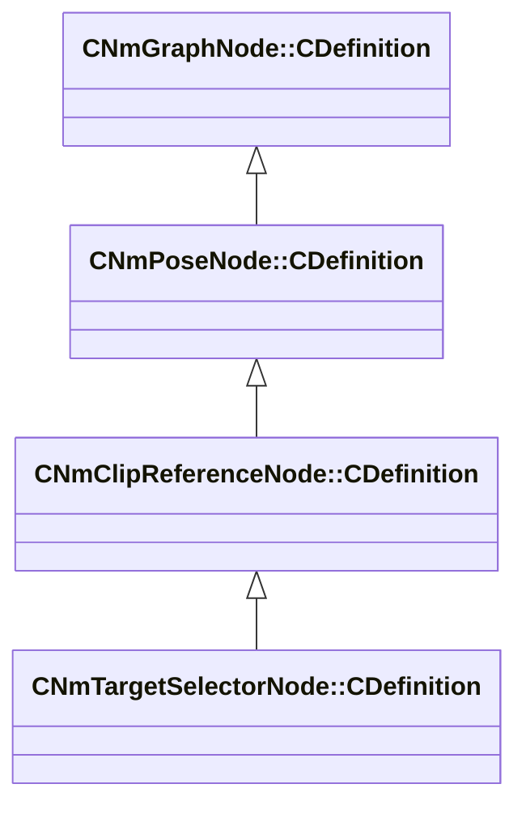

[Schemas](../../schemas.md) / [animlib](../animlib.md) / CNmTargetSelectorNode::CDefinition

# CNmTargetSelectorNode::CDefinition

> Source: **Build 26281801** · 2026-10-28 · `windows-x86_64` · schema `0.13.0`

**Kind:** class · **Size:** 64 bytes (`0x40`) · **Align:** 8 · **Module:** animlib

**Inherits from:** [CNmClipReferenceNode::CDefinition](../animlib/CNmClipReferenceNode.CDefinition.md)

**Relationships:**

## Memory layout

8 fields (7 declared here, 1 inherited). Offsets are absolute from the object base.

| Offset | Field | Type | From | Annotations |
|--------|-------|------|------|-------------|
| `0x8` | `m_nNodeIdx` | int16 | [CNmGraphNode::CDefinition](../animlib/CNmGraphNode.CDefinition.md) |  |
| `0x10` | `m_optionNodeIndices` | CUtlLeanVectorFixedGrowable< int16, 8 > |  |  |
| `0x28` | `m_flOrientationScoreWeight` | float32 |  |  |
| `0x2c` | `m_flPositionScoreWeight` | float32 |  |  |
| `0x30` | `m_parameterNodeIdx` | int16 |  |  |
| `0x32` | `m_bIgnoreInvalidOptions` | bool |  |  |
| `0x33` | `m_bIsWorldSpaceTarget` | bool |  |  |
| `0x38` | `m_alignmentBoneID` | CGlobalSymbol |  |  |

KV3 class defaults

<pre>{
	&quot;_class&quot;: &quot;CNmTargetSelectorNode::CDefinition&quot;,
	&quot;m_nNodeIdx&quot;: -1,
	&quot;m_optionNodeIndices&quot;:
	[
	],
	&quot;m_flOrientationScoreWeight&quot;: 1.000000,
	&quot;m_flPositionScoreWeight&quot;: 1.000000,
	&quot;m_parameterNodeIdx&quot;: -1,
	&quot;m_bIgnoreInvalidOptions&quot;: false,
	&quot;m_bIsWorldSpaceTarget&quot;: true,
	&quot;m_alignmentBoneID&quot;: &quot;&quot;
}</pre>

