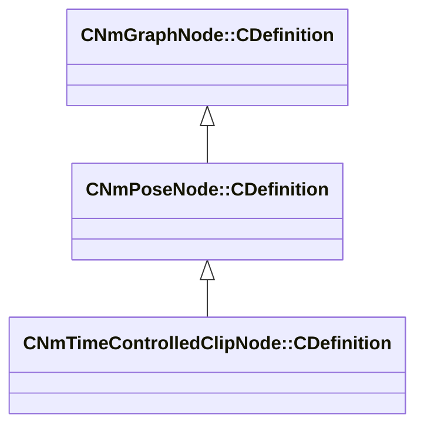

[Schemas](../../schemas.md) / [animlib](../animlib.md) / CNmTimeControlledClipNode::CDefinition

# CNmTimeControlledClipNode::CDefinition

> Source: **Build 26281801** · 2026-10-28 · `windows-x86_64` · schema `0.13.0`

**Kind:** class · **Size:** 64 bytes (`0x40`) · **Align:** 8 · **Module:** animlib

**Inherits from:** [CNmPoseNode::CDefinition](../animlib/CNmPoseNode.CDefinition.md)

**Relationships:**

## Memory layout

6 fields (5 declared here, 1 inherited). Offsets are absolute from the object base.

| Offset | Field | Type | From | Annotations |
|--------|-------|------|------|-------------|
| `0x8` | `m_nNodeIdx` | int16 | [CNmGraphNode::CDefinition](../animlib/CNmGraphNode.CDefinition.md) |  |
| `0x10` | `m_nPlayInReverseValueNodeIdx` | int16 |  |  |
| `0x12` | `m_bSampleRootMotion` | bool |  |  |
| `0x14` | `m_nDataSlotIdx` | int16 |  |  |
| `0x16` | `m_nTimeValueNodeIdx` | int16 |  |  |
| `0x18` | `m_graphEvents` | CUtlVectorFixedGrowable< CGlobalSymbol, 2 > |  |  |

KV3 class defaults

<pre>{
	&quot;_class&quot;: &quot;CNmTimeControlledClipNode::CDefinition&quot;,
	&quot;m_nNodeIdx&quot;: -1,
	&quot;m_nPlayInReverseValueNodeIdx&quot;: -1,
	&quot;m_bSampleRootMotion&quot;: true,
	&quot;m_nDataSlotIdx&quot;: -1,
	&quot;m_nTimeValueNodeIdx&quot;: -1,
	&quot;m_graphEvents&quot;:
	[
	]
}</pre>

