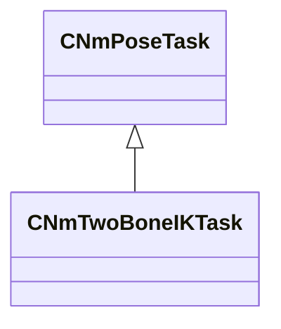

[Schemas](../../schemas.md) / [animlib](../animlib.md) / CNmTwoBoneIKTask

# CNmTwoBoneIKTask

> Source: **Build 26281801** · 2026-10-28 · `windows-x86_64` · schema `0.13.0`

**Kind:** class · **Size:** 240 bytes (`0xf0`) · **Align:** 16 · **Module:** animlib

**Inherits from:** [CNmPoseTask](../animlib/CNmPoseTask.md)

**Relationships:**

## Memory layout

3 fields (3 declared here, 0 inherited). Offsets are absolute from the object base.

| Offset | Field | Type | From | Annotations |
|--------|-------|------|------|-------------|
| `0x70` | `m_nEffectorBoneIdx` | int32 |  |  |
| `0x74` | `m_nEffectorTargetBoneIdx` | int32 |  |  |
| `0x80` | `m_targetTransform` | CTransform |  |  |
