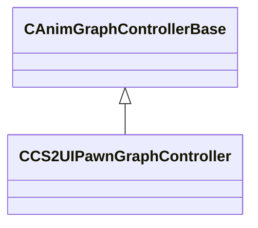

[Schemas](../../schemas.md) / [client](../client.md) / CCS2UIPawnGraphController

# CCS2UIPawnGraphController

> Source: **Build 25947352** · 2026-10-15 · `windows-x86_64` · schema `0.12.0`

**Kind:** class · **Size:** 576 bytes (`0x240`) · **Align:** 8 · **Module:** client

**Inherits from:** [CAnimGraphControllerBase](../server/CAnimGraphControllerBase.md)

**Relationships:**

## Memory layout

17 fields (16 declared here, 1 inherited). Offsets are absolute from the object base.

| Offset | Field | Type | From | Annotations |
|--------|-------|------|------|-------------|
| `0x4c` | `m_hExternalGraph` | [ExternalAnimGraphHandle_t](../server/ExternalAnimGraphHandle_t.md) | [CAnimGraphControllerBase](../server/CAnimGraphControllerBase.md) |  |
| `0xc0` | `m_nAnimationSeed` | CAnimGraph2ParamOptionalRef< float32 > |  |  |
| `0xd8` | `m_characterMode` | CAnimGraph2ParamOptionalRef< CGlobalSymbol > |  |  |
| `0xf0` | `m_bCharacterModeReset` | CAnimGraph2ParamOptionalRef< bool > |  |  |
| `0x108` | `m_nTeamPreviewVariant` | CAnimGraph2ParamOptionalRef< float32 > |  |  |
| `0x120` | `m_nTeamPreviewRandom` | CAnimGraph2ParamOptionalRef< float32 > |  |  |
| `0x138` | `m_nTeamPreviewPosition` | CAnimGraph2ParamOptionalRef< float32 > |  |  |
| `0x150` | `m_endOfMatchCelebration` | CAnimGraph2ParamOptionalRef< CGlobalSymbol > |  |  |
| `0x168` | `m_action` | CAnimGraph2ParamOptionalRef< CGlobalSymbol > |  |  |
| `0x180` | `m_bannerAnimation` | CAnimGraph2ParamOptionalRef< CGlobalSymbol > |  |  |
| `0x198` | `m_weaponCategory` | CAnimGraph2ParamOptionalRef< CGlobalSymbol > |  |  |
| `0x1b0` | `m_weaponType` | CAnimGraph2ParamOptionalRef< CGlobalSymbol > |  |  |
| `0x1c8` | `m_weaponState` | CAnimGraph2ParamOptionalRef< CGlobalSymbol > |  |  |
| `0x1e0` | `m_inspectTurnAngle` | CAnimGraph2ParamOptionalRef< float32 > |  |  |
| `0x1f8` | `m_nChickSnapshotVariant` | CAnimGraph2ParamOptionalRef< float32 > |  |  |
| `0x210` | `m_nChickLifeStage` | CAnimGraph2ParamOptionalRef< float32 > |  |  |
| `0x228` | `m_bCT` | CAnimGraph2ParamOptionalRef< bool > |  |  |

KV3 class defaults

<pre>{
	&quot;_class&quot;: &quot;CCS2UIPawnGraphController&quot;,
	&quot;m_hExternalGraph&quot;: 4294967295,
	&quot;m_nAnimationSeed&quot;: null,
	&quot;m_characterMode&quot;: null,
	&quot;m_bCharacterModeReset&quot;: null,
	&quot;m_nTeamPreviewVariant&quot;: null,
	&quot;m_nTeamPreviewRandom&quot;: null,
	&quot;m_nTeamPreviewPosition&quot;: null,
	&quot;m_endOfMatchCelebration&quot;: null,
	&quot;m_action&quot;: null,
	&quot;m_bannerAnimation&quot;: null,
	&quot;m_weaponCategory&quot;: null,
	&quot;m_weaponType&quot;: null,
	&quot;m_weaponState&quot;: null,
	&quot;m_inspectTurnAngle&quot;: null,
	&quot;m_nChickSnapshotVariant&quot;: null,
	&quot;m_nChickLifeStage&quot;: null,
	&quot;m_bCT&quot;: null
}</pre>

