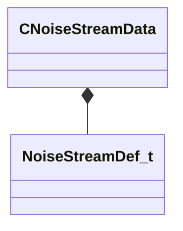

[Schemas](../../schemas.md) / [client](../client.md) / CNoiseStreamData

# CNoiseStreamData

> Source: **Build 25947352** · 2026-10-15 · `windows-x86_64` · schema `0.12.0`

**Kind:** class · **Size:** 80 bytes (`0x50`) · **Align:** 8 · **Module:** client

**Twin:** [CNoiseStreamData (server)](../server/CNoiseStreamData.md)

**Metadata:** `MVDataAssociatedFile scripts/noise_presets.vdata`, `MVDataOverlayType 1`, `MVDataPreviewWidget noise_stream`, `MVDataRoot`

**Relationships:**

## Memory layout

1 field (1 declared here, 0 inherited). Offsets are absolute from the object base.

| Offset | Field | Type | From | Annotations |
|--------|-------|------|------|-------------|
| `0x0` | `m_Stream` | [NoiseStreamDef_t](../mathlib_extended/NoiseStreamDef_t.md) |  | `MPropertyDescription The noise itself` |

KV3 class defaults

<pre>{
	&quot;m_Stream&quot;:
	{
		&quot;m_nType&quot;: &quot;NOISE_STREAM_TYPE_PERLIN&quot;,
		&quot;m_nModifier&quot;: &quot;NOISE_STREAM_MODIFIER_NONE&quot;,
		&quot;m_nTurbulence&quot;: &quot;NOISE_STREAM_TURB_NONE&quot;,
		&quot;m_flOutputMin&quot;: 0.000000,
		&quot;m_flOutputMax&quot;: 1.000000,
		&quot;m_flScale&quot;: 0.100000,
		&quot;m_vOffsetRate&quot;:
		[
			0.000000,
			0.000000,
			0.000000
		],
		&quot;m_flOffset&quot;: 0.000000,
		&quot;m_nOctaves&quot;: 1,
		&quot;m_flTurbulenceScale&quot;: 1.250000,
		&quot;m_flTurbulenceMix&quot;: 0.500000,
		&quot;m_Oscillators&quot;:
		[
		]
	}
}</pre>

