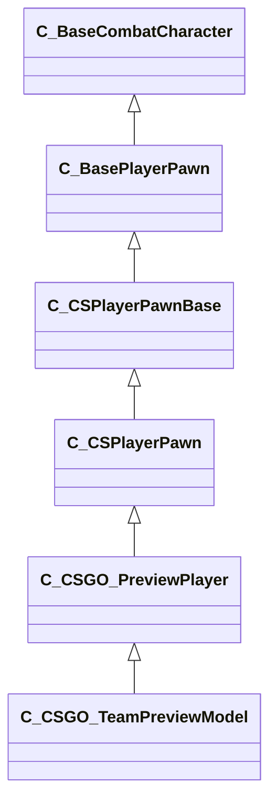

[Schemas](../../schemas.md) / [client](../client.md) / C_CSGO_TeamPreviewModel

# C_CSGO_TeamPreviewModel

> Source: **Build 25966348** · 2026-10-15 · `windows-x86_64` · schema `0.12.0`

**Kind:** class · **Size:** 14288 bytes (`0x37d0`) · **Align:** 16 · **Module:** client

**Inherits from:** [C_CSGO_PreviewPlayer](../client/C_CSGO_PreviewPlayer.md)

**Relationships:**

## Memory layout

317 fields (0 declared here, 317 inherited). Offsets are absolute from the object base.

| Offset | Field | Type | From | Annotations |
|--------|-------|------|------|-------------|
| `0x8` | `m_iszPrivateVScripts` | CUtlSymbolLarge | [CEntityInstance](../entity2/CEntityInstance.md) |  |
| `0x10` | `m_pEntity` | [CEntityIdentity](../entity2/CEntityIdentity.md)* | [CEntityInstance](../entity2/CEntityInstance.md) | CEntityIdentity pointer: the entity's identity record (name, class, handle, flags). |
| `0x28` | `m_CScriptComponent` | [CScriptComponent](../entity2/CScriptComponent.md)* | [CEntityInstance](../entity2/CEntityInstance.md) | VScript component attached to the entity, when scripted. |
| `0x30` | `m_CBodyComponent` | [CBodyComponent](../client/CBodyComponent.md)* | [C_BaseEntity](../client/C_BaseEntity.md) |  |
| `0x38` | `m_NetworkTransmitComponent` | [CNetworkTransmitComponent](../server/CNetworkTransmitComponent.md) | [C_BaseEntity](../client/C_BaseEntity.md) | `MNotSaved` |
| `0x328` | `m_nLastThinkTick` | [GameTick_t](../entity2/GameTick_t.md) | [C_BaseEntity](../client/C_BaseEntity.md) | `MNotSaved` |
| `0x330` | `m_pGameSceneNode` | [CGameSceneNode](../client/CGameSceneNode.md)* | [C_BaseEntity](../client/C_BaseEntity.md) | `MNotSaved` |
| `0x338` | `m_pRenderComponent` | [CRenderComponent](../client/CRenderComponent.md)* | [C_BaseEntity](../client/C_BaseEntity.md) | `MNotSaved` |
| `0x340` | `m_pCollision` | [CCollisionProperty](../client/CCollisionProperty.md)* | [C_BaseEntity](../client/C_BaseEntity.md) | `MNotSaved` |
| `0x348` | `m_iMaxHealth` | int32 | [C_BaseEntity](../client/C_BaseEntity.md) | `MNotSaved` |
| `0x34c` | `m_iHealth` | int32 | [C_BaseEntity](../client/C_BaseEntity.md) |  |
| `0x350` | `m_flDamageAccumulator` | float32 | [C_BaseEntity](../client/C_BaseEntity.md) | `MNotSaved` |
| `0x354` | `m_lifeState` | uint8 | [C_BaseEntity](../client/C_BaseEntity.md) | `MNotSaved` |
| `0x355` | `m_bTakesDamage` | bool | [C_BaseEntity](../client/C_BaseEntity.md) | `MNotSaved` |
| `0x358` | `m_nTakeDamageFlags` | [TakeDamageFlags_t](../server/TakeDamageFlags_t.md) | [C_BaseEntity](../client/C_BaseEntity.md) | `MNotSaved` |
| `0x360` | `m_nPlatformType` | [EntityPlatformTypes_t](../server/EntityPlatformTypes_t.md) | [C_BaseEntity](../client/C_BaseEntity.md) |  |
| `0x361` | `m_ubInterpolationFrame` | uint8 | [C_BaseEntity](../client/C_BaseEntity.md) | `MNotSaved` |
| `0x364` | `m_hSceneObjectController` | CHandle< [C_BaseEntity](../client/C_BaseEntity.md) > | [C_BaseEntity](../client/C_BaseEntity.md) |  |
| `0x368` | `m_nNoInterpolationTick` | int32 | [C_BaseEntity](../client/C_BaseEntity.md) | `MNotSaved` |
| `0x36c` | `m_nVisibilityNoInterpolationTick` | int32 | [C_BaseEntity](../client/C_BaseEntity.md) | `MNotSaved` |
| `0x370` | `m_flProxyRandomValue` | float32 | [C_BaseEntity](../client/C_BaseEntity.md) | `MNotSaved` |
| `0x374` | `m_iEFlags` | int32 | [C_BaseEntity](../client/C_BaseEntity.md) | `MNotSaved` |
| `0x378` | `m_nWaterType` | uint8 | [C_BaseEntity](../client/C_BaseEntity.md) | `MNotSaved` |
| `0x379` | `m_bInterpolateEvenWithNoModel` | bool | [C_BaseEntity](../client/C_BaseEntity.md) | `MNotSaved` |
| `0x37a` | `m_bPredictionEligible` | bool | [C_BaseEntity](../client/C_BaseEntity.md) | `MNotSaved` |
| `0x37b` | `m_bApplyLayerMatchIDToModel` | bool | [C_BaseEntity](../client/C_BaseEntity.md) | `MNotSaved` |
| `0x37c` | `m_tokLayerMatchID` | CUtlStringToken | [C_BaseEntity](../client/C_BaseEntity.md) | `MNotSaved` |
| `0x380` | `m_nSubclassID` | CUtlStringToken | [C_BaseEntity](../client/C_BaseEntity.md) |  |
| `0x390` | `m_nSimulationTick` | int32 | [C_BaseEntity](../client/C_BaseEntity.md) | `MNotSaved` |
| `0x394` | `m_iCurrentThinkContext` | int32 | [C_BaseEntity](../client/C_BaseEntity.md) | `MNotSaved` |
| `0x398` | `m_aThinkFunctions` | CUtlVector< thinkfunc_t > | [C_BaseEntity](../client/C_BaseEntity.md) | `MNotSaved` |
| `0x3b0` | `m_bDisabledContextThinks` | bool | [C_BaseEntity](../client/C_BaseEntity.md) |  |
| `0x3b4` | `m_flAnimTime` | float32 | [C_BaseEntity](../client/C_BaseEntity.md) | `MNotSaved` |
| `0x3b8` | `m_flSimulationTime` | float32 | [C_BaseEntity](../client/C_BaseEntity.md) | `MNotSaved` |
| `0x3bc` | `m_nSceneObjectOverrideFlags` | uint8 | [C_BaseEntity](../client/C_BaseEntity.md) |  |
| `0x3bd` | `m_bHasSuccessfullyInterpolated` | bool | [C_BaseEntity](../client/C_BaseEntity.md) | `MNotSaved` |
| `0x3be` | `m_bHasAddedVarsToInterpolation` | bool | [C_BaseEntity](../client/C_BaseEntity.md) | `MNotSaved` |
| `0x3bf` | `m_bRenderEvenWhenNotSuccessfullyInterpolated` | bool | [C_BaseEntity](../client/C_BaseEntity.md) | `MNotSaved` |
| `0x3c0` | `m_nInterpolationLatchDirtyFlags` | int32[2] | [C_BaseEntity](../client/C_BaseEntity.md) | `MNotSaved` |
| `0x3c8` | `m_ListEntry` | uint16[11] | [C_BaseEntity](../client/C_BaseEntity.md) | `MNotSaved` |
| `0x3e0` | `m_flCreateTime` | [GameTime_t](../entity2/GameTime_t.md) | [C_BaseEntity](../client/C_BaseEntity.md) | `MNotSaved` |
| `0x3e4` | `m_EntClientFlags` | uint16 | [C_BaseEntity](../client/C_BaseEntity.md) | `MNotSaved` |
| `0x3e6` | `m_bClientSideRagdoll` | bool | [C_BaseEntity](../client/C_BaseEntity.md) | `MNotSaved` |
| `0x3e7` | `m_iTeamNum` | uint8 | [C_BaseEntity](../client/C_BaseEntity.md) | `MNotSaved` |
| `0x3e8` | `m_spawnflags` | uint32 | [C_BaseEntity](../client/C_BaseEntity.md) |  |
| `0x3ec` | `m_nNextThinkTick` | [GameTick_t](../entity2/GameTick_t.md) | [C_BaseEntity](../client/C_BaseEntity.md) | `MNotSaved` |
| `0x3f4` | `m_fFlags` | uint32 | [C_BaseEntity](../client/C_BaseEntity.md) | `MSaveBehavior` |
| `0x3f8` | `m_vecAbsVelocity` | Vector | [C_BaseEntity](../client/C_BaseEntity.md) | `MNotSaved` |
| `0x404` | `m_vecServerVelocity` | [CNetworkVelocityVector](../server/CNetworkVelocityVector.md) | [C_BaseEntity](../client/C_BaseEntity.md) | `MNotSaved` |
| `0x430` | `m_vecVelocity` | [CNetworkVelocityVector](../server/CNetworkVelocityVector.md) | [C_BaseEntity](../client/C_BaseEntity.md) |  |
| `0x510` | `m_vecBaseVelocity` | Vector | [C_BaseEntity](../client/C_BaseEntity.md) | `MNotSaved` |
| `0x51c` | `m_hEffectEntity` | CHandle< [C_BaseEntity](../client/C_BaseEntity.md) > | [C_BaseEntity](../client/C_BaseEntity.md) | `MNotSaved` |
| `0x520` | `m_hOwnerEntity` | CHandle< [C_BaseEntity](../client/C_BaseEntity.md) > | [C_BaseEntity](../client/C_BaseEntity.md) |  |
| `0x524` | `m_MoveCollide` | [MoveCollide_t](../server/MoveCollide_t.md) | [C_BaseEntity](../client/C_BaseEntity.md) | `MNotSaved` |
| `0x525` | `m_MoveType` | [MoveType_t](../server/MoveType_t.md) | [C_BaseEntity](../client/C_BaseEntity.md) |  |
| `0x526` | `m_nActualMoveType` | [MoveType_t](../server/MoveType_t.md) | [C_BaseEntity](../client/C_BaseEntity.md) |  |
| `0x528` | `m_flWaterLevel` | float32 | [C_BaseEntity](../client/C_BaseEntity.md) | `MNotSaved` |
| `0x52c` | `m_fEffects` | uint32 | [C_BaseEntity](../client/C_BaseEntity.md) | `MNotSaved` |
| `0x530` | `m_hGroundEntity` | CHandle< [C_BaseEntity](../client/C_BaseEntity.md) > | [C_BaseEntity](../client/C_BaseEntity.md) | `MNotSaved` |
| `0x534` | `m_nGroundBodyIndex` | int32 | [C_BaseEntity](../client/C_BaseEntity.md) | `MNotSaved` |
| `0x538` | `m_flFriction` | float32 | [C_BaseEntity](../client/C_BaseEntity.md) | `MNotSaved` |
| `0x53c` | `m_flElasticity` | float32 | [C_BaseEntity](../client/C_BaseEntity.md) | `MNotSaved` |
| `0x540` | `m_flGravityScale` | float32 | [C_BaseEntity](../client/C_BaseEntity.md) | `MNotSaved` |
| `0x544` | `m_flTimeScale` | float32 | [C_BaseEntity](../client/C_BaseEntity.md) | `MNotSaved` |
| `0x548` | `m_bAnimatedEveryTick` | bool | [C_BaseEntity](../client/C_BaseEntity.md) | `MNotSaved` |
| `0x549` | `m_bGravityDisabled` | bool | [C_BaseEntity](../client/C_BaseEntity.md) |  |
| `0x54c` | `m_flNavIgnoreUntilTime` | [GameTime_t](../entity2/GameTime_t.md) | [C_BaseEntity](../client/C_BaseEntity.md) | `MNotSaved` |
| `0x550` | `m_hThink` | uint16 | [C_BaseEntity](../client/C_BaseEntity.md) | `MNotSaved` |
| `0x560` | `m_fBBoxVisFlags` | uint8 | [C_BaseEntity](../client/C_BaseEntity.md) | `MNotSaved` |
| `0x564` | `m_flActualGravityScale` | float32 | [C_BaseEntity](../client/C_BaseEntity.md) |  |
| `0x568` | `m_bGravityActuallyDisabled` | bool | [C_BaseEntity](../client/C_BaseEntity.md) |  |
| `0x569` | `m_bPredictable` | bool | [C_BaseEntity](../client/C_BaseEntity.md) | `MNotSaved` |
| `0x56a` | `m_bRenderWithViewModels` | bool | [C_BaseEntity](../client/C_BaseEntity.md) |  |
| `0x56c` | `m_nFirstPredictableCommand` | int32 | [C_BaseEntity](../client/C_BaseEntity.md) | `MNotSaved` |
| `0x570` | `m_nLastPredictableCommand` | int32 | [C_BaseEntity](../client/C_BaseEntity.md) | `MNotSaved` |
| `0x574` | `m_hOldMoveParent` | CHandle< [C_BaseEntity](../client/C_BaseEntity.md) > | [C_BaseEntity](../client/C_BaseEntity.md) | `MNotSaved` |
| `0x578` | `m_Particles` | [CParticleProperty](../particleslib/CParticleProperty.md) | [C_BaseEntity](../client/C_BaseEntity.md) | `MNotSaved` |
| `0x5a8` | `m_vecAngVelocity` | QAngle | [C_BaseEntity](../client/C_BaseEntity.md) |  |
| `0x5b4` | `m_DataChangeEventRef` | int32 | [C_BaseEntity](../client/C_BaseEntity.md) | `MNotSaved` |
| `0x5b8` | `m_dependencies` | CUtlVector< CEntityHandle > | [C_BaseEntity](../client/C_BaseEntity.md) | `MNotSaved` |
| `0x5d0` | `m_nCreationTick` | int32 | [C_BaseEntity](../client/C_BaseEntity.md) | `MNotSaved` |
| `0x5e1` | `m_bAnimTimeChanged` | bool | [C_BaseEntity](../client/C_BaseEntity.md) | `MNotSaved` |
| `0x5e2` | `m_bSimulationTimeChanged` | bool | [C_BaseEntity](../client/C_BaseEntity.md) | `MNotSaved` |
| `0x5f0` | `m_sUniqueHammerID` | CUtlString | [C_BaseEntity](../client/C_BaseEntity.md) | `MNotSaved` |
| `0x5f8` | `m_nBloodType` | [BloodType](../server/BloodType.md) | [C_BaseEntity](../client/C_BaseEntity.md) |  |
| `0xaf8` | `m_CRenderComponent` | [CRenderComponent](../client/CRenderComponent.md)* | [C_BaseModelEntity](../client/C_BaseModelEntity.md) | `MNotSaved` |
| `0xb00` | `m_CHitboxComponent` | [CHitboxComponent](../client/CHitboxComponent.md) | [C_BaseModelEntity](../client/C_BaseModelEntity.md) |  |
| `0xb18` | `m_pChoreoComponent` | [CChoreoComponent](../client/CChoreoComponent.md)* | [C_BaseModelEntity](../client/C_BaseModelEntity.md) |  |
| `0xb20` | `m_nDestructiblePartInitialStateDestructed0` | [HitGroup_t](../server/HitGroup_t.md) | [C_BaseModelEntity](../client/C_BaseModelEntity.md) |  |
| `0xb24` | `m_nDestructiblePartInitialStateDestructed1` | [HitGroup_t](../server/HitGroup_t.md) | [C_BaseModelEntity](../client/C_BaseModelEntity.md) |  |
| `0xb28` | `m_nDestructiblePartInitialStateDestructed2` | [HitGroup_t](../server/HitGroup_t.md) | [C_BaseModelEntity](../client/C_BaseModelEntity.md) |  |
| `0xb2c` | `m_nDestructiblePartInitialStateDestructed3` | [HitGroup_t](../server/HitGroup_t.md) | [C_BaseModelEntity](../client/C_BaseModelEntity.md) |  |
| `0xb30` | `m_nDestructiblePartInitialStateDestructed4` | [HitGroup_t](../server/HitGroup_t.md) | [C_BaseModelEntity](../client/C_BaseModelEntity.md) |  |
| `0xb34` | `m_nDestructiblePartInitialStateDestructed0_PartIndex` | int32 | [C_BaseModelEntity](../client/C_BaseModelEntity.md) |  |
| `0xb38` | `m_nDestructiblePartInitialStateDestructed1_PartIndex` | int32 | [C_BaseModelEntity](../client/C_BaseModelEntity.md) |  |
| `0xb3c` | `m_nDestructiblePartInitialStateDestructed2_PartIndex` | int32 | [C_BaseModelEntity](../client/C_BaseModelEntity.md) |  |
| `0xb40` | `m_nDestructiblePartInitialStateDestructed3_PartIndex` | int32 | [C_BaseModelEntity](../client/C_BaseModelEntity.md) |  |
| `0xb44` | `m_nDestructiblePartInitialStateDestructed4_PartIndex` | int32 | [C_BaseModelEntity](../client/C_BaseModelEntity.md) |  |
| `0xb48` | `m_bDestructiblePartInitialStateDestructed0_GenerateBreakpieces` | bool | [C_BaseModelEntity](../client/C_BaseModelEntity.md) |  |
| `0xb49` | `m_bDestructiblePartInitialStateDestructed1_GenerateBreakpieces` | bool | [C_BaseModelEntity](../client/C_BaseModelEntity.md) |  |
| `0xb4a` | `m_bDestructiblePartInitialStateDestructed2_GenerateBreakpieces` | bool | [C_BaseModelEntity](../client/C_BaseModelEntity.md) |  |
| `0xb4b` | `m_bDestructiblePartInitialStateDestructed3_GenerateBreakpieces` | bool | [C_BaseModelEntity](../client/C_BaseModelEntity.md) |  |
| `0xb4c` | `m_bDestructiblePartInitialStateDestructed4_GenerateBreakpieces` | bool | [C_BaseModelEntity](../client/C_BaseModelEntity.md) |  |
| `0xb50` | `m_pDestructiblePartsSystemComponent` | [CDestructiblePartsComponent](../client/CDestructiblePartsComponent.md)* | [C_BaseModelEntity](../client/C_BaseModelEntity.md) |  |
| `0xc78` | `m_bInitModelEffects` | bool | [C_BaseModelEntity](../client/C_BaseModelEntity.md) | `MNotSaved` |
| `0xc79` | `m_bDoingModelEffects` | bool | [C_BaseModelEntity](../client/C_BaseModelEntity.md) | `MNotSaved` |
| `0xc7c` | `m_iOldHealth` | int32 | [C_BaseModelEntity](../client/C_BaseModelEntity.md) | `MNotSaved` |
| `0xc80` | `m_nRenderMode` | [RenderMode_t](../server/RenderMode_t.md) | [C_BaseModelEntity](../client/C_BaseModelEntity.md) |  |
| `0xc81` | `m_nRenderFX` | [RenderFx_t](../server/RenderFx_t.md) | [C_BaseModelEntity](../client/C_BaseModelEntity.md) |  |
| `0xc82` | `m_bAllowFadeInView` | bool | [C_BaseModelEntity](../client/C_BaseModelEntity.md) |  |
| `0xca0` | `m_clrRender` | Color | [C_BaseModelEntity](../client/C_BaseModelEntity.md) |  |
| `0xca8` | `m_vecRenderAttributes` | C_UtlVectorEmbeddedNetworkVar< [EntityRenderAttribute_t](../client/EntityRenderAttribute_t.md) > | [C_BaseModelEntity](../client/C_BaseModelEntity.md) |  |
| `0xd28` | `m_bRenderToCubemaps` | bool | [C_BaseModelEntity](../client/C_BaseModelEntity.md) |  |
| `0xd29` | `m_bExpandRenderBoundsToIncludeCloth` | bool | [C_BaseModelEntity](../client/C_BaseModelEntity.md) |  |
| `0xd2a` | `m_bNoInterpolate` | bool | [C_BaseModelEntity](../client/C_BaseModelEntity.md) |  |
| `0xd30` | `m_Collision` | [CCollisionProperty](../client/CCollisionProperty.md) | [C_BaseModelEntity](../client/C_BaseModelEntity.md) |  |
| `0xde8` | `m_Glow` | [CGlowProperty](../client/CGlowProperty.md) | [C_BaseModelEntity](../client/C_BaseModelEntity.md) |  |
| `0xe40` | `m_flGlowBackfaceMult` | float32 | [C_BaseModelEntity](../client/C_BaseModelEntity.md) |  |
| `0xe44` | `m_fadeMinDist` | float32 | [C_BaseModelEntity](../client/C_BaseModelEntity.md) |  |
| `0xe48` | `m_fadeMaxDist` | float32 | [C_BaseModelEntity](../client/C_BaseModelEntity.md) |  |
| `0xe4c` | `m_flFadeScale` | float32 | [C_BaseModelEntity](../client/C_BaseModelEntity.md) |  |
| `0xe50` | `m_flShadowStrength` | float32 | [C_BaseModelEntity](../client/C_BaseModelEntity.md) |  |
| `0xe54` | `m_nObjectCulling` | uint8 | [C_BaseModelEntity](../client/C_BaseModelEntity.md) |  |
| `0xe55` | `m_nRequiredDecalRtEncoding` | [DecalRtEncoding_t](../scenesystem/DecalRtEncoding_t.md) | [C_BaseModelEntity](../client/C_BaseModelEntity.md) |  |
| `0xe58` | `m_bodyGroupTotalRequestCount` | uint32 | [C_BaseModelEntity](../client/C_BaseModelEntity.md) |  |
| `0xe60` | `m_bodyGroupRequests` | CUtlVectorFixedGrowable< [C_BaseModelEntity::BodyGroupRequest_t](../client/C_BaseModelEntity.BodyGroupRequest_t.md), 8 > | [C_BaseModelEntity](../client/C_BaseModelEntity.md) |  |
| `0xf38` | `m_bodyGroupChoices` | CUtlOrderedMap< CGlobalSymbol, int32 > | [C_BaseModelEntity](../client/C_BaseModelEntity.md) |  |
| `0xf60` | `m_vecViewOffset` | [CNetworkViewOffsetVector](../server/CNetworkViewOffsetVector.md) | [C_BaseModelEntity](../client/C_BaseModelEntity.md) |  |
| `0x1040` | `m_pClientAlphaProperty` | [CClientAlphaProperty](../client/CClientAlphaProperty.md)* | [C_BaseModelEntity](../client/C_BaseModelEntity.md) | `MNotSaved` |
| `0x1048` | `m_ClientOverrideTint` | Color | [C_BaseModelEntity](../client/C_BaseModelEntity.md) | `MNotSaved` |
| `0x104c` | `m_bUseClientOverrideTint` | bool | [C_BaseModelEntity](../client/C_BaseModelEntity.md) | `MNotSaved` |
| `0x1088` | `m_bvDisabledHitGroups` | uint32[1] | [C_BaseModelEntity](../client/C_BaseModelEntity.md) | `MKV3TransferSaveOpsForField GetHitgroupDisableListSaveRestoreOps` |
| `0x1098` | `m_graphControllerManager` | [CAnimGraphControllerManager](../server/CAnimGraphControllerManager.md) | [CBaseAnimGraph](../client/CBaseAnimGraph.md) |  |
| `0x1130` | `m_pMainGraphController` | [CAnimGraphControllerPtr](../server/CAnimGraphControllerPtr.md) | [CBaseAnimGraph](../client/CBaseAnimGraph.md) | The primary animation-graph controller instance for this entity. |
| `0x1138` | `m_bInitiallyPopulateInterpHistory` | bool | [CBaseAnimGraph](../client/CBaseAnimGraph.md) |  |
| `0x113a` | `m_bSuppressAnimEventSounds` | bool | [CBaseAnimGraph](../client/CBaseAnimGraph.md) |  |
| `0x1140` | `m_OnLayerCycleUpdated` | CEntityOutputTemplate< float32 > | [CBaseAnimGraph](../client/CBaseAnimGraph.md) |  |
| `0x1160` | `m_OnExternalChoreoGraphChanged` | [CEntityIOOutput](../entity2/CEntityIOOutput.md) | [CBaseAnimGraph](../client/CBaseAnimGraph.md) |  |
| `0x1180` | `m_bAnimGraphUpdateEnabled` | bool | [CBaseAnimGraph](../client/CBaseAnimGraph.md) |  |
| `0x1181` | `m_bAnimationUpdateScheduled` | bool | [CBaseAnimGraph](../client/CBaseAnimGraph.md) | `MNotSaved` |
| `0x1184` | `m_vecForce` | Vector | [CBaseAnimGraph](../client/CBaseAnimGraph.md) | `MNotSaved` |
| `0x1190` | `m_nForceBone` | int32 | [CBaseAnimGraph](../client/CBaseAnimGraph.md) | `MNotSaved` |
| `0x1198` | `m_pClientsideRagdoll` | [CBaseAnimGraph](../client/CBaseAnimGraph.md)* | [CBaseAnimGraph](../client/CBaseAnimGraph.md) | `MNotSaved` |
| `0x11a0` | `m_bBuiltRagdoll` | bool | [CBaseAnimGraph](../client/CBaseAnimGraph.md) | `MNotSaved` |
| `0x11b0` | `m_pRagdollControl` | [IPhysicsRagdollControl](../vphysics2/IPhysicsRagdollControl.md)* | [CBaseAnimGraph](../client/CBaseAnimGraph.md) | `MPhysPtr` |
| `0x11b8` | `m_RagdollPose` | [PhysicsRagdollPose_t](../client/PhysicsRagdollPose_t.md) | [CBaseAnimGraph](../client/CBaseAnimGraph.md) |  |
| `0x1200` | `m_bRagdollEnabled` | bool | [CBaseAnimGraph](../client/CBaseAnimGraph.md) | True while the entity is simulated as a ragdoll rather than animated. |
| `0x1201` | `m_bRagdollClientSide` | bool | [CBaseAnimGraph](../client/CBaseAnimGraph.md) | `MNotSaved` |
| `0x1202` | `m_bShouldUpdateTransformations` | bool | [CBaseAnimGraph](../client/CBaseAnimGraph.md) |  |
| `0x1210` | `m_bHasAnimatedMaterialAttributes` | bool | [CBaseAnimGraph](../client/CBaseAnimGraph.md) | `MNotSaved` |
| `0x1268` | `m_hMyWearables` | C_NetworkUtlVectorBase< CHandle< [C_EconWearable](../client/C_EconWearable.md) > > | [C_BaseCombatCharacter](../client/C_BaseCombatCharacter.md) | `MNotSaved` |
| `0x1280` | `m_leftFootAttachment` | [AttachmentHandle_t](../modellib/AttachmentHandle_t.md) | [C_BaseCombatCharacter](../client/C_BaseCombatCharacter.md) | `MNotSaved` |
| `0x1281` | `m_rightFootAttachment` | [AttachmentHandle_t](../modellib/AttachmentHandle_t.md) | [C_BaseCombatCharacter](../client/C_BaseCombatCharacter.md) | `MNotSaved` |
| `0x1284` | `m_nWaterWakeMode` | [C_BaseCombatCharacter::WaterWakeMode_t](../client/C_BaseCombatCharacter.WaterWakeMode_t.md) | [C_BaseCombatCharacter](../client/C_BaseCombatCharacter.md) | `MNotSaved` |
| `0x1288` | `m_flWaterWorldZ` | float32 | [C_BaseCombatCharacter](../client/C_BaseCombatCharacter.md) | `MNotSaved` |
| `0x128c` | `m_flWaterNextTraceTime` | float32 | [C_BaseCombatCharacter](../client/C_BaseCombatCharacter.md) | `MNotSaved` |
| `0x12f0` | `m_pWeaponServices` | [CPlayer_WeaponServices](../client/CPlayer_WeaponServices.md)* | [C_BasePlayerPawn](../client/C_BasePlayerPawn.md) |  |
| `0x12f8` | `m_pItemServices` | [CPlayer_ItemServices](../client/CPlayer_ItemServices.md)* | [C_BasePlayerPawn](../client/C_BasePlayerPawn.md) |  |
| `0x1300` | `m_pAutoaimServices` | [CPlayer_AutoaimServices](../client/CPlayer_AutoaimServices.md)* | [C_BasePlayerPawn](../client/C_BasePlayerPawn.md) |  |
| `0x1308` | `m_pObserverServices` | [CPlayer_ObserverServices](../client/CPlayer_ObserverServices.md)* | [C_BasePlayerPawn](../client/C_BasePlayerPawn.md) |  |
| `0x1310` | `m_pWaterServices` | [CPlayer_WaterServices](../client/CPlayer_WaterServices.md)* | [C_BasePlayerPawn](../client/C_BasePlayerPawn.md) |  |
| `0x1318` | `m_pUseServices` | [CPlayer_UseServices](../client/CPlayer_UseServices.md)* | [C_BasePlayerPawn](../client/C_BasePlayerPawn.md) |  |
| `0x1320` | `m_pFlashlightServices` | [CPlayer_FlashlightServices](../client/CPlayer_FlashlightServices.md)* | [C_BasePlayerPawn](../client/C_BasePlayerPawn.md) |  |
| `0x1328` | `m_pCameraServices` | [CPlayer_CameraServices](../client/CPlayer_CameraServices.md)* | [C_BasePlayerPawn](../client/C_BasePlayerPawn.md) |  |
| `0x1330` | `m_pMovementServices` | [CPlayer_MovementServices](../client/CPlayer_MovementServices.md)* | [C_BasePlayerPawn](../client/C_BasePlayerPawn.md) |  |
| `0x1340` | `m_ServerViewAngleChanges` | C_UtlVectorEmbeddedNetworkVar< [ViewAngleServerChange_t](../client/ViewAngleServerChange_t.md) > | [C_BasePlayerPawn](../client/C_BasePlayerPawn.md) | `MNotSaved` |
| `0x13a8` | `v_angle` | QAngle | [C_BasePlayerPawn](../client/C_BasePlayerPawn.md) |  |
| `0x13b4` | `v_anglePrevious` | QAngle | [C_BasePlayerPawn](../client/C_BasePlayerPawn.md) |  |
| `0x13c0` | `m_iHideHUD` | uint32 | [C_BasePlayerPawn](../client/C_BasePlayerPawn.md) |  |
| `0x13c8` | `m_skybox3d` | sky3dparams_t | [C_BasePlayerPawn](../client/C_BasePlayerPawn.md) |  |
| `0x1458` | `m_flDeathTime` | [GameTime_t](../entity2/GameTime_t.md) | [C_BasePlayerPawn](../client/C_BasePlayerPawn.md) |  |
| `0x1460` | `m_vecPredictionError` | Vector | [C_BasePlayerPawn](../client/C_BasePlayerPawn.md) | `MNotSaved` |
| `0x146c` | `m_flPredictionErrorTime` | [GameTime_t](../entity2/GameTime_t.md) | [C_BasePlayerPawn](../client/C_BasePlayerPawn.md) | `MNotSaved` |
| `0x148c` | `m_vecLastCameraSetupLocalOrigin` | Vector | [C_BasePlayerPawn](../client/C_BasePlayerPawn.md) | `MNotSaved` |
| `0x1498` | `m_flLastCameraSetupTime` | [GameTime_t](../entity2/GameTime_t.md) | [C_BasePlayerPawn](../client/C_BasePlayerPawn.md) | `MNotSaved` |
| `0x149c` | `m_flFOVSensitivityAdjust` | float32 | [C_BasePlayerPawn](../client/C_BasePlayerPawn.md) | `MNotSaved` |
| `0x14a0` | `m_flMouseSensitivity` | float32 | [C_BasePlayerPawn](../client/C_BasePlayerPawn.md) | `MNotSaved` |
| `0x14a4` | `m_vOldOrigin` | Vector | [C_BasePlayerPawn](../client/C_BasePlayerPawn.md) | `MNotSaved` |
| `0x14b0` | `m_flOldSimulationTime` | float32 | [C_BasePlayerPawn](../client/C_BasePlayerPawn.md) | `MNotSaved` |
| `0x14b4` | `m_nLastExecutedCommandNumber` | int32 | [C_BasePlayerPawn](../client/C_BasePlayerPawn.md) | `MNotSaved` |
| `0x14b8` | `m_nLastExecutedCommandTick` | int32 | [C_BasePlayerPawn](../client/C_BasePlayerPawn.md) | `MNotSaved` |
| `0x14bc` | `m_hController` | CHandle< [CBasePlayerController](../client/CBasePlayerController.md) > | [C_BasePlayerPawn](../client/C_BasePlayerPawn.md) |  |
| `0x14c0` | `m_hDefaultController` | CHandle< [CBasePlayerController](../client/CBasePlayerController.md) > | [C_BasePlayerPawn](../client/C_BasePlayerPawn.md) |  |
| `0x14c4` | `m_bIsSwappingToPredictableController` | bool | [C_BasePlayerPawn](../client/C_BasePlayerPawn.md) | `MNotSaved` |
| `0x14d8` | `m_pPingServices` | [CCSPlayer_PingServices](../client/CCSPlayer_PingServices.md)* | [C_CSPlayerPawnBase](../client/C_CSPlayerPawnBase.md) |  |
| `0x14e0` | `m_previousPlayerState` | [CSPlayerState](../server/CSPlayerState.md) | [C_CSPlayerPawnBase](../client/C_CSPlayerPawnBase.md) |  |
| `0x14e4` | `m_iPlayerState` | [CSPlayerState](../server/CSPlayerState.md) | [C_CSPlayerPawnBase](../client/C_CSPlayerPawnBase.md) |  |
| `0x14e8` | `m_bHasMovedSinceSpawn` | bool | [C_CSPlayerPawnBase](../client/C_CSPlayerPawnBase.md) |  |
| `0x14ec` | `m_flLastSpawnTimeIndex` | [GameTime_t](../entity2/GameTime_t.md) | [C_CSPlayerPawnBase](../client/C_CSPlayerPawnBase.md) |  |
| `0x14f0` | `m_iProgressBarDuration` | int32 | [C_CSPlayerPawnBase](../client/C_CSPlayerPawnBase.md) |  |
| `0x14f4` | `m_flProgressBarStartTime` | float32 | [C_CSPlayerPawnBase](../client/C_CSPlayerPawnBase.md) |  |
| `0x14f8` | `m_flClientDeathTime` | [GameTime_t](../entity2/GameTime_t.md) | [C_CSPlayerPawnBase](../client/C_CSPlayerPawnBase.md) |  |
| `0x14fc` | `m_flFlashBangTime` | float32 | [C_CSPlayerPawnBase](../client/C_CSPlayerPawnBase.md) |  |
| `0x1500` | `m_flFlashScreenshotAlpha` | float32 | [C_CSPlayerPawnBase](../client/C_CSPlayerPawnBase.md) |  |
| `0x1504` | `m_flFlashOverlayAlpha` | float32 | [C_CSPlayerPawnBase](../client/C_CSPlayerPawnBase.md) |  |
| `0x1508` | `m_bFlashBuildUp` | bool | [C_CSPlayerPawnBase](../client/C_CSPlayerPawnBase.md) |  |
| `0x1509` | `m_bFlashDspHasBeenCleared` | bool | [C_CSPlayerPawnBase](../client/C_CSPlayerPawnBase.md) |  |
| `0x150a` | `m_bFlashScreenshotHasBeenGrabbed` | bool | [C_CSPlayerPawnBase](../client/C_CSPlayerPawnBase.md) |  |
| `0x150c` | `m_flFlashMaxAlpha` | float32 | [C_CSPlayerPawnBase](../client/C_CSPlayerPawnBase.md) |  |
| `0x1510` | `m_flFlashDuration` | float32 | [C_CSPlayerPawnBase](../client/C_CSPlayerPawnBase.md) |  |
| `0x1514` | `m_flClientHealthFadeChangeTimestamp` | [GameTime_t](../entity2/GameTime_t.md) | [C_CSPlayerPawnBase](../client/C_CSPlayerPawnBase.md) |  |
| `0x1518` | `m_nClientHealthFadeParityValue` | int32 | [C_CSPlayerPawnBase](../client/C_CSPlayerPawnBase.md) |  |
| `0x151c` | `m_fNextThinkPushAway` | float32 | [C_CSPlayerPawnBase](../client/C_CSPlayerPawnBase.md) |  |
| `0x1524` | `m_flCurrentMusicStartTime` | float32 | [C_CSPlayerPawnBase](../client/C_CSPlayerPawnBase.md) |  |
| `0x1528` | `m_flMusicRoundStartTime` | float32 | [C_CSPlayerPawnBase](../client/C_CSPlayerPawnBase.md) |  |
| `0x152c` | `m_bDeferStartMusicOnWarmup` | bool | [C_CSPlayerPawnBase](../client/C_CSPlayerPawnBase.md) |  |
| `0x1530` | `m_flLastSmokeOverlayAlpha` | float32 | [C_CSPlayerPawnBase](../client/C_CSPlayerPawnBase.md) |  |
| `0x1534` | `m_flLastSmokeAge` | float32 | [C_CSPlayerPawnBase](../client/C_CSPlayerPawnBase.md) |  |
| `0x1538` | `m_vLastSmokeOverlayColor` | Vector | [C_CSPlayerPawnBase](../client/C_CSPlayerPawnBase.md) |  |
| `0x1560` | `m_hOriginalController` | CHandle< [CCSPlayerController](../client/CCSPlayerController.md) > | [C_CSPlayerPawnBase](../client/C_CSPlayerPawnBase.md) |  |
| `0x1570` | `m_pBulletServices` | [CCSPlayer_BulletServices](../client/CCSPlayer_BulletServices.md)* | [C_CSPlayerPawn](../client/C_CSPlayerPawn.md) |  |
| `0x1578` | `m_pHostageServices` | [CCSPlayer_HostageServices](../client/CCSPlayer_HostageServices.md)* | [C_CSPlayerPawn](../client/C_CSPlayerPawn.md) |  |
| `0x1580` | `m_pBuyServices` | [CCSPlayer_BuyServices](../client/CCSPlayer_BuyServices.md)* | [C_CSPlayerPawn](../client/C_CSPlayerPawn.md) |  |
| `0x1588` | `m_pGlowServices` | [CCSPlayer_GlowServices](../client/CCSPlayer_GlowServices.md)* | [C_CSPlayerPawn](../client/C_CSPlayerPawn.md) |  |
| `0x1590` | `m_pActionTrackingServices` | [CCSPlayer_ActionTrackingServices](../client/CCSPlayer_ActionTrackingServices.md)* | [C_CSPlayerPawn](../client/C_CSPlayerPawn.md) |  |
| `0x1598` | `m_pAimPunchServices` | [CCSPlayer_AimPunchServices](../client/CCSPlayer_AimPunchServices.md)* | [C_CSPlayerPawn](../client/C_CSPlayerPawn.md) |  |
| `0x15a0` | `m_pDamageReactServices` | [CCSPlayer_DamageReactServices](../client/CCSPlayer_DamageReactServices.md)* | [C_CSPlayerPawn](../client/C_CSPlayerPawn.md) |  |
| `0x15a8` | `m_flHealthShotBoostExpirationTime` | [GameTime_t](../entity2/GameTime_t.md) | [C_CSPlayerPawn](../client/C_CSPlayerPawn.md) |  |
| `0x15ac` | `m_flLastFiredWeaponTime` | [GameTime_t](../entity2/GameTime_t.md) | [C_CSPlayerPawn](../client/C_CSPlayerPawn.md) |  |
| `0x15b0` | `m_bHasFemaleVoice` | bool | [C_CSPlayerPawn](../client/C_CSPlayerPawn.md) |  |
| `0x15b4` | `m_flLandingTimeSeconds` | float32 | [C_CSPlayerPawn](../client/C_CSPlayerPawn.md) |  |
| `0x15b8` | `m_flOldFallVelocity` | float32 | [C_CSPlayerPawn](../client/C_CSPlayerPawn.md) |  |
| `0x15bc` | `m_szLastPlaceName` | char[18] | [C_CSPlayerPawn](../client/C_CSPlayerPawn.md) |  |
| `0x15ce` | `m_bPrevDefuser` | bool | [C_CSPlayerPawn](../client/C_CSPlayerPawn.md) |  |
| `0x15cf` | `m_bPrevHelmet` | bool | [C_CSPlayerPawn](../client/C_CSPlayerPawn.md) |  |
| `0x15d0` | `m_nPrevArmorVal` | int32 | [C_CSPlayerPawn](../client/C_CSPlayerPawn.md) |  |
| `0x15d4` | `m_nPrevGrenadeAmmoCount` | int32 | [C_CSPlayerPawn](../client/C_CSPlayerPawn.md) |  |
| `0x15d8` | `m_unPreviousWeaponHash` | uint32 | [C_CSPlayerPawn](../client/C_CSPlayerPawn.md) |  |
| `0x15dc` | `m_unWeaponHash` | uint32 | [C_CSPlayerPawn](../client/C_CSPlayerPawn.md) |  |
| `0x15e0` | `m_bInBuyZone` | bool | [C_CSPlayerPawn](../client/C_CSPlayerPawn.md) |  |
| `0x15e1` | `m_bPreviouslyInBuyZone` | bool | [C_CSPlayerPawn](../client/C_CSPlayerPawn.md) |  |
| `0x15e2` | `m_bInLanding` | bool | [C_CSPlayerPawn](../client/C_CSPlayerPawn.md) |  |
| `0x15e4` | `m_flLandingStartTime` | float32 | [C_CSPlayerPawn](../client/C_CSPlayerPawn.md) |  |
| `0x15e8` | `m_bInHostageRescueZone` | bool | [C_CSPlayerPawn](../client/C_CSPlayerPawn.md) |  |
| `0x15e9` | `m_bInBombZone` | bool | [C_CSPlayerPawn](../client/C_CSPlayerPawn.md) |  |
| `0x15ea` | `m_bIsBuyMenuOpen` | bool | [C_CSPlayerPawn](../client/C_CSPlayerPawn.md) |  |
| `0x15ec` | `m_flTimeOfLastInjury` | [GameTime_t](../entity2/GameTime_t.md) | [C_CSPlayerPawn](../client/C_CSPlayerPawn.md) |  |
| `0x15f0` | `m_flNextSprayDecalTime` | [GameTime_t](../entity2/GameTime_t.md) | [C_CSPlayerPawn](../client/C_CSPlayerPawn.md) |  |
| `0x1758` | `m_iRetakesOffering` | int32 | [C_CSPlayerPawn](../client/C_CSPlayerPawn.md) |  |
| `0x175c` | `m_iRetakesOfferingCard` | int32 | [C_CSPlayerPawn](../client/C_CSPlayerPawn.md) |  |
| `0x1760` | `m_bRetakesHasDefuseKit` | bool | [C_CSPlayerPawn](../client/C_CSPlayerPawn.md) |  |
| `0x1761` | `m_bRetakesMVPLastRound` | bool | [C_CSPlayerPawn](../client/C_CSPlayerPawn.md) |  |
| `0x1764` | `m_iRetakesMVPBoostItem` | int32 | [C_CSPlayerPawn](../client/C_CSPlayerPawn.md) |  |
| `0x1768` | `m_RetakesMVPBoostExtraUtility` | loadout_slot_t | [C_CSPlayerPawn](../client/C_CSPlayerPawn.md) |  |
| `0x176d` | `m_bNeedToReApplyGloves` | bool | [C_CSPlayerPawn](../client/C_CSPlayerPawn.md) |  |
| `0x1770` | `m_EconGloves` | [C_EconItemView](../client/C_EconItemView.md) | [C_CSPlayerPawn](../client/C_CSPlayerPawn.md) |  |
| `0x1d20` | `m_nEconGlovesChanged` | uint8 | [C_CSPlayerPawn](../client/C_CSPlayerPawn.md) |  |
| `0x1d21` | `m_bMustSyncRagdollState` | bool | [C_CSPlayerPawn](../client/C_CSPlayerPawn.md) |  |
| `0x1d24` | `m_nRagdollDamageBone` | int32 | [C_CSPlayerPawn](../client/C_CSPlayerPawn.md) |  |
| `0x1d28` | `m_vRagdollDamageForce` | Vector | [C_CSPlayerPawn](../client/C_CSPlayerPawn.md) |  |
| `0x1d34` | `m_szRagdollDamageWeaponName` | char[64] | [C_CSPlayerPawn](../client/C_CSPlayerPawn.md) |  |
| `0x1d74` | `m_bRagdollDamageHeadshot` | bool | [C_CSPlayerPawn](../client/C_CSPlayerPawn.md) |  |
| `0x1d78` | `m_vRagdollServerOrigin` | VectorWS | [C_CSPlayerPawn](../client/C_CSPlayerPawn.md) |  |
| `0x1d84` | `m_lastLandTime` | [GameTime_t](../entity2/GameTime_t.md) | [C_CSPlayerPawn](../client/C_CSPlayerPawn.md) |  |
| `0x1d88` | `m_bOnGroundLastTick` | bool | [C_CSPlayerPawn](../client/C_CSPlayerPawn.md) |  |
| `0x1da4` | `m_hHudModelArms` | CHandle< [C_CS2HudModelArms](../client/C_CS2HudModelArms.md) > | [C_CSPlayerPawn](../client/C_CSPlayerPawn.md) |  |
| `0x1da8` | `m_qDeathEyeAngles` | QAngle | [C_CSPlayerPawn](../client/C_CSPlayerPawn.md) |  |
| `0x1db4` | `m_bLeftHanded` | bool | [C_CSPlayerPawn](../client/C_CSPlayerPawn.md) |  |
| `0x1db8` | `m_fSwitchedHandednessTime` | [GameTime_t](../entity2/GameTime_t.md) | [C_CSPlayerPawn](../client/C_CSPlayerPawn.md) |  |
| `0x1dbc` | `m_flViewmodelOffsetX` | float32 | [C_CSPlayerPawn](../client/C_CSPlayerPawn.md) |  |
| `0x1dc0` | `m_flViewmodelOffsetY` | float32 | [C_CSPlayerPawn](../client/C_CSPlayerPawn.md) |  |
| `0x1dc4` | `m_flViewmodelOffsetZ` | float32 | [C_CSPlayerPawn](../client/C_CSPlayerPawn.md) |  |
| `0x1dc8` | `m_flViewmodelFOV` | float32 | [C_CSPlayerPawn](../client/C_CSPlayerPawn.md) |  |
| `0x1dcc` | `m_vecPlayerPatchEconIndices` | uint32[5] | [C_CSPlayerPawn](../client/C_CSPlayerPawn.md) |  |
| `0x1e10` | `m_GunGameImmunityColor` | Color | [C_CSPlayerPawn](../client/C_CSPlayerPawn.md) |  |
| `0x1e60` | `m_vecBulletHitModels` | CUtlVector< [C_BulletHitModel](../client/C_BulletHitModel.md)* > | [C_CSPlayerPawn](../client/C_CSPlayerPawn.md) |  |
| `0x1e78` | `m_bIsWalking` | bool | [C_CSPlayerPawn](../client/C_CSPlayerPawn.md) |  |
| `0x1e80` | `m_entitySpottedState` | [EntitySpottedState_t](../client/EntitySpottedState_t.md) | [C_CSPlayerPawn](../client/C_CSPlayerPawn.md) |  |
| `0x1e98` | `m_bIsScoped` | bool | [C_CSPlayerPawn](../client/C_CSPlayerPawn.md) |  |
| `0x1e99` | `m_bResumeZoom` | bool | [C_CSPlayerPawn](../client/C_CSPlayerPawn.md) |  |
| `0x1e9a` | `m_bIsDefusing` | bool | [C_CSPlayerPawn](../client/C_CSPlayerPawn.md) |  |
| `0x1e9b` | `m_bIsGrabbingHostage` | bool | [C_CSPlayerPawn](../client/C_CSPlayerPawn.md) |  |
| `0x1e9c` | `m_iBlockingUseActionInProgress` | [CSPlayerBlockingUseAction_t](../server/CSPlayerBlockingUseAction_t.md) | [C_CSPlayerPawn](../client/C_CSPlayerPawn.md) |  |
| `0x1ea0` | `m_flEmitSoundTime` | [GameTime_t](../entity2/GameTime_t.md) | [C_CSPlayerPawn](../client/C_CSPlayerPawn.md) |  |
| `0x1ea4` | `m_flEmitSoundTime_Client` | [GameTime_t](../entity2/GameTime_t.md) | [C_CSPlayerPawn](../client/C_CSPlayerPawn.md) |  |
| `0x1ea8` | `m_bInNoDefuseArea` | bool | [C_CSPlayerPawn](../client/C_CSPlayerPawn.md) |  |
| `0x1eac` | `m_nWhichBombZone` | int32 | [C_CSPlayerPawn](../client/C_CSPlayerPawn.md) |  |
| `0x1eb0` | `m_iShotsFired` | int32 | [C_CSPlayerPawn](../client/C_CSPlayerPawn.md) |  |
| `0x1eb4` | `m_flFlinchStack` | float32 | [C_CSPlayerPawn](../client/C_CSPlayerPawn.md) |  |
| `0x1eb8` | `m_flVelocityModifier` | float32 | [C_CSPlayerPawn](../client/C_CSPlayerPawn.md) |  |
| `0x1ebc` | `m_bWaitForNoAttack` | bool | [C_CSPlayerPawn](../client/C_CSPlayerPawn.md) |  |
| `0x1ec0` | `m_ignoreLadderJumpTime` | float32 | [C_CSPlayerPawn](../client/C_CSPlayerPawn.md) |  |
| `0x1ec5` | `m_bKilledByHeadshot` | bool | [C_CSPlayerPawn](../client/C_CSPlayerPawn.md) |  |
| `0x1ec8` | `m_ArmorValue` | int32 | [C_CSPlayerPawn](../client/C_CSPlayerPawn.md) |  |
| `0x1ecc` | `m_unCurrentEquipmentValue` | uint16 | [C_CSPlayerPawn](../client/C_CSPlayerPawn.md) |  |
| `0x1ece` | `m_unRoundStartEquipmentValue` | uint16 | [C_CSPlayerPawn](../client/C_CSPlayerPawn.md) |  |
| `0x1ed0` | `m_unFreezetimeEndEquipmentValue` | uint16 | [C_CSPlayerPawn](../client/C_CSPlayerPawn.md) |  |
| `0x1ed4` | `m_nLastKillerIndex` | CEntityIndex | [C_CSPlayerPawn](../client/C_CSPlayerPawn.md) |  |
| `0x1ed8` | `m_bOldIsScoped` | bool | [C_CSPlayerPawn](../client/C_CSPlayerPawn.md) |  |
| `0x1ed9` | `m_bHasDeathInfo` | bool | [C_CSPlayerPawn](../client/C_CSPlayerPawn.md) |  |
| `0x1edc` | `m_flDeathInfoTime` | float32 | [C_CSPlayerPawn](../client/C_CSPlayerPawn.md) |  |
| `0x1ee0` | `m_vecDeathInfoOrigin` | VectorWS | [C_CSPlayerPawn](../client/C_CSPlayerPawn.md) |  |
| `0x1f18` | `m_grenadeParameterStashTime` | [GameTime_t](../entity2/GameTime_t.md) | [C_CSPlayerPawn](../client/C_CSPlayerPawn.md) |  |
| `0x1f1c` | `m_bGrenadeParametersStashed` | bool | [C_CSPlayerPawn](../client/C_CSPlayerPawn.md) |  |
| `0x1f20` | `m_angStashedShootAngles` | QAngle | [C_CSPlayerPawn](../client/C_CSPlayerPawn.md) |  |
| `0x1f2c` | `m_vecStashedGrenadeThrowPosition` | VectorWS | [C_CSPlayerPawn](../client/C_CSPlayerPawn.md) |  |
| `0x1f38` | `m_vecStashedGrenadeThrowPawnCenter` | VectorWS | [C_CSPlayerPawn](../client/C_CSPlayerPawn.md) |  |
| `0x1f44` | `m_vecStashedVelocity` | Vector | [C_CSPlayerPawn](../client/C_CSPlayerPawn.md) |  |
| `0x1f50` | `m_flInterpolatedInaccuracy` | float32 | [C_CSPlayerPawn](../client/C_CSPlayerPawn.md) |  |
| `0x3500` | `m_bShouldAutobuyDMWeapons` | bool | [C_CSPlayerPawn](../client/C_CSPlayerPawn.md) |  |
| `0x3504` | `m_fImmuneToGunGameDamageTime` | [GameTime_t](../entity2/GameTime_t.md) | [C_CSPlayerPawn](../client/C_CSPlayerPawn.md) |  |
| `0x3508` | `m_bGunGameImmunity` | bool | [C_CSPlayerPawn](../client/C_CSPlayerPawn.md) |  |
| `0x350c` | `m_fImmuneToGunGameDamageTimeLast` | [GameTime_t](../entity2/GameTime_t.md) | [C_CSPlayerPawn](../client/C_CSPlayerPawn.md) |  |
| `0x3510` | `m_flModifier0` | float32 | [C_CSPlayerPawn](../client/C_CSPlayerPawn.md) |  |
| `0x3514` | `m_fMolotovDamageTime` | float32 | [C_CSPlayerPawn](../client/C_CSPlayerPawn.md) |  |
| `0x3580` | `m_nPlayerInfernoBodyFx` | [ParticleIndex_t](../server/ParticleIndex_t.md) | [C_CSPlayerPawn](../client/C_CSPlayerPawn.md) |  |
| `0x3600` | `m_angEyeAngles` | QAngle | [C_CSPlayerPawn](../client/C_CSPlayerPawn.md) |  |
| `0x3690` | `m_arrOldEyeAnglesTimes` | [GameTime_t](../entity2/GameTime_t.md)[4] | [C_CSPlayerPawn](../client/C_CSPlayerPawn.md) |  |
| `0x36a0` | `m_arrOldEyeAngles` | QAngle[4] | [C_CSPlayerPawn](../client/C_CSPlayerPawn.md) |  |
| `0x36d0` | `m_angEyeAnglesVelocity` | QAngle | [C_CSPlayerPawn](../client/C_CSPlayerPawn.md) |  |
| `0x36dc` | `m_iIDEntIndex` | CEntityIndex | [C_CSPlayerPawn](../client/C_CSPlayerPawn.md) |  |
| `0x36e0` | `m_delayTargetIDTimer` | [CountdownTimer](../client/CountdownTimer.md) | [C_CSPlayerPawn](../client/C_CSPlayerPawn.md) |  |
| `0x36f8` | `m_iTargetItemEntIdx` | CEntityIndex | [C_CSPlayerPawn](../client/C_CSPlayerPawn.md) |  |
| `0x36fc` | `m_iOldIDEntIndex` | CEntityIndex | [C_CSPlayerPawn](../client/C_CSPlayerPawn.md) |  |
| `0x3700` | `m_holdTargetIDTimer` | [CountdownTimer](../client/CountdownTimer.md) | [C_CSPlayerPawn](../client/C_CSPlayerPawn.md) |  |
| `0x3720` | `m_animgraphCharacterModeString` | CGlobalSymbol | [C_CSGO_PreviewPlayer](../client/C_CSGO_PreviewPlayer.md) |  |
| `0x3728` | `m_flInitialModelScale` | float32 | [C_CSGO_PreviewPlayer](../client/C_CSGO_PreviewPlayer.md) |  |
