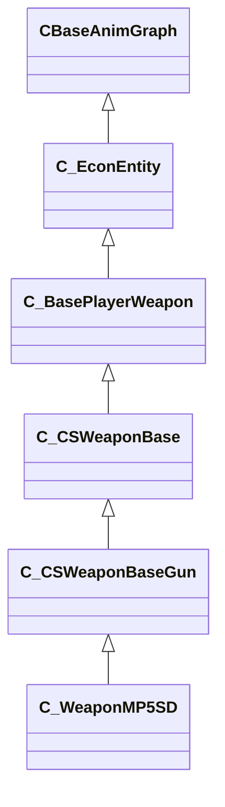

[Schemas](../../schemas.md) / [client](../client.md) / C_WeaponMP5SD

# C_WeaponMP5SD

> Source: **Build 25966348** · 2026-10-15 · `windows-x86_64` · schema `0.12.0`

**Kind:** class · **Size:** 8016 bytes (`0x1f50`) · **Align:** 16 · **Module:** client

**Inherits from:** [C_CSWeaponBaseGun](../client/C_CSWeaponBaseGun.md)

**Relationships:**

## Memory layout

241 fields (0 declared here, 241 inherited). Offsets are absolute from the object base.

| Offset | Field | Type | From | Annotations |
|--------|-------|------|------|-------------|
| `0x8` | `m_iszPrivateVScripts` | CUtlSymbolLarge | [CEntityInstance](../entity2/CEntityInstance.md) |  |
| `0x10` | `m_pEntity` | [CEntityIdentity](../entity2/CEntityIdentity.md)* | [CEntityInstance](../entity2/CEntityInstance.md) | CEntityIdentity pointer: the entity's identity record (name, class, handle, flags). |
| `0x28` | `m_CScriptComponent` | [CScriptComponent](../entity2/CScriptComponent.md)* | [CEntityInstance](../entity2/CEntityInstance.md) | VScript component attached to the entity, when scripted. |
| `0x30` | `m_CBodyComponent` | [CBodyComponent](../client/CBodyComponent.md)* | [C_BaseEntity](../client/C_BaseEntity.md) |  |
| `0x38` | `m_NetworkTransmitComponent` | [CNetworkTransmitComponent](../server/CNetworkTransmitComponent.md) | [C_BaseEntity](../client/C_BaseEntity.md) | `MNotSaved` |
| `0x328` | `m_nLastThinkTick` | [GameTick_t](../entity2/GameTick_t.md) | [C_BaseEntity](../client/C_BaseEntity.md) | `MNotSaved` |
| `0x330` | `m_pGameSceneNode` | [CGameSceneNode](../client/CGameSceneNode.md)* | [C_BaseEntity](../client/C_BaseEntity.md) | `MNotSaved` |
| `0x338` | `m_pRenderComponent` | [CRenderComponent](../client/CRenderComponent.md)* | [C_BaseEntity](../client/C_BaseEntity.md) | `MNotSaved` |
| `0x340` | `m_pCollision` | [CCollisionProperty](../client/CCollisionProperty.md)* | [C_BaseEntity](../client/C_BaseEntity.md) | `MNotSaved` |
| `0x348` | `m_iMaxHealth` | int32 | [C_BaseEntity](../client/C_BaseEntity.md) | `MNotSaved` |
| `0x34c` | `m_iHealth` | int32 | [C_BaseEntity](../client/C_BaseEntity.md) |  |
| `0x350` | `m_flDamageAccumulator` | float32 | [C_BaseEntity](../client/C_BaseEntity.md) | `MNotSaved` |
| `0x354` | `m_lifeState` | uint8 | [C_BaseEntity](../client/C_BaseEntity.md) | `MNotSaved` |
| `0x355` | `m_bTakesDamage` | bool | [C_BaseEntity](../client/C_BaseEntity.md) | `MNotSaved` |
| `0x358` | `m_nTakeDamageFlags` | [TakeDamageFlags_t](../server/TakeDamageFlags_t.md) | [C_BaseEntity](../client/C_BaseEntity.md) | `MNotSaved` |
| `0x360` | `m_nPlatformType` | [EntityPlatformTypes_t](../server/EntityPlatformTypes_t.md) | [C_BaseEntity](../client/C_BaseEntity.md) |  |
| `0x361` | `m_ubInterpolationFrame` | uint8 | [C_BaseEntity](../client/C_BaseEntity.md) | `MNotSaved` |
| `0x364` | `m_hSceneObjectController` | CHandle< [C_BaseEntity](../client/C_BaseEntity.md) > | [C_BaseEntity](../client/C_BaseEntity.md) |  |
| `0x368` | `m_nNoInterpolationTick` | int32 | [C_BaseEntity](../client/C_BaseEntity.md) | `MNotSaved` |
| `0x36c` | `m_nVisibilityNoInterpolationTick` | int32 | [C_BaseEntity](../client/C_BaseEntity.md) | `MNotSaved` |
| `0x370` | `m_flProxyRandomValue` | float32 | [C_BaseEntity](../client/C_BaseEntity.md) | `MNotSaved` |
| `0x374` | `m_iEFlags` | int32 | [C_BaseEntity](../client/C_BaseEntity.md) | `MNotSaved` |
| `0x378` | `m_nWaterType` | uint8 | [C_BaseEntity](../client/C_BaseEntity.md) | `MNotSaved` |
| `0x379` | `m_bInterpolateEvenWithNoModel` | bool | [C_BaseEntity](../client/C_BaseEntity.md) | `MNotSaved` |
| `0x37a` | `m_bPredictionEligible` | bool | [C_BaseEntity](../client/C_BaseEntity.md) | `MNotSaved` |
| `0x37b` | `m_bApplyLayerMatchIDToModel` | bool | [C_BaseEntity](../client/C_BaseEntity.md) | `MNotSaved` |
| `0x37c` | `m_tokLayerMatchID` | CUtlStringToken | [C_BaseEntity](../client/C_BaseEntity.md) | `MNotSaved` |
| `0x380` | `m_nSubclassID` | CUtlStringToken | [C_BaseEntity](../client/C_BaseEntity.md) |  |
| `0x390` | `m_nSimulationTick` | int32 | [C_BaseEntity](../client/C_BaseEntity.md) | `MNotSaved` |
| `0x394` | `m_iCurrentThinkContext` | int32 | [C_BaseEntity](../client/C_BaseEntity.md) | `MNotSaved` |
| `0x398` | `m_aThinkFunctions` | CUtlVector< thinkfunc_t > | [C_BaseEntity](../client/C_BaseEntity.md) | `MNotSaved` |
| `0x3b0` | `m_bDisabledContextThinks` | bool | [C_BaseEntity](../client/C_BaseEntity.md) |  |
| `0x3b4` | `m_flAnimTime` | float32 | [C_BaseEntity](../client/C_BaseEntity.md) | `MNotSaved` |
| `0x3b8` | `m_flSimulationTime` | float32 | [C_BaseEntity](../client/C_BaseEntity.md) | `MNotSaved` |
| `0x3bc` | `m_nSceneObjectOverrideFlags` | uint8 | [C_BaseEntity](../client/C_BaseEntity.md) |  |
| `0x3bd` | `m_bHasSuccessfullyInterpolated` | bool | [C_BaseEntity](../client/C_BaseEntity.md) | `MNotSaved` |
| `0x3be` | `m_bHasAddedVarsToInterpolation` | bool | [C_BaseEntity](../client/C_BaseEntity.md) | `MNotSaved` |
| `0x3bf` | `m_bRenderEvenWhenNotSuccessfullyInterpolated` | bool | [C_BaseEntity](../client/C_BaseEntity.md) | `MNotSaved` |
| `0x3c0` | `m_nInterpolationLatchDirtyFlags` | int32[2] | [C_BaseEntity](../client/C_BaseEntity.md) | `MNotSaved` |
| `0x3c8` | `m_ListEntry` | uint16[11] | [C_BaseEntity](../client/C_BaseEntity.md) | `MNotSaved` |
| `0x3e0` | `m_flCreateTime` | [GameTime_t](../entity2/GameTime_t.md) | [C_BaseEntity](../client/C_BaseEntity.md) | `MNotSaved` |
| `0x3e4` | `m_EntClientFlags` | uint16 | [C_BaseEntity](../client/C_BaseEntity.md) | `MNotSaved` |
| `0x3e6` | `m_bClientSideRagdoll` | bool | [C_BaseEntity](../client/C_BaseEntity.md) | `MNotSaved` |
| `0x3e7` | `m_iTeamNum` | uint8 | [C_BaseEntity](../client/C_BaseEntity.md) | `MNotSaved` |
| `0x3e8` | `m_spawnflags` | uint32 | [C_BaseEntity](../client/C_BaseEntity.md) |  |
| `0x3ec` | `m_nNextThinkTick` | [GameTick_t](../entity2/GameTick_t.md) | [C_BaseEntity](../client/C_BaseEntity.md) | `MNotSaved` |
| `0x3f4` | `m_fFlags` | uint32 | [C_BaseEntity](../client/C_BaseEntity.md) | `MSaveBehavior` |
| `0x3f8` | `m_vecAbsVelocity` | Vector | [C_BaseEntity](../client/C_BaseEntity.md) | `MNotSaved` |
| `0x404` | `m_vecServerVelocity` | [CNetworkVelocityVector](../server/CNetworkVelocityVector.md) | [C_BaseEntity](../client/C_BaseEntity.md) | `MNotSaved` |
| `0x430` | `m_vecVelocity` | [CNetworkVelocityVector](../server/CNetworkVelocityVector.md) | [C_BaseEntity](../client/C_BaseEntity.md) |  |
| `0x510` | `m_vecBaseVelocity` | Vector | [C_BaseEntity](../client/C_BaseEntity.md) | `MNotSaved` |
| `0x51c` | `m_hEffectEntity` | CHandle< [C_BaseEntity](../client/C_BaseEntity.md) > | [C_BaseEntity](../client/C_BaseEntity.md) | `MNotSaved` |
| `0x520` | `m_hOwnerEntity` | CHandle< [C_BaseEntity](../client/C_BaseEntity.md) > | [C_BaseEntity](../client/C_BaseEntity.md) |  |
| `0x524` | `m_MoveCollide` | [MoveCollide_t](../server/MoveCollide_t.md) | [C_BaseEntity](../client/C_BaseEntity.md) | `MNotSaved` |
| `0x525` | `m_MoveType` | [MoveType_t](../server/MoveType_t.md) | [C_BaseEntity](../client/C_BaseEntity.md) |  |
| `0x526` | `m_nActualMoveType` | [MoveType_t](../server/MoveType_t.md) | [C_BaseEntity](../client/C_BaseEntity.md) |  |
| `0x528` | `m_flWaterLevel` | float32 | [C_BaseEntity](../client/C_BaseEntity.md) | `MNotSaved` |
| `0x52c` | `m_fEffects` | uint32 | [C_BaseEntity](../client/C_BaseEntity.md) | `MNotSaved` |
| `0x530` | `m_hGroundEntity` | CHandle< [C_BaseEntity](../client/C_BaseEntity.md) > | [C_BaseEntity](../client/C_BaseEntity.md) | `MNotSaved` |
| `0x534` | `m_nGroundBodyIndex` | int32 | [C_BaseEntity](../client/C_BaseEntity.md) | `MNotSaved` |
| `0x538` | `m_flFriction` | float32 | [C_BaseEntity](../client/C_BaseEntity.md) | `MNotSaved` |
| `0x53c` | `m_flElasticity` | float32 | [C_BaseEntity](../client/C_BaseEntity.md) | `MNotSaved` |
| `0x540` | `m_flGravityScale` | float32 | [C_BaseEntity](../client/C_BaseEntity.md) | `MNotSaved` |
| `0x544` | `m_flTimeScale` | float32 | [C_BaseEntity](../client/C_BaseEntity.md) | `MNotSaved` |
| `0x548` | `m_bAnimatedEveryTick` | bool | [C_BaseEntity](../client/C_BaseEntity.md) | `MNotSaved` |
| `0x549` | `m_bGravityDisabled` | bool | [C_BaseEntity](../client/C_BaseEntity.md) |  |
| `0x54c` | `m_flNavIgnoreUntilTime` | [GameTime_t](../entity2/GameTime_t.md) | [C_BaseEntity](../client/C_BaseEntity.md) | `MNotSaved` |
| `0x550` | `m_hThink` | uint16 | [C_BaseEntity](../client/C_BaseEntity.md) | `MNotSaved` |
| `0x560` | `m_fBBoxVisFlags` | uint8 | [C_BaseEntity](../client/C_BaseEntity.md) | `MNotSaved` |
| `0x564` | `m_flActualGravityScale` | float32 | [C_BaseEntity](../client/C_BaseEntity.md) |  |
| `0x568` | `m_bGravityActuallyDisabled` | bool | [C_BaseEntity](../client/C_BaseEntity.md) |  |
| `0x569` | `m_bPredictable` | bool | [C_BaseEntity](../client/C_BaseEntity.md) | `MNotSaved` |
| `0x56a` | `m_bRenderWithViewModels` | bool | [C_BaseEntity](../client/C_BaseEntity.md) |  |
| `0x56c` | `m_nFirstPredictableCommand` | int32 | [C_BaseEntity](../client/C_BaseEntity.md) | `MNotSaved` |
| `0x570` | `m_nLastPredictableCommand` | int32 | [C_BaseEntity](../client/C_BaseEntity.md) | `MNotSaved` |
| `0x574` | `m_hOldMoveParent` | CHandle< [C_BaseEntity](../client/C_BaseEntity.md) > | [C_BaseEntity](../client/C_BaseEntity.md) | `MNotSaved` |
| `0x578` | `m_Particles` | [CParticleProperty](../particleslib/CParticleProperty.md) | [C_BaseEntity](../client/C_BaseEntity.md) | `MNotSaved` |
| `0x5a8` | `m_vecAngVelocity` | QAngle | [C_BaseEntity](../client/C_BaseEntity.md) |  |
| `0x5b4` | `m_DataChangeEventRef` | int32 | [C_BaseEntity](../client/C_BaseEntity.md) | `MNotSaved` |
| `0x5b8` | `m_dependencies` | CUtlVector< CEntityHandle > | [C_BaseEntity](../client/C_BaseEntity.md) | `MNotSaved` |
| `0x5d0` | `m_nCreationTick` | int32 | [C_BaseEntity](../client/C_BaseEntity.md) | `MNotSaved` |
| `0x5e1` | `m_bAnimTimeChanged` | bool | [C_BaseEntity](../client/C_BaseEntity.md) | `MNotSaved` |
| `0x5e2` | `m_bSimulationTimeChanged` | bool | [C_BaseEntity](../client/C_BaseEntity.md) | `MNotSaved` |
| `0x5f0` | `m_sUniqueHammerID` | CUtlString | [C_BaseEntity](../client/C_BaseEntity.md) | `MNotSaved` |
| `0x5f8` | `m_nBloodType` | [BloodType](../server/BloodType.md) | [C_BaseEntity](../client/C_BaseEntity.md) |  |
| `0xaf8` | `m_CRenderComponent` | [CRenderComponent](../client/CRenderComponent.md)* | [C_BaseModelEntity](../client/C_BaseModelEntity.md) | `MNotSaved` |
| `0xb00` | `m_CHitboxComponent` | [CHitboxComponent](../client/CHitboxComponent.md) | [C_BaseModelEntity](../client/C_BaseModelEntity.md) |  |
| `0xb18` | `m_pChoreoComponent` | [CChoreoComponent](../client/CChoreoComponent.md)* | [C_BaseModelEntity](../client/C_BaseModelEntity.md) |  |
| `0xb20` | `m_nDestructiblePartInitialStateDestructed0` | [HitGroup_t](../server/HitGroup_t.md) | [C_BaseModelEntity](../client/C_BaseModelEntity.md) |  |
| `0xb24` | `m_nDestructiblePartInitialStateDestructed1` | [HitGroup_t](../server/HitGroup_t.md) | [C_BaseModelEntity](../client/C_BaseModelEntity.md) |  |
| `0xb28` | `m_nDestructiblePartInitialStateDestructed2` | [HitGroup_t](../server/HitGroup_t.md) | [C_BaseModelEntity](../client/C_BaseModelEntity.md) |  |
| `0xb2c` | `m_nDestructiblePartInitialStateDestructed3` | [HitGroup_t](../server/HitGroup_t.md) | [C_BaseModelEntity](../client/C_BaseModelEntity.md) |  |
| `0xb30` | `m_nDestructiblePartInitialStateDestructed4` | [HitGroup_t](../server/HitGroup_t.md) | [C_BaseModelEntity](../client/C_BaseModelEntity.md) |  |
| `0xb34` | `m_nDestructiblePartInitialStateDestructed0_PartIndex` | int32 | [C_BaseModelEntity](../client/C_BaseModelEntity.md) |  |
| `0xb38` | `m_nDestructiblePartInitialStateDestructed1_PartIndex` | int32 | [C_BaseModelEntity](../client/C_BaseModelEntity.md) |  |
| `0xb3c` | `m_nDestructiblePartInitialStateDestructed2_PartIndex` | int32 | [C_BaseModelEntity](../client/C_BaseModelEntity.md) |  |
| `0xb40` | `m_nDestructiblePartInitialStateDestructed3_PartIndex` | int32 | [C_BaseModelEntity](../client/C_BaseModelEntity.md) |  |
| `0xb44` | `m_nDestructiblePartInitialStateDestructed4_PartIndex` | int32 | [C_BaseModelEntity](../client/C_BaseModelEntity.md) |  |
| `0xb48` | `m_bDestructiblePartInitialStateDestructed0_GenerateBreakpieces` | bool | [C_BaseModelEntity](../client/C_BaseModelEntity.md) |  |
| `0xb49` | `m_bDestructiblePartInitialStateDestructed1_GenerateBreakpieces` | bool | [C_BaseModelEntity](../client/C_BaseModelEntity.md) |  |
| `0xb4a` | `m_bDestructiblePartInitialStateDestructed2_GenerateBreakpieces` | bool | [C_BaseModelEntity](../client/C_BaseModelEntity.md) |  |
| `0xb4b` | `m_bDestructiblePartInitialStateDestructed3_GenerateBreakpieces` | bool | [C_BaseModelEntity](../client/C_BaseModelEntity.md) |  |
| `0xb4c` | `m_bDestructiblePartInitialStateDestructed4_GenerateBreakpieces` | bool | [C_BaseModelEntity](../client/C_BaseModelEntity.md) |  |
| `0xb50` | `m_pDestructiblePartsSystemComponent` | [CDestructiblePartsComponent](../client/CDestructiblePartsComponent.md)* | [C_BaseModelEntity](../client/C_BaseModelEntity.md) |  |
| `0xc78` | `m_bInitModelEffects` | bool | [C_BaseModelEntity](../client/C_BaseModelEntity.md) | `MNotSaved` |
| `0xc79` | `m_bDoingModelEffects` | bool | [C_BaseModelEntity](../client/C_BaseModelEntity.md) | `MNotSaved` |
| `0xc7c` | `m_iOldHealth` | int32 | [C_BaseModelEntity](../client/C_BaseModelEntity.md) | `MNotSaved` |
| `0xc80` | `m_nRenderMode` | [RenderMode_t](../server/RenderMode_t.md) | [C_BaseModelEntity](../client/C_BaseModelEntity.md) |  |
| `0xc81` | `m_nRenderFX` | [RenderFx_t](../server/RenderFx_t.md) | [C_BaseModelEntity](../client/C_BaseModelEntity.md) |  |
| `0xc82` | `m_bAllowFadeInView` | bool | [C_BaseModelEntity](../client/C_BaseModelEntity.md) |  |
| `0xca0` | `m_clrRender` | Color | [C_BaseModelEntity](../client/C_BaseModelEntity.md) |  |
| `0xca8` | `m_vecRenderAttributes` | C_UtlVectorEmbeddedNetworkVar< [EntityRenderAttribute_t](../client/EntityRenderAttribute_t.md) > | [C_BaseModelEntity](../client/C_BaseModelEntity.md) |  |
| `0xd28` | `m_bRenderToCubemaps` | bool | [C_BaseModelEntity](../client/C_BaseModelEntity.md) |  |
| `0xd29` | `m_bExpandRenderBoundsToIncludeCloth` | bool | [C_BaseModelEntity](../client/C_BaseModelEntity.md) |  |
| `0xd2a` | `m_bNoInterpolate` | bool | [C_BaseModelEntity](../client/C_BaseModelEntity.md) |  |
| `0xd30` | `m_Collision` | [CCollisionProperty](../client/CCollisionProperty.md) | [C_BaseModelEntity](../client/C_BaseModelEntity.md) |  |
| `0xde8` | `m_Glow` | [CGlowProperty](../client/CGlowProperty.md) | [C_BaseModelEntity](../client/C_BaseModelEntity.md) |  |
| `0xe40` | `m_flGlowBackfaceMult` | float32 | [C_BaseModelEntity](../client/C_BaseModelEntity.md) |  |
| `0xe44` | `m_fadeMinDist` | float32 | [C_BaseModelEntity](../client/C_BaseModelEntity.md) |  |
| `0xe48` | `m_fadeMaxDist` | float32 | [C_BaseModelEntity](../client/C_BaseModelEntity.md) |  |
| `0xe4c` | `m_flFadeScale` | float32 | [C_BaseModelEntity](../client/C_BaseModelEntity.md) |  |
| `0xe50` | `m_flShadowStrength` | float32 | [C_BaseModelEntity](../client/C_BaseModelEntity.md) |  |
| `0xe54` | `m_nObjectCulling` | uint8 | [C_BaseModelEntity](../client/C_BaseModelEntity.md) |  |
| `0xe55` | `m_nRequiredDecalRtEncoding` | [DecalRtEncoding_t](../scenesystem/DecalRtEncoding_t.md) | [C_BaseModelEntity](../client/C_BaseModelEntity.md) |  |
| `0xe58` | `m_bodyGroupTotalRequestCount` | uint32 | [C_BaseModelEntity](../client/C_BaseModelEntity.md) |  |
| `0xe60` | `m_bodyGroupRequests` | CUtlVectorFixedGrowable< [C_BaseModelEntity::BodyGroupRequest_t](../client/C_BaseModelEntity.BodyGroupRequest_t.md), 8 > | [C_BaseModelEntity](../client/C_BaseModelEntity.md) |  |
| `0xf38` | `m_bodyGroupChoices` | CUtlOrderedMap< CGlobalSymbol, int32 > | [C_BaseModelEntity](../client/C_BaseModelEntity.md) |  |
| `0xf60` | `m_vecViewOffset` | [CNetworkViewOffsetVector](../server/CNetworkViewOffsetVector.md) | [C_BaseModelEntity](../client/C_BaseModelEntity.md) |  |
| `0x1040` | `m_pClientAlphaProperty` | [CClientAlphaProperty](../client/CClientAlphaProperty.md)* | [C_BaseModelEntity](../client/C_BaseModelEntity.md) | `MNotSaved` |
| `0x1048` | `m_ClientOverrideTint` | Color | [C_BaseModelEntity](../client/C_BaseModelEntity.md) | `MNotSaved` |
| `0x104c` | `m_bUseClientOverrideTint` | bool | [C_BaseModelEntity](../client/C_BaseModelEntity.md) | `MNotSaved` |
| `0x1088` | `m_bvDisabledHitGroups` | uint32[1] | [C_BaseModelEntity](../client/C_BaseModelEntity.md) | `MKV3TransferSaveOpsForField GetHitgroupDisableListSaveRestoreOps` |
| `0x1098` | `m_graphControllerManager` | [CAnimGraphControllerManager](../server/CAnimGraphControllerManager.md) | [CBaseAnimGraph](../client/CBaseAnimGraph.md) |  |
| `0x1130` | `m_pMainGraphController` | [CAnimGraphControllerPtr](../server/CAnimGraphControllerPtr.md) | [CBaseAnimGraph](../client/CBaseAnimGraph.md) | The primary animation-graph controller instance for this entity. |
| `0x1138` | `m_bInitiallyPopulateInterpHistory` | bool | [CBaseAnimGraph](../client/CBaseAnimGraph.md) |  |
| `0x113a` | `m_bSuppressAnimEventSounds` | bool | [CBaseAnimGraph](../client/CBaseAnimGraph.md) |  |
| `0x1140` | `m_OnLayerCycleUpdated` | CEntityOutputTemplate< float32 > | [CBaseAnimGraph](../client/CBaseAnimGraph.md) |  |
| `0x1160` | `m_OnExternalChoreoGraphChanged` | [CEntityIOOutput](../entity2/CEntityIOOutput.md) | [CBaseAnimGraph](../client/CBaseAnimGraph.md) |  |
| `0x1180` | `m_bAnimGraphUpdateEnabled` | bool | [CBaseAnimGraph](../client/CBaseAnimGraph.md) |  |
| `0x1181` | `m_bAnimationUpdateScheduled` | bool | [CBaseAnimGraph](../client/CBaseAnimGraph.md) | `MNotSaved` |
| `0x1184` | `m_vecForce` | Vector | [CBaseAnimGraph](../client/CBaseAnimGraph.md) | `MNotSaved` |
| `0x1190` | `m_nForceBone` | int32 | [CBaseAnimGraph](../client/CBaseAnimGraph.md) | `MNotSaved` |
| `0x1198` | `m_pClientsideRagdoll` | [CBaseAnimGraph](../client/CBaseAnimGraph.md)* | [CBaseAnimGraph](../client/CBaseAnimGraph.md) | `MNotSaved` |
| `0x11a0` | `m_bBuiltRagdoll` | bool | [CBaseAnimGraph](../client/CBaseAnimGraph.md) | `MNotSaved` |
| `0x11b0` | `m_pRagdollControl` | [IPhysicsRagdollControl](../vphysics2/IPhysicsRagdollControl.md)* | [CBaseAnimGraph](../client/CBaseAnimGraph.md) | `MPhysPtr` |
| `0x11b8` | `m_RagdollPose` | [PhysicsRagdollPose_t](../client/PhysicsRagdollPose_t.md) | [CBaseAnimGraph](../client/CBaseAnimGraph.md) |  |
| `0x1200` | `m_bRagdollEnabled` | bool | [CBaseAnimGraph](../client/CBaseAnimGraph.md) | True while the entity is simulated as a ragdoll rather than animated. |
| `0x1201` | `m_bRagdollClientSide` | bool | [CBaseAnimGraph](../client/CBaseAnimGraph.md) | `MNotSaved` |
| `0x1202` | `m_bShouldUpdateTransformations` | bool | [CBaseAnimGraph](../client/CBaseAnimGraph.md) |  |
| `0x1210` | `m_bHasAnimatedMaterialAttributes` | bool | [CBaseAnimGraph](../client/CBaseAnimGraph.md) | `MNotSaved` |
| `0x1278` | `m_flFlexDelayTime` | float32 | [C_EconEntity](../client/C_EconEntity.md) |  |
| `0x1280` | `m_flFlexDelayedWeight` | float32* | [C_EconEntity](../client/C_EconEntity.md) |  |
| `0x1288` | `m_bAttributesInitialized` | bool | [C_EconEntity](../client/C_EconEntity.md) |  |
| `0x1290` | `m_AttributeManager` | [C_AttributeContainer](../client/C_AttributeContainer.md) | [C_EconEntity](../client/C_EconEntity.md) |  |
| `0x18a0` | `m_OriginalOwnerXuidLow` | uint32 | [C_EconEntity](../client/C_EconEntity.md) |  |
| `0x18a4` | `m_OriginalOwnerXuidHigh` | uint32 | [C_EconEntity](../client/C_EconEntity.md) |  |
| `0x18a8` | `m_nFallbackPaintKit` | int32 | [C_EconEntity](../client/C_EconEntity.md) |  |
| `0x18ac` | `m_nFallbackSeed` | int32 | [C_EconEntity](../client/C_EconEntity.md) |  |
| `0x18b0` | `m_flFallbackWear` | float32 | [C_EconEntity](../client/C_EconEntity.md) |  |
| `0x18b4` | `m_nFallbackStatTrak` | int32 | [C_EconEntity](../client/C_EconEntity.md) |  |
| `0x18b8` | `m_bClientside` | bool | [C_EconEntity](../client/C_EconEntity.md) |  |
| `0x18b9` | `m_bParticleSystemsCreated` | bool | [C_EconEntity](../client/C_EconEntity.md) |  |
| `0x18c0` | `m_vecAttachedParticles` | CUtlVector< int32 > | [C_EconEntity](../client/C_EconEntity.md) |  |
| `0x18d8` | `m_hViewmodelAttachment` | CHandle< [CBaseAnimGraph](../client/CBaseAnimGraph.md) > | [C_EconEntity](../client/C_EconEntity.md) |  |
| `0x18dc` | `m_iOldTeam` | int32 | [C_EconEntity](../client/C_EconEntity.md) |  |
| `0x18e0` | `m_bAttachmentDirty` | bool | [C_EconEntity](../client/C_EconEntity.md) |  |
| `0x18e4` | `m_nUnloadedModelIndex` | int32 | [C_EconEntity](../client/C_EconEntity.md) |  |
| `0x18e8` | `m_iNumOwnerValidationRetries` | int32 | [C_EconEntity](../client/C_EconEntity.md) |  |
| `0x18f8` | `m_hOldProvidee` | CHandle< [C_BaseEntity](../client/C_BaseEntity.md) > | [C_EconEntity](../client/C_EconEntity.md) |  |
| `0x1900` | `m_vecAttachedModels` | CUtlVector< [C_EconEntity::AttachedModelData_t](../client/C_EconEntity.AttachedModelData_t.md) > | [C_EconEntity](../client/C_EconEntity.md) |  |
| `0x1918` | `m_nNextPrimaryAttackTick` | [GameTick_t](../entity2/GameTick_t.md) | [C_BasePlayerWeapon](../client/C_BasePlayerWeapon.md) |  |
| `0x191c` | `m_flNextPrimaryAttackTickRatio` | float32 | [C_BasePlayerWeapon](../client/C_BasePlayerWeapon.md) |  |
| `0x1920` | `m_nNextSecondaryAttackTick` | [GameTick_t](../entity2/GameTick_t.md) | [C_BasePlayerWeapon](../client/C_BasePlayerWeapon.md) |  |
| `0x1924` | `m_flNextSecondaryAttackTickRatio` | float32 | [C_BasePlayerWeapon](../client/C_BasePlayerWeapon.md) |  |
| `0x1928` | `m_iClip1` | int32 | [C_BasePlayerWeapon](../client/C_BasePlayerWeapon.md) |  |
| `0x192c` | `m_iClip2` | int32 | [C_BasePlayerWeapon](../client/C_BasePlayerWeapon.md) |  |
| `0x1930` | `m_pReserveAmmo` | int32[2] | [C_BasePlayerWeapon](../client/C_BasePlayerWeapon.md) |  |
| `0x19a8` | `m_iWeaponGameplayAnimState` | [WeaponGameplayAnimState](../server/WeaponGameplayAnimState.md) | [C_CSWeaponBase](../client/C_CSWeaponBase.md) |  |
| `0x19ac` | `m_flWeaponGameplayAnimStateTimestamp` | [GameTime_t](../entity2/GameTime_t.md) | [C_CSWeaponBase](../client/C_CSWeaponBase.md) |  |
| `0x19b0` | `m_flInspectCancelCompleteTime` | [GameTime_t](../entity2/GameTime_t.md) | [C_CSWeaponBase](../client/C_CSWeaponBase.md) |  |
| `0x19b4` | `m_bInspectPending` | bool | [C_CSWeaponBase](../client/C_CSWeaponBase.md) |  |
| `0x19b5` | `m_bInspectShouldLoop` | bool | [C_CSWeaponBase](../client/C_CSWeaponBase.md) |  |
| `0x19e0` | `m_nLastEmptySoundCmdNum` | int32 | [C_CSWeaponBase](../client/C_CSWeaponBase.md) |  |
| `0x19e4` | `m_bFireOnEmpty` | bool | [C_CSWeaponBase](../client/C_CSWeaponBase.md) |  |
| `0x19e8` | `m_OnPlayerPickup` | [CEntityIOOutput](../entity2/CEntityIOOutput.md) | [C_CSWeaponBase](../client/C_CSWeaponBase.md) |  |
| `0x1a00` | `m_weaponMode` | [CSWeaponMode](../server/CSWeaponMode.md) | [C_CSWeaponBase](../client/C_CSWeaponBase.md) |  |
| `0x1a04` | `m_flTurningInaccuracyDelta` | float32 | [C_CSWeaponBase](../client/C_CSWeaponBase.md) |  |
| `0x1a08` | `m_vecTurningInaccuracyEyeDirLast` | Vector | [C_CSWeaponBase](../client/C_CSWeaponBase.md) |  |
| `0x1a14` | `m_flTurningInaccuracy` | float32 | [C_CSWeaponBase](../client/C_CSWeaponBase.md) |  |
| `0x1a18` | `m_fAccuracyPenalty` | float32 | [C_CSWeaponBase](../client/C_CSWeaponBase.md) |  |
| `0x1a1c` | `m_flLastAccuracyUpdateTime` | [GameTime_t](../entity2/GameTime_t.md) | [C_CSWeaponBase](../client/C_CSWeaponBase.md) |  |
| `0x1a20` | `m_fAccuracySmoothedForZoom` | float32 | [C_CSWeaponBase](../client/C_CSWeaponBase.md) |  |
| `0x1a24` | `m_iRecoilIndex` | int32 | [C_CSWeaponBase](../client/C_CSWeaponBase.md) |  |
| `0x1a28` | `m_flRecoilIndex` | float32 | [C_CSWeaponBase](../client/C_CSWeaponBase.md) |  |
| `0x1a2c` | `m_bBurstMode` | bool | [C_CSWeaponBase](../client/C_CSWeaponBase.md) |  |
| `0x1a30` | `m_flLastBurstModeChangeTime` | [GameTime_t](../entity2/GameTime_t.md) | [C_CSWeaponBase](../client/C_CSWeaponBase.md) |  |
| `0x1a34` | `m_nPostponeFireReadyTicks` | [GameTick_t](../entity2/GameTick_t.md) | [C_CSWeaponBase](../client/C_CSWeaponBase.md) |  |
| `0x1a38` | `m_flPostponeFireReadyFrac` | float32 | [C_CSWeaponBase](../client/C_CSWeaponBase.md) |  |
| `0x1a3c` | `m_bInReload` | bool | [C_CSWeaponBase](../client/C_CSWeaponBase.md) |  |
| `0x1a40` | `m_nDeployTick` | [GameTick_t](../entity2/GameTick_t.md) | [C_CSWeaponBase](../client/C_CSWeaponBase.md) |  |
| `0x1a44` | `m_flAttackHoldStartTime` | [GameTime_t](../entity2/GameTime_t.md) | [C_CSWeaponBase](../client/C_CSWeaponBase.md) |  |
| `0x1a48` | `m_flDroppedAtTime` | [GameTime_t](../entity2/GameTime_t.md) | [C_CSWeaponBase](../client/C_CSWeaponBase.md) |  |
| `0x1a50` | `m_bIsHauledBack` | bool | [C_CSWeaponBase](../client/C_CSWeaponBase.md) |  |
| `0x1a51` | `m_bSilencerOn` | bool | [C_CSWeaponBase](../client/C_CSWeaponBase.md) |  |
| `0x1a54` | `m_flTimeSilencerSwitchComplete` | [GameTime_t](../entity2/GameTime_t.md) | [C_CSWeaponBase](../client/C_CSWeaponBase.md) |  |
| `0x1a58` | `m_bStealthy` | bool | [C_CSWeaponBase](../client/C_CSWeaponBase.md) |  |
| `0x1a59` | `m_bInSilentReloadSection` | bool | [C_CSWeaponBase](../client/C_CSWeaponBase.md) |  |
| `0x1a5c` | `m_flStealthHoldStartTime` | [GameTime_t](../entity2/GameTime_t.md) | [C_CSWeaponBase](../client/C_CSWeaponBase.md) |  |
| `0x1a60` | `m_bReloadHeldSinceStart` | bool | [C_CSWeaponBase](../client/C_CSWeaponBase.md) |  |
| `0x1a64` | `m_flWeaponActionPlaybackRate` | float32 | [C_CSWeaponBase](../client/C_CSWeaponBase.md) |  |
| `0x1a68` | `m_iOriginalTeamNumber` | int32 | [C_CSWeaponBase](../client/C_CSWeaponBase.md) |  |
| `0x1a6c` | `m_iMostRecentTeamNumber` | int32 | [C_CSWeaponBase](../client/C_CSWeaponBase.md) |  |
| `0x1a70` | `m_bDroppedNearBuyZone` | bool | [C_CSWeaponBase](../client/C_CSWeaponBase.md) |  |
| `0x1a74` | `m_flNextAttackRenderTimeOffset` | float32 | [C_CSWeaponBase](../client/C_CSWeaponBase.md) |  |
| `0x1b20` | `m_bClearWeaponIdentifyingUGC` | bool | [C_CSWeaponBase](../client/C_CSWeaponBase.md) |  |
| `0x1b21` | `m_bVisualsDataSet` | bool | [C_CSWeaponBase](../client/C_CSWeaponBase.md) |  |
| `0x1b22` | `m_bUIWeapon` | bool | [C_CSWeaponBase](../client/C_CSWeaponBase.md) |  |
| `0x1b24` | `m_nCustomEconReloadEventId` | int32 | [C_CSWeaponBase](../client/C_CSWeaponBase.md) |  |
| `0x1b30` | `m_bCanBePickedUp` | bool | [C_CSWeaponBase](../client/C_CSWeaponBase.md) |  |
| `0x1b34` | `m_nextPrevOwnerUseTime` | [GameTime_t](../entity2/GameTime_t.md) | [C_CSWeaponBase](../client/C_CSWeaponBase.md) |  |
| `0x1b38` | `m_hPrevOwner` | CHandle< [C_CSPlayerPawn](../client/C_CSPlayerPawn.md) > | [C_CSWeaponBase](../client/C_CSWeaponBase.md) |  |
| `0x1b3c` | `m_nDropTick` | [GameTick_t](../entity2/GameTick_t.md) | [C_CSWeaponBase](../client/C_CSWeaponBase.md) |  |
| `0x1b40` | `m_bWasActiveWeaponWhenDropped` | bool | [C_CSWeaponBase](../client/C_CSWeaponBase.md) |  |
| `0x1b64` | `m_donated` | bool | [C_CSWeaponBase](../client/C_CSWeaponBase.md) |  |
| `0x1b68` | `m_fLastShotTime` | [GameTime_t](../entity2/GameTime_t.md) | [C_CSWeaponBase](../client/C_CSWeaponBase.md) |  |
| `0x1b6c` | `m_bWasOwnedByCT` | bool | [C_CSWeaponBase](../client/C_CSWeaponBase.md) |  |
| `0x1b6d` | `m_bWasOwnedByTerrorist` | bool | [C_CSWeaponBase](../client/C_CSWeaponBase.md) |  |
| `0x1b70` | `m_flNextClientFireBulletTime` | float32 | [C_CSWeaponBase](../client/C_CSWeaponBase.md) |  |
| `0x1b74` | `m_flNextClientFireBulletTime_Repredict` | float32 | [C_CSWeaponBase](../client/C_CSWeaponBase.md) |  |
| `0x1bd0` | `m_IronSightController` | [C_IronSightController](../client/C_IronSightController.md) | [C_CSWeaponBase](../client/C_CSWeaponBase.md) |  |
| `0x1c80` | `m_iIronSightMode` | int32 | [C_CSWeaponBase](../client/C_CSWeaponBase.md) |  |
| `0x1cf8` | `m_flLastLOSTraceFailureTime` | [GameTime_t](../entity2/GameTime_t.md) | [C_CSWeaponBase](../client/C_CSWeaponBase.md) |  |
| `0x1d58` | `m_flWatTickOffset` | float32 | [C_CSWeaponBase](../client/C_CSWeaponBase.md) |  |
| `0x1d6c` | `m_flLastShakeTime` | [GameTime_t](../entity2/GameTime_t.md) | [C_CSWeaponBase](../client/C_CSWeaponBase.md) |  |
| `0x1f20` | `m_zoomLevel` | int32 | [C_CSWeaponBaseGun](../client/C_CSWeaponBaseGun.md) |  |
| `0x1f24` | `m_iBurstShotsRemaining` | int32 | [C_CSWeaponBaseGun](../client/C_CSWeaponBaseGun.md) |  |
| `0x1f28` | `m_iSilencerBodygroup` | int32 | [C_CSWeaponBaseGun](../client/C_CSWeaponBaseGun.md) |  |
| `0x1f38` | `m_silencedModelIndex` | int32 | [C_CSWeaponBaseGun](../client/C_CSWeaponBaseGun.md) |  |
| `0x1f3c` | `m_inPrecache` | bool | [C_CSWeaponBaseGun](../client/C_CSWeaponBaseGun.md) |  |
| `0x1f3d` | `m_bNeedsBoltAction` | bool | [C_CSWeaponBaseGun](../client/C_CSWeaponBaseGun.md) |  |
| `0x1f40` | `m_nRevolverCylinderIdx` | int32 | [C_CSWeaponBaseGun](../client/C_CSWeaponBaseGun.md) |  |

**Also inherits (secondary base classes):** [IHasAttributes](../server/IHasAttributes.md) — additional-base fields sit at a shifted offset the schema does not record; see each base's own page for its layout.
