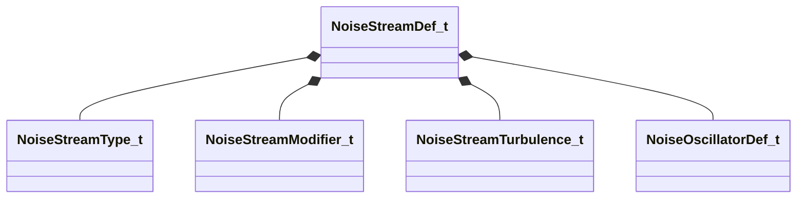

[Schemas](../../schemas.md) / [mathlib_extended](../mathlib_extended.md) / NoiseStreamDef_t

# NoiseStreamDef_t

> Source: **Build 25966348** · 2026-10-15 · `windows-x86_64` · schema `0.12.0`

**Kind:** class · **Size:** 80 bytes (`0x50`) · **Align:** 8 · **Module:** mathlib_extended

**Relationships:**

## Memory layout

12 fields (12 declared here, 0 inherited). Offsets are absolute from the object base.

| Offset | Field | Type | From | Annotations |
|--------|-------|------|------|-------------|
| `0x0` | `m_nType` | [NoiseStreamType_t](../mathlib_extended/NoiseStreamType_t.md) |  |  |
| `0x4` | `m_nModifier` | [NoiseStreamModifier_t](../mathlib_extended/NoiseStreamModifier_t.md) |  |  |
| `0x8` | `m_nTurbulence` | [NoiseStreamTurbulence_t](../mathlib_extended/NoiseStreamTurbulence_t.md) |  |  |
| `0xc` | `m_flOutputMin` | float32 |  | `MPropertyAttributeRange -10000 10000` |
| `0x10` | `m_flOutputMax` | float32 |  | `MPropertyAttributeRange -10000 10000` |
| `0x14` | `m_flScale` | float32 |  | `MPropertyAttributeRange biased 0.001 100` |
| `0x18` | `m_vOffsetRate` | Vector |  |  |
| `0x24` | `m_flOffset` | float32 |  | `MPropertyAttributeRange -1000 1000` |
| `0x28` | `m_nOctaves` | int32 |  | `MPropertyAttributeRange 1 4` |
| `0x2c` | `m_flTurbulenceScale` | float32 |  | `MPropertyAttributeRange 0 10` |
| `0x30` | `m_flTurbulenceMix` | float32 |  | `MPropertyAttributeRange 0 1` |
| `0x38` | `m_Oscillators` | CUtlVector< [NoiseOscillatorDef_t](../mathlib_extended/NoiseOscillatorDef_t.md) > |  |  |

KV3 class defaults

<pre>{
	&quot;m_nType&quot;: &quot;NOISE_STREAM_TYPE_PERLIN&quot;,
	&quot;m_nModifier&quot;: &quot;NOISE_STREAM_MODIFIER_NONE&quot;,
	&quot;m_nTurbulence&quot;: &quot;NOISE_STREAM_TURB_NONE&quot;,
	&quot;m_flOutputMin&quot;: 0.000000,
	&quot;m_flOutputMax&quot;: 1.000000,
	&quot;m_flScale&quot;: 0.100000,
	&quot;m_vOffsetRate&quot;:
	[
		0.000000,
		0.000000,
		0.000000
	],
	&quot;m_flOffset&quot;: 0.000000,
	&quot;m_nOctaves&quot;: 1,
	&quot;m_flTurbulenceScale&quot;: 1.250000,
	&quot;m_flTurbulenceMix&quot;: 0.500000,
	&quot;m_Oscillators&quot;:
	[
	]
}</pre>

