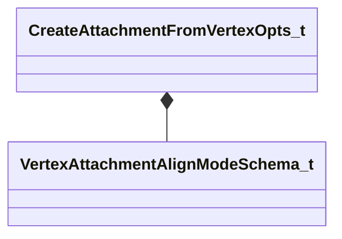

[Schemas](../../schemas.md) / [modeldoc_editor](../modeldoc_editor.md) / CreateAttachmentFromVertexOpts_t

# CreateAttachmentFromVertexOpts_t

> Source: **Build 26144732** · 2026-10-22 · `windows-x86_64` · schema `0.12.0`

**Kind:** class · **Size:** 32 bytes (`0x20`) · **Align:** 8 · **Module:** modeldoc_editor

**Metadata:** `MPropertyDescription Options for creating an attachment from a mesh vertex.`, `MPropertyElementNameFn`

**Relationships:**

## Memory layout

6 fields (6 declared here, 0 inherited). Offsets are absolute from the object base.

| Offset | Field | Type | From | Annotations |
|--------|-------|------|------|-------------|
| `0x0` | `m_Name` | CUtlString |  | `MPropertyFlattenIntoParentRow` `MPropertyReadOnly` |
| `0x8` | `m_AttachmentName` | CUtlString |  | `MPropertyDescription Base name for the created attachment.  A unique suffix is appended if needed.` `MPropertyFriendlyName Attachment Name` |
| `0x10` | `m_eAlignMode` | [VertexAttachmentAlignModeSchema_t](../modeldoc_editor/VertexAttachmentAlignModeSchema_t.md) |  | `MPropertyDescription How the created attachment is oriented.` `MPropertyFriendlyName Alignment` |
| `0x14` | `m_nMaxInfluences` | int32 |  | `MPropertyDescription Maximum number of bone influences to copy (1-3).  A vertex can have more, but attachments support at most 3.` `MPropertyFriendlyName Max Influences` |
| `0x18` | `m_bShowPreview` | bool |  | `MPropertyDescription Draw the nearby-vertex point cloud while hovering.  Turn off if the attachment axis preview alone is enough.` `MPropertyFriendlyName Show Vertex Preview` |
| `0x19` | `m_bHideConfigModels` | bool |  | `MPropertyDescription Temporarily turn off Show Config during placement.  Config/SpawnConfig attached models can never be picked by this tool, so they only obscure the mesh.` `MPropertyFriendlyName Hide Config Models` |

KV3 class defaults

<pre>{
	&quot;m_Name&quot;: &quot;Create Attachment From Vertex Options&quot;,
	&quot;m_AttachmentName&quot;: &quot;attach&quot;,
	&quot;m_eAlignMode&quot;: &quot;VTX_ATTACH_ALIGN_NORMAL&quot;,
	&quot;m_nMaxInfluences&quot;: 3,
	&quot;m_bShowPreview&quot;: true,
	&quot;m_bHideConfigModels&quot;: true
}</pre>

