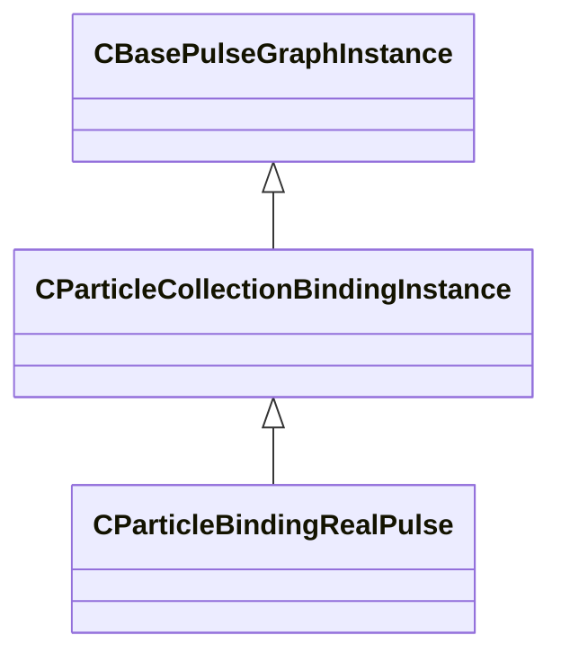

[Schemas](../../schemas.md) / [particleslib](../particleslib.md) / CParticleBindingRealPulse

# CParticleBindingRealPulse

> Source: **Build 25966348** · 2026-10-15 · `windows-x86_64` · schema `0.12.0`

**Kind:** class · **Size:** 168 bytes (`0xa8`) · **Align:** n/a (unspecified) · **Module:** particleslib

**Inherits from:** [CParticleCollectionBindingInstance](../particleslib/CParticleCollectionBindingInstance.md)

**Relationships:**

## Memory layout

No schema-visible fields (168 bytes of opaque storage).
