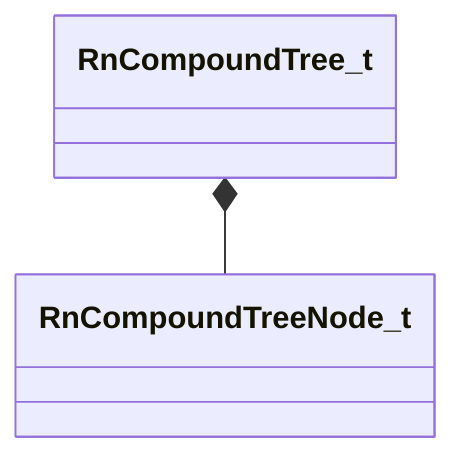

[Schemas](../../schemas.md) / [physicslib](../physicslib.md) / RnCompoundTree_t

# RnCompoundTree_t

> Source: **Build 26334290** · 2026-10-30 · `windows-x86_64` · schema `0.13.0`

**Kind:** class · **Size:** 24 bytes (`0x18`) · **Align:** 8 · **Module:** physicslib

**Relationships:**

## Memory layout

2 fields (2 declared here, 0 inherited). Offsets are absolute from the object base.

| Offset | Field | Type | From | Annotations |
|--------|-------|------|------|-------------|
| `0x0` | `m_Nodes` | CUtlLeanVector< [RnCompoundTreeNode_t](../physicslib/RnCompoundTreeNode_t.md) > |  |  |
| `0x10` | `m_nStartIterationIndex` | uint32 |  |  |

KV3 class defaults

<pre>{
	&quot;m_Nodes&quot;:
	[
	],
	&quot;m_nStartIterationIndex&quot;: 0
}</pre>

