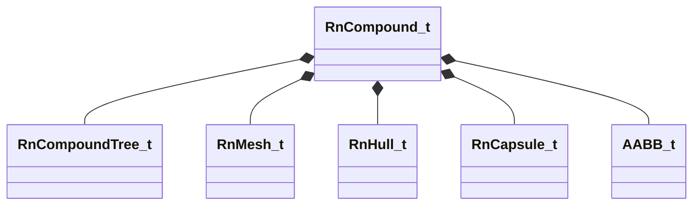

[Schemas](../../schemas.md) / [physicslib](../physicslib.md) / RnCompound_t

# RnCompound_t

> Source: **Build 26281801** · 2026-10-28 · `windows-x86_64` · schema `0.13.0`

**Kind:** class · **Size:** 352 bytes (`0x160`) · **Align:** 8 · **Module:** physicslib

**Relationships:**

## Memory layout

13 fields (13 declared here, 0 inherited). Offsets are absolute from the object base.

| Offset | Field | Type | From | Annotations |
|--------|-------|------|------|-------------|
| `0x0` | `m_Tree` | [RnCompoundTree_t](../physicslib/RnCompoundTree_t.md) |  |  |
| `0x18` | `m_nHullBaseIndex` | int32 |  |  |
| `0x1c` | `m_nMeshBaseIndex` | int32 |  |  |
| `0x20` | `m_nShapeCount` | int32 |  |  |
| `0x28` | `m_Meshes` | CUtlLeanVectorFixedGrowable< [RnMesh_t](../physicslib/RnMesh_t.md), 1 > |  |  |
| `0xf0` | `m_Hulls` | CUtlLeanVector< [RnHull_t](../physicslib/RnHull_t.md) > |  |  |
| `0x100` | `m_Capsules` | CUtlLeanVector< [RnCapsule_t](../physicslib/RnCapsule_t.md) > |  |  |
| `0x110` | `m_Spheres` | CUtlLeanVector< RnSphere_t > |  |  |
| `0x120` | `m_CompoundMaterialIndices` | CUtlLeanVector< uint8 > |  |  |
| `0x130` | `m_Bounds` | [AABB_t](../mathlib_extended/AABB_t.md) |  |  |
| `0x148` | `m_vOrthographicAreas` | Vector |  |  |
| `0x154` | `m_flSurfaceArea` | float32 |  |  |
| `0x158` | `m_flVolume` | float32 |  |  |

KV3 class defaults

<pre>{
	&quot;m_Tree&quot;:
	{
		&quot;m_Nodes&quot;:
		[
		],
		&quot;m_nStartIterationIndex&quot;: 0
	},
	&quot;m_nHullBaseIndex&quot;: 0,
	&quot;m_nMeshBaseIndex&quot;: 0,
	&quot;m_nShapeCount&quot;: 0,
	&quot;m_Meshes&quot;:
	[
	],
	&quot;m_Hulls&quot;:
	[
	],
	&quot;m_Capsules&quot;:
	[
	],
	&quot;m_Spheres&quot;:
	[
	],
	&quot;m_CompoundMaterialIndices&quot;:
	[
	],
	&quot;m_Bounds&quot;:
	{
		&quot;m_vMinBounds&quot;:
		[
			0.000000,
			0.000000,
			0.000000
		],
		&quot;m_vMaxBounds&quot;:
		[
			0.000000,
			0.000000,
			0.000000
		]
	},
	&quot;m_vOrthographicAreas&quot;:
	[
		0.000000,
		0.000000,
		0.000000
	],
	&quot;m_flSurfaceArea&quot;: 0.000000,
	&quot;m_flVolume&quot;: 0.000000
}</pre>

