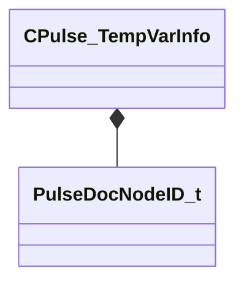

[Schemas](../../schemas.md) / [pulse_runtime_lib](../pulse_runtime_lib.md) / CPulse_TempVarInfo

# CPulse_TempVarInfo

> Source: **Build 26144732** · 2026-10-22 · `windows-x86_64` · schema `0.12.0`

**Kind:** class · **Size:** 48 bytes (`0x30`) · **Align:** 8 · **Module:** pulse_runtime_lib

**Relationships:**

## Memory layout

4 fields (4 declared here, 0 inherited). Offsets are absolute from the object base.

| Offset | Field | Type | From | Annotations |
|--------|-------|------|------|-------------|
| `0x0` | `m_Name` | PulseSymbol_t |  |  |
| `0x10` | `m_Type` | CPulseValueFullType |  |  |
| `0x28` | `m_nEditorNodeID` | [PulseDocNodeID_t](../pulse_runtime_lib/PulseDocNodeID_t.md) |  |  |
| `0x2c` | `m_bIsObservable` | bool |  |  |

KV3 class defaults

<pre>{
	&quot;m_Name&quot;: &quot;&quot;,
	&quot;m_Type&quot;: &quot;PVAL_VOID&quot;,
	&quot;m_nEditorNodeID&quot;: -1,
	&quot;m_bIsObservable&quot;: false
}</pre>

