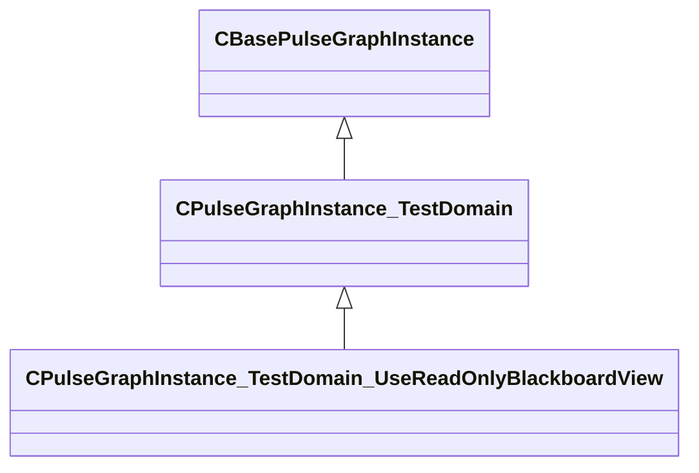

[Schemas](../../schemas.md) / [pulse_system](../pulse_system.md) / CPulseGraphInstance_TestDomain_UseReadOnlyBlackboardView

# CPulseGraphInstance_TestDomain_UseReadOnlyBlackboardView

> Source: **Build 26281801** · 2026-10-28 · `windows-x86_64` · schema `0.13.0`

**Kind:** class · **Size:** 208 bytes (`0xd0`) · **Align:** n/a (unspecified) · **Module:** pulse_system

**Inherits from:** [CPulseGraphInstance_TestDomain](../pulse_system/CPulseGraphInstance_TestDomain.md)

**Relationships:**

## Memory layout

9 fields (0 declared here, 9 inherited). Offsets are absolute from the object base.

| Offset | Field | Type | From | Annotations |
|--------|-------|------|------|-------------|
| `0xa0` | `m_bIsRunningUnitTests` | bool | [CPulseGraphInstance_TestDomain](../pulse_system/CPulseGraphInstance_TestDomain.md) |  |
| `0xa1` | `m_bExplicitTimeStepping` | bool | [CPulseGraphInstance_TestDomain](../pulse_system/CPulseGraphInstance_TestDomain.md) |  |
| `0xa2` | `m_bExpectingToDestroyWithYieldedCursors` | bool | [CPulseGraphInstance_TestDomain](../pulse_system/CPulseGraphInstance_TestDomain.md) |  |
| `0xa3` | `m_bQuietTracepoints` | bool | [CPulseGraphInstance_TestDomain](../pulse_system/CPulseGraphInstance_TestDomain.md) |  |
| `0xa4` | `m_bExpectingCursorTerminatedDueToMaxInstructions` | bool | [CPulseGraphInstance_TestDomain](../pulse_system/CPulseGraphInstance_TestDomain.md) |  |
| `0xa8` | `m_nCursorsTerminatedDueToMaxInstructions` | int32 | [CPulseGraphInstance_TestDomain](../pulse_system/CPulseGraphInstance_TestDomain.md) |  |
| `0xac` | `m_nNextValidateIndex` | int32 | [CPulseGraphInstance_TestDomain](../pulse_system/CPulseGraphInstance_TestDomain.md) |  |
| `0xb0` | `m_Tracepoints` | CUtlVector< CUtlString > | [CPulseGraphInstance_TestDomain](../pulse_system/CPulseGraphInstance_TestDomain.md) |  |
| `0xc8` | `m_bTestYesOrNoPath` | bool | [CPulseGraphInstance_TestDomain](../pulse_system/CPulseGraphInstance_TestDomain.md) |  |
