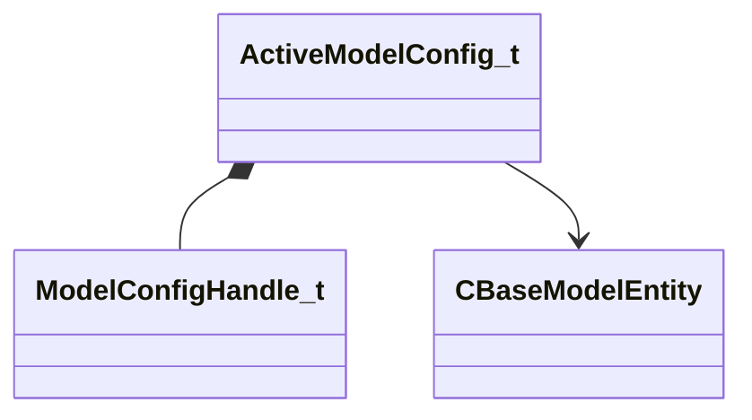

[Schemas](../../schemas.md) / [server](../server.md) / ActiveModelConfig_t

# ActiveModelConfig_t

> Source: **Build 26144732** · 2026-10-22 · `windows-x86_64` · schema `0.12.0`

**Kind:** class · **Size:** 160 bytes (`0xa0`) · **Align:** 8 · **Module:** server

**Twin:** [ActiveModelConfig_t (client)](../client/ActiveModelConfig_t.md)

**Relationships:**

## Memory layout

6 fields (6 declared here, 0 inherited). Offsets are absolute from the object base.

| Offset | Field | Type | From | Annotations |
|--------|-------|------|------|-------------|
| `0x30` | `m_Handle` | [ModelConfigHandle_t](../server/ModelConfigHandle_t.md) |  |  |
| `0x38` | `m_Name` | CUtlSymbolLarge |  |  |
| `0x40` | `m_AssociatedEntities` | CNetworkUtlVectorBase< CHandle< [CBaseModelEntity](../server/CBaseModelEntity.md) > > |  |  |
| `0x58` | `m_AssociatedEntityNames` | CNetworkUtlVectorBase< CUtlSymbolLarge > |  |  |
| `0x70` | `m_vecAssociatedEntityCollidesWithHierarchy` | CUtlLeanVector< bool > |  |  |
| `0x80` | `m_vecAssociatedEntityCollidesOutsideHierarchy` | CUtlLeanVector< bool > |  |  |

KV3 class defaults

<pre>{
	&quot;_class&quot;: &quot;ActiveModelConfig_t&quot;,
	&quot;m_Handle&quot;: 0,
	&quot;m_Name&quot;: &quot;&quot;,
	&quot;m_AssociatedEntities&quot;:
	[
	],
	&quot;m_AssociatedEntityNames&quot;:
	[
	],
	&quot;m_vecAssociatedEntityCollidesWithHierarchy&quot;:
	[
	],
	&quot;m_vecAssociatedEntityCollidesOutsideHierarchy&quot;:
	[
	]
}</pre>

