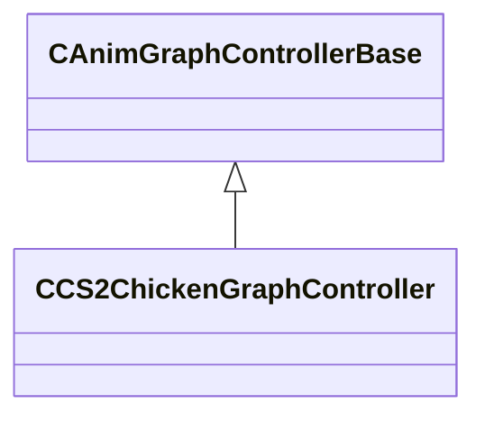

[Schemas](../../schemas.md) / [server](../server.md) / CCS2ChickenGraphController

# CCS2ChickenGraphController

> Source: **Build 25966348** · 2026-10-15 · `windows-x86_64` · schema `0.12.0`

**Kind:** class · **Size:** 496 bytes (`0x1f0`) · **Align:** 8 · **Module:** server

**Inherits from:** [CAnimGraphControllerBase](../server/CAnimGraphControllerBase.md)

**Relationships:**

## Memory layout

14 fields (13 declared here, 1 inherited). Offsets are absolute from the object base.

| Offset | Field | Type | From | Annotations |
|--------|-------|------|------|-------------|
| `0x4c` | `m_hExternalGraph` | [ExternalAnimGraphHandle_t](../server/ExternalAnimGraphHandle_t.md) | [CAnimGraphControllerBase](../server/CAnimGraphControllerBase.md) |  |
| `0xc0` | `m_action` | CAnimGraph2ParamOptionalRef< CGlobalSymbol > |  |  |
| `0xd8` | `m_bActionReset` | CAnimGraph2ParamAutoResetOptionalRef |  |  |
| `0xf8` | `m_actionVariation` | CAnimGraph2ParamOptionalRef< float32 > |  |  |
| `0x110` | `m_bInWater` | CAnimGraph2ParamOptionalRef< bool > |  |  |
| `0x128` | `m_mode` | CAnimGraph2ParamOptionalRef< CGlobalSymbol > |  |  |
| `0x140` | `m_lifeStage` | CAnimGraph2ParamOptionalRef< CGlobalSymbol > |  |  |
| `0x158` | `m_idlePhase` | CAnimGraph2ParamOptionalRef< float32 > |  |  |
| `0x170` | `m_turnAngle` | CAnimGraph2ParamOptionalRef< float32 > |  |  |
| `0x188` | `m_bHasLookatTarget` | CAnimGraph2ParamOptionalRef< bool > |  |  |
| `0x1a0` | `m_lookatTarget` | CAnimGraph2ParamOptionalRef< Vector > |  |  |
| `0x1b8` | `m_bFlinch` | CAnimGraph2ParamOptionalRef< bool > |  |  |
| `0x1d0` | `m_flinchVariation` | CAnimGraph2ParamOptionalRef< float32 > |  |  |
| `0x1e8` | `m_bHasActionCompletedEvent` | bool |  |  |

KV3 class defaults

<pre>{
	&quot;_class&quot;: &quot;CCS2ChickenGraphController&quot;,
	&quot;m_hExternalGraph&quot;: 4294967295,
	&quot;m_action&quot;: null,
	&quot;m_bActionReset&quot;: null,
	&quot;m_actionVariation&quot;: null,
	&quot;m_bInWater&quot;: null,
	&quot;m_mode&quot;: null,
	&quot;m_lifeStage&quot;: null,
	&quot;m_idlePhase&quot;: null,
	&quot;m_turnAngle&quot;: null,
	&quot;m_bHasLookatTarget&quot;: null,
	&quot;m_lookatTarget&quot;: null,
	&quot;m_bFlinch&quot;: null,
	&quot;m_flinchVariation&quot;: null,
	&quot;m_bHasActionCompletedEvent&quot;: false
}</pre>

