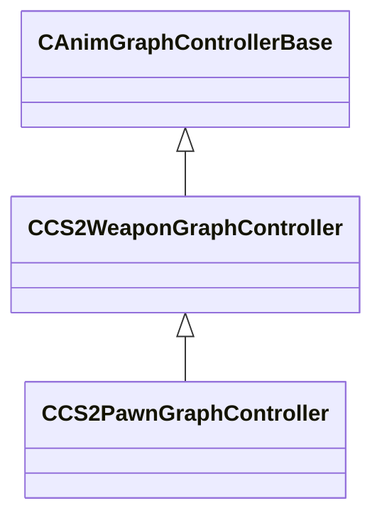

[Schemas](../../schemas.md) / [server](../server.md) / CCS2WeaponGraphController

# CCS2WeaponGraphController

> Source: **Build 26281801** · 2026-10-28 · `windows-x86_64` · schema `0.13.0`

**Kind:** class · **Size:** 1472 bytes (`0x5c0`) · **Align:** 8 · **Module:** server

**Twin:** [CCS2WeaponGraphController (client)](../client/CCS2WeaponGraphController.md)

**Inherits from:** [CAnimGraphControllerBase](../server/CAnimGraphControllerBase.md)

**Derived by:** [CCS2PawnGraphController](../server/CCS2PawnGraphController.md)

**Relationships:**

## Memory layout

21 fields (20 declared here, 1 inherited). Offsets are absolute from the object base.

| Offset | Field | Type | From | Annotations |
|--------|-------|------|------|-------------|
| `0x4c` | `m_hExternalGraph` | [ExternalAnimGraphHandle_t](../server/ExternalAnimGraphHandle_t.md) | [CAnimGraphControllerBase](../server/CAnimGraphControllerBase.md) |  |
| `0xc0` | `m_action` | CAnimGraph2ParamOptionalRef< CGlobalSymbol > |  |  |
| `0xd8` | `m_bActionReset` | CAnimGraph2ParamOptionalRef< bool > |  |  |
| `0xf0` | `m_flWeaponActionSpeedScale` | CAnimGraph2ParamOptionalRef< float32 > |  |  |
| `0x108` | `m_weaponCategory` | CAnimGraph2ParamOptionalRef< CGlobalSymbol > |  |  |
| `0x120` | `m_weaponType` | CAnimGraph2ParamOptionalRef< CGlobalSymbol > |  |  |
| `0x138` | `m_weaponExtraInfo` | CAnimGraph2ParamOptionalRef< CGlobalSymbol > |  |  |
| `0x150` | `m_flWeaponAmmo` | CAnimGraph2ParamOptionalRef< float32 > |  |  |
| `0x168` | `m_flWeaponAmmoMax` | CAnimGraph2ParamOptionalRef< float32 > |  |  |
| `0x180` | `m_flWeaponAmmoReserve` | CAnimGraph2ParamOptionalRef< float32 > |  |  |
| `0x198` | `m_bWeaponIsSilenced` | CAnimGraph2ParamOptionalRef< bool > |  |  |
| `0x1b0` | `m_flWeaponIronsightAmount` | CAnimGraph2ParamOptionalRef< float32 > |  |  |
| `0x1c8` | `m_bIsUsingLegacyModel` | CAnimGraph2ParamOptionalRef< bool > |  |  |
| `0x1e0` | `m_idleVariation` | CAnimGraph2ParamOptionalRef< float32 > |  |  |
| `0x1f8` | `m_deployVariation` | CAnimGraph2ParamOptionalRef< float32 > |  |  |
| `0x210` | `m_attackType` | CAnimGraph2ParamOptionalRef< CGlobalSymbol > |  |  |
| `0x228` | `m_attackThrowStrength` | CAnimGraph2ParamOptionalRef< float32 > |  |  |
| `0x240` | `m_flAttackVariation` | CAnimGraph2ParamOptionalRef< float32 > |  |  |
| `0x258` | `m_inspectVariation` | CAnimGraph2ParamOptionalRef< float32 > |  |  |
| `0x270` | `m_inspectExtraInfo` | CAnimGraph2ParamOptionalRef< CGlobalSymbol > |  |  |
| `0x288` | `m_reloadStage` | CAnimGraph2ParamOptionalRef< CGlobalSymbol > |  |  |

KV3 class defaults

<pre>{
	&quot;_class&quot;: &quot;CCS2WeaponGraphController&quot;,
	&quot;m_hExternalGraph&quot;: 4294967295,
	&quot;m_action&quot;: null,
	&quot;m_bActionReset&quot;: null,
	&quot;m_flWeaponActionSpeedScale&quot;: null,
	&quot;m_weaponCategory&quot;: null,
	&quot;m_weaponType&quot;: null,
	&quot;m_weaponExtraInfo&quot;: null,
	&quot;m_flWeaponAmmo&quot;: null,
	&quot;m_flWeaponAmmoMax&quot;: null,
	&quot;m_flWeaponAmmoReserve&quot;: null,
	&quot;m_bWeaponIsSilenced&quot;: null,
	&quot;m_flWeaponIronsightAmount&quot;: null,
	&quot;m_bIsUsingLegacyModel&quot;: null,
	&quot;m_idleVariation&quot;: null,
	&quot;m_deployVariation&quot;: null,
	&quot;m_attackType&quot;: null,
	&quot;m_attackThrowStrength&quot;: null,
	&quot;m_flAttackVariation&quot;: null,
	&quot;m_inspectVariation&quot;: null,
	&quot;m_inspectExtraInfo&quot;: null,
	&quot;m_reloadStage&quot;: null
}</pre>

