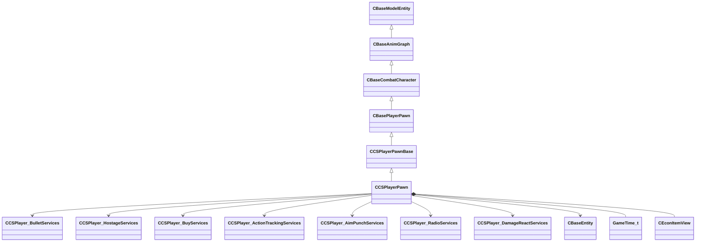

[Schemas](../../schemas.md) / [server](../server.md) / CCSPlayerPawn

# CCSPlayerPawn

> Source: **Build 25947352** · 2026-10-15 · `windows-x86_64` · schema `0.12.0`

The physical in-world representation of a CS2 player.  Carries per-round state: health, armor, position, animations, and weapon inventory.  A new CCSPlayerPawn is created each round on (re)spawn; the corresponding CCSPlayerController persists across rounds.

> 📝 Source 2 architecture separates the controller (session/connection state) from the pawn (physics/animation state).  Demo parsers must follow m_hController → CCSPlayerController to resolve name, team, and stats.

**Kind:** class · **Size:** 5568 bytes (`0x15c0`) · **Align:** 16 · **Module:** server

**Inherits from:** [CCSPlayerPawnBase](../server/CCSPlayerPawnBase.md)

**Relationships:**

## Memory layout

303 fields (106 declared here, 197 inherited). Offsets are absolute from the object base.

| Offset | Field | Type | From | Annotations |
|--------|-------|------|------|-------------|
| `0x8` | `m_iszPrivateVScripts` | CUtlSymbolLarge | [CEntityInstance](../entity2/CEntityInstance.md) |  |
| `0x10` | `m_pEntity` | [CEntityIdentity](../entity2/CEntityIdentity.md)* | [CEntityInstance](../entity2/CEntityInstance.md) | CEntityIdentity pointer: the entity's identity record (name, class, handle, flags). |
| `0x28` | `m_CScriptComponent` | [CScriptComponent](../entity2/CScriptComponent.md)* | [CEntityInstance](../entity2/CEntityInstance.md) | VScript component attached to the entity, when scripted. |
| `0x30` | `m_CBodyComponent` | [CBodyComponent](../server/CBodyComponent.md)* | [CBaseEntity](../server/CBaseEntity.md) |  |
| `0x38` | `m_NetworkTransmitComponent` | [CNetworkTransmitComponent](../server/CNetworkTransmitComponent.md) | [CBaseEntity](../server/CBaseEntity.md) |  |
| `0x248` | `m_aThinkFunctions` | CUtlVector< thinkfunc_t > | [CBaseEntity](../server/CBaseEntity.md) |  |
| `0x260` | `m_iCurrentThinkContext` | int32 | [CBaseEntity](../server/CBaseEntity.md) | `MNotSaved` |
| `0x264` | `m_nLastThinkTick` | [GameTick_t](../entity2/GameTick_t.md) | [CBaseEntity](../server/CBaseEntity.md) |  |
| `0x268` | `m_bDisabledContextThinks` | bool | [CBaseEntity](../server/CBaseEntity.md) |  |
| `0x278` | `m_isSteadyState` | CTypedBitVec< 64 > | [CBaseEntity](../server/CBaseEntity.md) | `MNotSaved` |
| `0x280` | `m_lastNetworkChange` | float32 | [CBaseEntity](../server/CBaseEntity.md) | `MNotSaved` |
| `0x288` | `m_think` | BASEPTR | [CBaseEntity](../server/CBaseEntity.md) |  |
| `0x290` | `m_ResponseContexts` | CUtlVector< [ResponseContext_t](../server/ResponseContext_t.md) > | [CBaseEntity](../server/CBaseEntity.md) |  |
| `0x2a8` | `m_iszResponseContext` | CUtlSymbolLarge | [CBaseEntity](../server/CBaseEntity.md) |  |
| `0x2b0` | `m_pfnTouch` | ENTITYFUNCPTR | [CBaseEntity](../server/CBaseEntity.md) |  |
| `0x2b8` | `m_pfnUse` | USEPTR | [CBaseEntity](../server/CBaseEntity.md) |  |
| `0x2c0` | `m_pfnBlocked` | ENTITYFUNCPTR | [CBaseEntity](../server/CBaseEntity.md) |  |
| `0x2c8` | `m_pfnMoveDone` | BASEPTR | [CBaseEntity](../server/CBaseEntity.md) |  |
| `0x2d0` | `m_iHealth` | int32 | [CBaseEntity](../server/CBaseEntity.md) | Current health points of the entity. Serialised with the 'ClampHealth' encoder so values above max are clamped. *Sent only to the Player network group and LocalPlayerExclusive.* |
| `0x2d4` | `m_iMaxHealth` | int32 | [CBaseEntity](../server/CBaseEntity.md) | Maximum health points; used to normalise health bars in the HUD. |
| `0x2d8` | `m_lifeState` | uint8 | [CBaseEntity](../server/CBaseEntity.md) | LIFE_STATE enum: 0 = Alive, 1 = Dying, 2 = Dead, 3 = Respawnable, 4 = Discardbody. |
| `0x2dc` | `m_flDamageAccumulator` | float32 | [CBaseEntity](../server/CBaseEntity.md) |  |
| `0x2e0` | `m_bTakesDamage` | bool | [CBaseEntity](../server/CBaseEntity.md) |  |
| `0x2e8` | `m_nTakeDamageFlags` | [TakeDamageFlags_t](../server/TakeDamageFlags_t.md) | [CBaseEntity](../server/CBaseEntity.md) |  |
| `0x2f0` | `m_nPlatformType` | [EntityPlatformTypes_t](../server/EntityPlatformTypes_t.md) | [CBaseEntity](../server/CBaseEntity.md) |  |
| `0x2f2` | `m_MoveCollide` | [MoveCollide_t](../server/MoveCollide_t.md) | [CBaseEntity](../server/CBaseEntity.md) |  |
| `0x2f3` | `m_MoveType` | [MoveType_t](../server/MoveType_t.md) | [CBaseEntity](../server/CBaseEntity.md) |  |
| `0x2f4` | `m_nPreviouslySetMoveType` | [MoveType_t](../server/MoveType_t.md) | [CBaseEntity](../server/CBaseEntity.md) |  |
| `0x2f5` | `m_nActualMoveType` | [MoveType_t](../server/MoveType_t.md) | [CBaseEntity](../server/CBaseEntity.md) |  |
| `0x2f6` | `m_nWaterTouch` | uint8 | [CBaseEntity](../server/CBaseEntity.md) | `MNotSaved` |
| `0x2f7` | `m_nSlimeTouch` | uint8 | [CBaseEntity](../server/CBaseEntity.md) | `MNotSaved` |
| `0x2f8` | `m_bRestoreInHierarchy` | bool | [CBaseEntity](../server/CBaseEntity.md) |  |
| `0x300` | `m_target` | CUtlSymbolLarge | [CBaseEntity](../server/CBaseEntity.md) |  |
| `0x308` | `m_hDamageFilter` | CHandle< [CBaseFilter](../server/CBaseFilter.md) > | [CBaseEntity](../server/CBaseEntity.md) |  |
| `0x310` | `m_iszDamageFilterName` | CUtlSymbolLarge | [CBaseEntity](../server/CBaseEntity.md) |  |
| `0x318` | `m_flMoveDoneTime` | float32 | [CBaseEntity](../server/CBaseEntity.md) |  |
| `0x31c` | `m_nSubclassID` | CUtlStringToken | [CBaseEntity](../server/CBaseEntity.md) |  |
| `0x328` | `m_flAnimTime` | float32 | [CBaseEntity](../server/CBaseEntity.md) | Floating-point timestamp of the most-recent animation update; used by the client for animation interpolation. `MKV3TransferSaveOpsForField GetEngineTimeSaveRestoreOps` |
| `0x32c` | `m_flSimulationTime` | float32 | [CBaseEntity](../server/CBaseEntity.md) | Floating-point timestamp of the most-recent physics simulation step; used by the client for position interpolation. `MKV3TransferSaveOpsForField GetEngineTimeSaveRestoreOps` |
| `0x330` | `m_flCreateTime` | [GameTime_t](../entity2/GameTime_t.md) | [CBaseEntity](../server/CBaseEntity.md) |  |
| `0x334` | `m_bClientSideRagdoll` | bool | [CBaseEntity](../server/CBaseEntity.md) |  |
| `0x335` | `m_ubInterpolationFrame` | uint8 | [CBaseEntity](../server/CBaseEntity.md) |  |
| `0x338` | `m_vPrevVPhysicsUpdatePos` | VectorWS | [CBaseEntity](../server/CBaseEntity.md) |  |
| `0x344` | `m_iTeamNum` | uint8 | [CBaseEntity](../server/CBaseEntity.md) | Team number: 0 = Unassigned, 1 = Spectator, 2 = Terrorist, 3 = Counter-Terrorist. |
| `0x348` | `m_iGlobalname` | CUtlSymbolLarge | [CBaseEntity](../server/CBaseEntity.md) | `MSaveBehavior` |
| `0x350` | `m_iSentToClients` | int32 | [CBaseEntity](../server/CBaseEntity.md) | `MNotSaved` |
| `0x358` | `m_sUniqueHammerID` | CUtlString | [CBaseEntity](../server/CBaseEntity.md) |  |
| `0x360` | `m_spawnflags` | uint32 | [CBaseEntity](../server/CBaseEntity.md) |  |
| `0x364` | `m_nNextThinkTick` | [GameTick_t](../entity2/GameTick_t.md) | [CBaseEntity](../server/CBaseEntity.md) | Server tick on which the entity's Think() function will next execute (-1 = never). |
| `0x368` | `m_nSimulationTick` | int32 | [CBaseEntity](../server/CBaseEntity.md) | `MKV3TransferSaveOpsForField GetEngineTickSaveRestoreOps` |
| `0x370` | `m_OnKilled` | [CEntityIOOutput](../entity2/CEntityIOOutput.md) | [CBaseEntity](../server/CBaseEntity.md) |  |
| `0x388` | `m_fFlags` | uint32 | [CBaseEntity](../server/CBaseEntity.md) | Entity flags bitmask (FL_ONGROUND = 1, FL_DUCKING = 4, FL_INWATER = 8, FL_FROZEN = 0x200, etc.). |
| `0x38c` | `m_vecAbsVelocity` | Vector | [CBaseEntity](../server/CBaseEntity.md) |  |
| `0x398` | `m_vecVelocity` | [CNetworkVelocityVector](../server/CNetworkVelocityVector.md) | [CBaseEntity](../server/CBaseEntity.md) | Current world-space velocity vector of the entity. |
| `0x3c8` | `m_vecBaseVelocity` | Vector | [CBaseEntity](../server/CBaseEntity.md) | Additional world-space velocity contributed by moving platforms, conveyor belts, etc. |
| `0x3d4` | `m_nPushEnumCount` | int32 | [CBaseEntity](../server/CBaseEntity.md) | `MNotSaved` |
| `0x3d8` | `m_pCollision` | [CCollisionProperty](../server/CCollisionProperty.md)* | [CBaseEntity](../server/CBaseEntity.md) | `MNotSaved` |
| `0x3e0` | `m_hEffectEntity` | CHandle< [CBaseEntity](../server/CBaseEntity.md) > | [CBaseEntity](../server/CBaseEntity.md) |  |
| `0x3e4` | `m_hOwnerEntity` | CHandle< [CBaseEntity](../server/CBaseEntity.md) > | [CBaseEntity](../server/CBaseEntity.md) | CHandle to the entity that owns or spawned this entity (e.g. the thrower of a grenade). |
| `0x3e8` | `m_fEffects` | uint32 | [CBaseEntity](../server/CBaseEntity.md) | Effect flags bitmask (EF_NODRAW = 32, EF_NORECEIVESHADOW = 64, etc.). |
| `0x3ec` | `m_hGroundEntity` | CHandle< [CBaseEntity](../server/CBaseEntity.md) > | [CBaseEntity](../server/CBaseEntity.md) | CHandle to the entity this entity is standing on (INVALID_EHANDLE if airborne). |
| `0x3f0` | `m_nGroundBodyIndex` | int32 | [CBaseEntity](../server/CBaseEntity.md) |  |
| `0x3f4` | `m_flFriction` | float32 | [CBaseEntity](../server/CBaseEntity.md) | Surface friction multiplier (1.0 = normal; lower values make the entity slide more). |
| `0x3f8` | `m_flElasticity` | float32 | [CBaseEntity](../server/CBaseEntity.md) |  |
| `0x3fc` | `m_flGravityScale` | float32 | [CBaseEntity](../server/CBaseEntity.md) | Gravity scale multiplier (1.0 = normal; 0 = no gravity). |
| `0x400` | `m_flTimeScale` | float32 | [CBaseEntity](../server/CBaseEntity.md) | Time-scale multiplier applied to this entity's simulation (1.0 = real time; used by bullet time effects). |
| `0x404` | `m_flWaterLevel` | float32 | [CBaseEntity](../server/CBaseEntity.md) |  |
| `0x408` | `m_bGravityDisabled` | bool | [CBaseEntity](../server/CBaseEntity.md) |  |
| `0x409` | `m_bAnimatedEveryTick` | bool | [CBaseEntity](../server/CBaseEntity.md) | True when the entity's animation must be updated every server tick regardless of network interest. |
| `0x40c` | `m_flActualGravityScale` | float32 | [CBaseEntity](../server/CBaseEntity.md) |  |
| `0x410` | `m_bGravityActuallyDisabled` | bool | [CBaseEntity](../server/CBaseEntity.md) |  |
| `0x411` | `m_bDisableLowViolence` | bool | [CBaseEntity](../server/CBaseEntity.md) |  |
| `0x412` | `m_nWaterType` | uint8 | [CBaseEntity](../server/CBaseEntity.md) |  |
| `0x414` | `m_iEFlags` | int32 | [CBaseEntity](../server/CBaseEntity.md) |  |
| `0x418` | `m_OnUser1` | [CEntityIOOutput](../entity2/CEntityIOOutput.md) | [CBaseEntity](../server/CBaseEntity.md) |  |
| `0x430` | `m_OnUser2` | [CEntityIOOutput](../entity2/CEntityIOOutput.md) | [CBaseEntity](../server/CBaseEntity.md) |  |
| `0x448` | `m_OnUser3` | [CEntityIOOutput](../entity2/CEntityIOOutput.md) | [CBaseEntity](../server/CBaseEntity.md) |  |
| `0x460` | `m_OnUser4` | [CEntityIOOutput](../entity2/CEntityIOOutput.md) | [CBaseEntity](../server/CBaseEntity.md) |  |
| `0x478` | `m_iInitialTeamNum` | int32 | [CBaseEntity](../server/CBaseEntity.md) |  |
| `0x47c` | `m_flNavIgnoreUntilTime` | [GameTime_t](../entity2/GameTime_t.md) | [CBaseEntity](../server/CBaseEntity.md) |  |
| `0x480` | `m_vecAngVelocity` | QAngle | [CBaseEntity](../server/CBaseEntity.md) |  |
| `0x48c` | `m_bNetworkQuantizeOriginAndAngles` | bool | [CBaseEntity](../server/CBaseEntity.md) |  |
| `0x48d` | `m_bLagCompensate` | bool | [CBaseEntity](../server/CBaseEntity.md) |  |
| `0x490` | `m_pBlocker` | CHandle< [CBaseEntity](../server/CBaseEntity.md) > | [CBaseEntity](../server/CBaseEntity.md) |  |
| `0x494` | `m_flLocalTime` | float32 | [CBaseEntity](../server/CBaseEntity.md) |  |
| `0x498` | `m_flVPhysicsUpdateLocalTime` | float32 | [CBaseEntity](../server/CBaseEntity.md) |  |
| `0x49c` | `m_nBloodType` | [BloodType](../server/BloodType.md) | [CBaseEntity](../server/CBaseEntity.md) |  |
| `0x4a0` | `m_pPulseGraphInstance` | [CPulseGraphInstance_ServerEntity](../server/CPulseGraphInstance_ServerEntity.md)* | [CBaseEntity](../server/CBaseEntity.md) | `MKV3TransferSaveOpsForField GetPulseInstanceSaveRestoreOps` |
| `0x4a8` | `m_CRenderComponent` | [CRenderComponent](../server/CRenderComponent.md)* | [CBaseModelEntity](../server/CBaseModelEntity.md) | `MNotSaved` |
| `0x4b0` | `m_CHitboxComponent` | [CHitboxComponent](../server/CHitboxComponent.md) | [CBaseModelEntity](../server/CBaseModelEntity.md) |  |
| `0x4c8` | `m_pChoreoComponent` | [CChoreoComponent](../server/CChoreoComponent.md)* | [CBaseModelEntity](../server/CBaseModelEntity.md) |  |
| `0x4d0` | `m_nDestructiblePartInitialStateDestructed0` | [HitGroup_t](../server/HitGroup_t.md) | [CBaseModelEntity](../server/CBaseModelEntity.md) |  |
| `0x4d4` | `m_nDestructiblePartInitialStateDestructed1` | [HitGroup_t](../server/HitGroup_t.md) | [CBaseModelEntity](../server/CBaseModelEntity.md) |  |
| `0x4d8` | `m_nDestructiblePartInitialStateDestructed2` | [HitGroup_t](../server/HitGroup_t.md) | [CBaseModelEntity](../server/CBaseModelEntity.md) |  |
| `0x4dc` | `m_nDestructiblePartInitialStateDestructed3` | [HitGroup_t](../server/HitGroup_t.md) | [CBaseModelEntity](../server/CBaseModelEntity.md) |  |
| `0x4e0` | `m_nDestructiblePartInitialStateDestructed4` | [HitGroup_t](../server/HitGroup_t.md) | [CBaseModelEntity](../server/CBaseModelEntity.md) |  |
| `0x4e4` | `m_nDestructiblePartInitialStateDestructed0_PartIndex` | int32 | [CBaseModelEntity](../server/CBaseModelEntity.md) |  |
| `0x4e8` | `m_nDestructiblePartInitialStateDestructed1_PartIndex` | int32 | [CBaseModelEntity](../server/CBaseModelEntity.md) |  |
| `0x4ec` | `m_nDestructiblePartInitialStateDestructed2_PartIndex` | int32 | [CBaseModelEntity](../server/CBaseModelEntity.md) |  |
| `0x4f0` | `m_nDestructiblePartInitialStateDestructed3_PartIndex` | int32 | [CBaseModelEntity](../server/CBaseModelEntity.md) |  |
| `0x4f4` | `m_nDestructiblePartInitialStateDestructed4_PartIndex` | int32 | [CBaseModelEntity](../server/CBaseModelEntity.md) |  |
| `0x4f8` | `m_bDestructiblePartInitialStateDestructed0_GenerateBreakpieces` | bool | [CBaseModelEntity](../server/CBaseModelEntity.md) |  |
| `0x4f9` | `m_bDestructiblePartInitialStateDestructed1_GenerateBreakpieces` | bool | [CBaseModelEntity](../server/CBaseModelEntity.md) |  |
| `0x4fa` | `m_bDestructiblePartInitialStateDestructed2_GenerateBreakpieces` | bool | [CBaseModelEntity](../server/CBaseModelEntity.md) |  |
| `0x4fb` | `m_bDestructiblePartInitialStateDestructed3_GenerateBreakpieces` | bool | [CBaseModelEntity](../server/CBaseModelEntity.md) |  |
| `0x4fc` | `m_bDestructiblePartInitialStateDestructed4_GenerateBreakpieces` | bool | [CBaseModelEntity](../server/CBaseModelEntity.md) |  |
| `0x500` | `m_pDestructiblePartsSystemComponent` | [CDestructiblePartsComponent](../server/CDestructiblePartsComponent.md)* | [CBaseModelEntity](../server/CBaseModelEntity.md) |  |
| `0x508` | `m_OnDestructibleHitGroupDamageLevelChanged` | CEntityOutputTemplate< [CBaseModelEntity::OnDamageLevelChangedArgs_t](../server/CBaseModelEntity.OnDamageLevelChangedArgs_t.md) > | [CBaseModelEntity](../server/CBaseModelEntity.md) |  |
| `0x530` | `m_flDissolveStartTime` | [GameTime_t](../entity2/GameTime_t.md) | [CBaseModelEntity](../server/CBaseModelEntity.md) |  |
| `0x538` | `m_OnIgnite` | [CEntityIOOutput](../entity2/CEntityIOOutput.md) | [CBaseModelEntity](../server/CBaseModelEntity.md) |  |
| `0x550` | `m_nRenderMode` | [RenderMode_t](../server/RenderMode_t.md) | [CBaseModelEntity](../server/CBaseModelEntity.md) | RenderMode_t enum controlling transparency and rendering method (0 = Normal, 5 = Translucent, etc.). |
| `0x551` | `m_nRenderFX` | [RenderFx_t](../server/RenderFx_t.md) | [CBaseModelEntity](../server/CBaseModelEntity.md) | RenderFx_t enum for special rendering effects (pulsing, fading, hologram, etc.). |
| `0x552` | `m_bAllowFadeInView` | bool | [CBaseModelEntity](../server/CBaseModelEntity.md) |  |
| `0x570` | `m_clrRender` | Color | [CBaseModelEntity](../server/CBaseModelEntity.md) | RGBA tint colour multiplied onto the entity's diffuse texture. |
| `0x578` | `m_vecRenderAttributes` | CUtlVectorEmbeddedNetworkVar< [EntityRenderAttribute_t](../server/EntityRenderAttribute_t.md) > | [CBaseModelEntity](../server/CBaseModelEntity.md) |  |
| `0x5e0` | `m_bRenderToCubemaps` | bool | [CBaseModelEntity](../server/CBaseModelEntity.md) |  |
| `0x5e1` | `m_bExpandRenderBoundsToIncludeCloth` | bool | [CBaseModelEntity](../server/CBaseModelEntity.md) |  |
| `0x5e2` | `m_bNoInterpolate` | bool | [CBaseModelEntity](../server/CBaseModelEntity.md) |  |
| `0x5e8` | `m_Collision` | [CCollisionProperty](../server/CCollisionProperty.md) | [CBaseModelEntity](../server/CBaseModelEntity.md) | CCollisionProperty struct encoding the entity's collision bounding box shape and flags. |
| `0x6a0` | `m_Glow` | [CGlowProperty](../server/CGlowProperty.md) | [CBaseModelEntity](../server/CBaseModelEntity.md) | CGlowProperty struct controlling the entity's glow outline (colour, radius, visibility rules). |
| `0x6f8` | `m_flGlowBackfaceMult` | float32 | [CBaseModelEntity](../server/CBaseModelEntity.md) | Multiplier for the glow effect on back-facing surfaces of the model. |
| `0x6fc` | `m_fadeMinDist` | float32 | [CBaseModelEntity](../server/CBaseModelEntity.md) | Minimum distance (world units) at which the entity starts to fade out. |
| `0x700` | `m_fadeMaxDist` | float32 | [CBaseModelEntity](../server/CBaseModelEntity.md) | Distance at which the entity is fully faded out and invisible. |
| `0x704` | `m_flFadeScale` | float32 | [CBaseModelEntity](../server/CBaseModelEntity.md) | Scale factor applied to fade distances; 0 disables distance fading. |
| `0x708` | `m_flShadowStrength` | float32 | [CBaseModelEntity](../server/CBaseModelEntity.md) | Opacity of this entity's cast shadow (0 = no shadow, 1 = full shadow). |
| `0x70c` | `m_nObjectCulling` | uint8 | [CBaseModelEntity](../server/CBaseModelEntity.md) |  |
| `0x710` | `m_bodyGroupTotalRequestCount` | uint32 | [CBaseModelEntity](../server/CBaseModelEntity.md) |  |
| `0x718` | `m_bodyGroupRequests` | CUtlVectorFixedGrowable< [CBaseModelEntity::BodyGroupRequest_t](../server/CBaseModelEntity.BodyGroupRequest_t.md), 8 > | [CBaseModelEntity](../server/CBaseModelEntity.md) |  |
| `0x7f0` | `m_bodyGroupChoices` | CUtlOrderedMap< CGlobalSymbol, int32 > | [CBaseModelEntity](../server/CBaseModelEntity.md) |  |
| `0x818` | `m_vecViewOffset` | [CNetworkViewOffsetVector](../server/CNetworkViewOffsetVector.md) | [CBaseModelEntity](../server/CBaseModelEntity.md) | Offset from the entity origin to the player's view position (eye height). |
| `0x848` | `m_bvDisabledHitGroups` | uint32[1] | [CBaseModelEntity](../server/CBaseModelEntity.md) | `MKV3TransferSaveOpsForField GetHitgroupDisableListSaveRestoreOps` |
| `0x850` | `m_graphControllerManager` | [CAnimGraphControllerManager](../server/CAnimGraphControllerManager.md) | [CBaseAnimGraph](../server/CBaseAnimGraph.md) |  |
| `0x8e8` | `m_pMainGraphController` | [CAnimGraphControllerPtr](../server/CAnimGraphControllerPtr.md) | [CBaseAnimGraph](../server/CBaseAnimGraph.md) | The primary animation-graph controller instance for this entity. |
| `0x8f0` | `m_bInitiallyPopulateInterpHistory` | bool | [CBaseAnimGraph](../server/CBaseAnimGraph.md) |  |
| `0x8f8` | `m_OnLayerCycleUpdated` | CEntityOutputTemplate< float32 > | [CBaseAnimGraph](../server/CBaseAnimGraph.md) |  |
| `0x918` | `m_OnExternalChoreoGraphChanged` | [CEntityIOOutput](../entity2/CEntityIOOutput.md) | [CBaseAnimGraph](../server/CBaseAnimGraph.md) |  |
| `0x930` | `m_pChoreoServices` | [IChoreoServices](../server/IChoreoServices.md)* | [CBaseAnimGraph](../server/CBaseAnimGraph.md) | `MKV3TransferSaveOpsForField GetChoreoServicesSaveRestoreOps` |
| `0x938` | `m_bAnimGraphUpdateEnabled` | bool | [CBaseAnimGraph](../server/CBaseAnimGraph.md) |  |
| `0x939` | `m_bAnimationUpdateScheduled` | bool | [CBaseAnimGraph](../server/CBaseAnimGraph.md) | `MNotSaved` |
| `0x93c` | `m_vecForce` | Vector | [CBaseAnimGraph](../server/CBaseAnimGraph.md) | `MNotSaved` |
| `0x948` | `m_nForceBone` | int32 | [CBaseAnimGraph](../server/CBaseAnimGraph.md) | `MNotSaved` |
| `0x958` | `m_pRagdollControl` | [IPhysicsRagdollControl](../vphysics2/IPhysicsRagdollControl.md)* | [CBaseAnimGraph](../server/CBaseAnimGraph.md) | `MPhysPtr` |
| `0x960` | `m_RagdollPose` | [PhysicsRagdollPose_t](../server/PhysicsRagdollPose_t.md) | [CBaseAnimGraph](../server/CBaseAnimGraph.md) |  |
| `0x988` | `m_bRagdollEnabled` | bool | [CBaseAnimGraph](../server/CBaseAnimGraph.md) | True while the entity is simulated as a ragdoll rather than animated. |
| `0x989` | `m_bRagdollClientSide` | bool | [CBaseAnimGraph](../server/CBaseAnimGraph.md) | `MNotSaved` |
| `0x98a` | `m_bShouldUpdateTransformations` | bool | [CBaseAnimGraph](../server/CBaseAnimGraph.md) |  |
| `0x990` | `m_xParentedRagdollRootInEntitySpace` | CTransform | [CBaseAnimGraph](../server/CBaseAnimGraph.md) |  |
| `0xa40` | `m_bForceServerRagdoll` | bool | [CBaseCombatCharacter](../server/CBaseCombatCharacter.md) |  |
| `0xa48` | `m_hMyWearables` | CNetworkUtlVectorBase< CHandle< [CEconWearable](../server/CEconWearable.md) > > | [CBaseCombatCharacter](../server/CBaseCombatCharacter.md) | Handles to the character's equipped wearable items (gloves, agent model pieces). `MNotSaved` |
| `0xa60` | `m_impactEnergyScale` | float32 | [CBaseCombatCharacter](../server/CBaseCombatCharacter.md) | Scale applied to impact-damage energy for this character. |
| `0xa64` | `m_bApplyStressDamage` | bool | [CBaseCombatCharacter](../server/CBaseCombatCharacter.md) |  |
| `0xa65` | `m_bDeathEventsDispatched` | bool | [CBaseCombatCharacter](../server/CBaseCombatCharacter.md) |  |
| `0xaa8` | `m_vecRelationships` | CUtlVector< [RelationshipOverride_t](../server/RelationshipOverride_t.md) > | [CBaseCombatCharacter](../server/CBaseCombatCharacter.md) |  |
| `0xac0` | `m_strRelationships` | CUtlSymbolLarge | [CBaseCombatCharacter](../server/CBaseCombatCharacter.md) |  |
| `0xac8` | `m_eHull` | [Hull_t](../server/Hull_t.md) | [CBaseCombatCharacter](../server/CBaseCombatCharacter.md) |  |
| `0xacc` | `m_nNavHullIdx` | uint32 | [CBaseCombatCharacter](../server/CBaseCombatCharacter.md) |  |
| `0xad0` | `m_movementStats` | [CMovementStatsProperty](../server/CMovementStatsProperty.md) | [CBaseCombatCharacter](../server/CBaseCombatCharacter.md) |  |
| `0xb10` | `m_pWeaponServices` | [CPlayer_WeaponServices](../server/CPlayer_WeaponServices.md)* | [CBasePlayerPawn](../server/CBasePlayerPawn.md) | Weapon-handling component (active weapon, switch timing). |
| `0xb18` | `m_pItemServices` | [CPlayer_ItemServices](../server/CPlayer_ItemServices.md)* | [CBasePlayerPawn](../server/CBasePlayerPawn.md) | Carried-item component (defuser, helmet). |
| `0xb20` | `m_pAutoaimServices` | [CPlayer_AutoaimServices](../server/CPlayer_AutoaimServices.md)* | [CBasePlayerPawn](../server/CBasePlayerPawn.md) |  |
| `0xb28` | `m_pObserverServices` | [CPlayer_ObserverServices](../server/CPlayer_ObserverServices.md)* | [CBasePlayerPawn](../server/CBasePlayerPawn.md) | Spectator component, active while the pawn is dead or observing. |
| `0xb30` | `m_pWaterServices` | [CPlayer_WaterServices](../server/CPlayer_WaterServices.md)* | [CBasePlayerPawn](../server/CBasePlayerPawn.md) |  |
| `0xb38` | `m_pUseServices` | [CPlayer_UseServices](../server/CPlayer_UseServices.md)* | [CBasePlayerPawn](../server/CBasePlayerPawn.md) |  |
| `0xb40` | `m_pFlashlightServices` | [CPlayer_FlashlightServices](../server/CPlayer_FlashlightServices.md)* | [CBasePlayerPawn](../server/CBasePlayerPawn.md) |  |
| `0xb48` | `m_pCameraServices` | [CPlayer_CameraServices](../server/CPlayer_CameraServices.md)* | [CBasePlayerPawn](../server/CBasePlayerPawn.md) | View / camera component. |
| `0xb50` | `m_pMovementServices` | [CPlayer_MovementServices](../server/CPlayer_MovementServices.md)* | [CBasePlayerPawn](../server/CBasePlayerPawn.md) | Movement / input component. |
| `0xb60` | `m_ServerViewAngleChanges` | CUtlVectorEmbeddedNetworkVar< [ViewAngleServerChange_t](../server/ViewAngleServerChange_t.md) > | [CBasePlayerPawn](../server/CBasePlayerPawn.md) | `MNotSaved` |
| `0xbc8` | `v_angle` | QAngle | [CBasePlayerPawn](../server/CBasePlayerPawn.md) | Current view (eye) angles of the pawn. |
| `0xbd4` | `v_anglePrevious` | QAngle | [CBasePlayerPawn](../server/CBasePlayerPawn.md) |  |
| `0xbe0` | `m_iHideHUD` | uint32 | [CBasePlayerPawn](../server/CBasePlayerPawn.md) |  |
| `0xbe8` | `m_skybox3d` | sky3dparams_t | [CBasePlayerPawn](../server/CBasePlayerPawn.md) |  |
| `0xc78` | `m_fTimeLastHurt` | [GameTime_t](../entity2/GameTime_t.md) | [CBasePlayerPawn](../server/CBasePlayerPawn.md) |  |
| `0xc7c` | `m_flDeathTime` | [GameTime_t](../entity2/GameTime_t.md) | [CBasePlayerPawn](../server/CBasePlayerPawn.md) |  |
| `0xc80` | `m_fNextSuicideTime` | [GameTime_t](../entity2/GameTime_t.md) | [CBasePlayerPawn](../server/CBasePlayerPawn.md) | `MNotSaved` |
| `0xc88` | `m_fInitHUD` | bool | [CBasePlayerPawn](../server/CBasePlayerPawn.md) |  |
| `0xc90` | `m_pExpresser` | [CAI_Expresser](../server/CAI_Expresser.md)* | [CBasePlayerPawn](../server/CBasePlayerPawn.md) |  |
| `0xc98` | `m_hController` | CHandle< [CBasePlayerController](../server/CBasePlayerController.md) > | [CBasePlayerPawn](../server/CBasePlayerPawn.md) |  |
| `0xc9c` | `m_hDefaultController` | CHandle< [CBasePlayerController](../server/CBasePlayerController.md) > | [CBasePlayerPawn](../server/CBasePlayerPawn.md) |  |
| `0xca4` | `m_fHltvReplayDelay` | float32 | [CBasePlayerPawn](../server/CBasePlayerPawn.md) | `MNotSaved` |
| `0xca8` | `m_fHltvReplayEnd` | float32 | [CBasePlayerPawn](../server/CBasePlayerPawn.md) | `MNotSaved` |
| `0xcac` | `m_iHltvReplayEntity` | CEntityIndex | [CBasePlayerPawn](../server/CBasePlayerPawn.md) | `MNotSaved` |
| `0xcb0` | `m_sndOpvarLatchData` | CUtlVector< sndopvarlatchdata_t > | [CBasePlayerPawn](../server/CBasePlayerPawn.md) |  |
| `0xce0` | `m_CTouchExpansionComponent` | [CTouchExpansionComponent](../server/CTouchExpansionComponent.md) | [CCSPlayerPawnBase](../server/CCSPlayerPawnBase.md) |  |
| `0xd30` | `m_pPingServices` | [CCSPlayer_PingServices](../server/CCSPlayer_PingServices.md)* | [CCSPlayerPawnBase](../server/CCSPlayerPawnBase.md) | Pointer to CCSPlayer_PingServices managing the in-game map-ping system. |
| `0xd38` | `m_blindUntilTime` | [GameTime_t](../entity2/GameTime_t.md) | [CCSPlayerPawnBase](../server/CCSPlayerPawnBase.md) |  |
| `0xd3c` | `m_blindStartTime` | [GameTime_t](../entity2/GameTime_t.md) | [CCSPlayerPawnBase](../server/CCSPlayerPawnBase.md) |  |
| `0xd40` | `m_iPlayerState` | [CSPlayerState](../server/CSPlayerState.md) | [CCSPlayerPawnBase](../server/CCSPlayerPawnBase.md) | CSPlayerState enum: STATE_ACTIVE = 0 (alive), STATE_WELCOME = 1, STATE_PICKINGTEAM = 2, STATE_PICKINGCLASS = 3, STATE_DEATH_ANIM = 4, STATE_DEATH_WAIT_FOR_KEY = 5, STATE_OBSERVER_MODE = 6. |
| `0xdf0` | `m_bRespawning` | bool | [CCSPlayerPawnBase](../server/CCSPlayerPawnBase.md) |  |
| `0xdf1` | `m_bHasMovedSinceSpawn` | bool | [CCSPlayerPawnBase](../server/CCSPlayerPawnBase.md) | True once the player moves after spawning; prevents accidental movement-triggered events. |
| `0xdf4` | `m_iNumSpawns` | int32 | [CCSPlayerPawnBase](../server/CCSPlayerPawnBase.md) |  |
| `0xdfc` | `m_flIdleTimeSinceLastAction` | float32 | [CCSPlayerPawnBase](../server/CCSPlayerPawnBase.md) |  |
| `0xe00` | `m_fNextRadarUpdateTime` | float32 | [CCSPlayerPawnBase](../server/CCSPlayerPawnBase.md) |  |
| `0xe04` | `m_flFlashDuration` | float32 | [CCSPlayerPawnBase](../server/CCSPlayerPawnBase.md) | Total duration in seconds of the current flash-bang blind effect (0 when not flashed). |
| `0xe08` | `m_flFlashMaxAlpha` | float32 | [CCSPlayerPawnBase](../server/CCSPlayerPawnBase.md) | Peak screen-overlay alpha (0–255) of the current flash bang; scales with proximity and facing angle. |
| `0xe0c` | `m_flProgressBarStartTime` | float32 | [CCSPlayerPawnBase](../server/CCSPlayerPawnBase.md) | GameTime at which the current progress bar (defuse/pickup) started. |
| `0xe10` | `m_iProgressBarDuration` | int32 | [CCSPlayerPawnBase](../server/CCSPlayerPawnBase.md) | Duration in seconds of the current progress bar interaction. |
| `0xe14` | `m_hOriginalController` | CHandle< [CCSPlayerController](../server/CCSPlayerController.md) > | [CCSPlayerPawnBase](../server/CCSPlayerPawnBase.md) | CHandle back to the CCSPlayerController that owns this pawn, even when a bot has taken over. *Use this to map a pawn to its player for demo parsing.* |
| `0xe30` | `m_pBulletServices` | [CCSPlayer_BulletServices](../server/CCSPlayer_BulletServices.md)* |  | Pointer to CCSPlayer_BulletServices which tracks hit counts registered on the server. |
| `0xe38` | `m_pHostageServices` | [CCSPlayer_HostageServices](../server/CCSPlayer_HostageServices.md)* |  | Pointer to CCSPlayer_HostageServices which tracks which hostage entity this player is currently carrying. |
| `0xe40` | `m_pBuyServices` | [CCSPlayer_BuyServices](../server/CCSPlayer_BuyServices.md)* |  | Pointer to CCSPlayer_BuyServices which tracks sellback purchase history for the current round. |
| `0xe48` | `m_pActionTrackingServices` | [CCSPlayer_ActionTrackingServices](../server/CCSPlayer_ActionTrackingServices.md)* |  | Pointer to CCSPlayer_ActionTrackingServices which tracks weapon purchases and rescue state for stats/scoring. |
| `0xe50` | `m_pAimPunchServices` | [CCSPlayer_AimPunchServices](../server/CCSPlayer_AimPunchServices.md)* |  |  |
| `0xe58` | `m_pRadioServices` | [CCSPlayer_RadioServices](../server/CCSPlayer_RadioServices.md)* |  |  |
| `0xe60` | `m_pDamageReactServices` | [CCSPlayer_DamageReactServices](../server/CCSPlayer_DamageReactServices.md)* |  |  |
| `0xe68` | `m_nCharacterDefIndex` | uint16 |  |  |
| `0xe6a` | `m_bHasFemaleVoice` | bool |  | True when the equipped agent skin uses a female voice pack. |
| `0xe70` | `m_strVOPrefix` | CUtlString |  |  |
| `0xe78` | `m_szLastPlaceName` | char[18] |  | Human-readable area/landmark name from the nav mesh where the player was last located (e.g. 'CTSpawn', 'BombsiteA'). |
| `0xf68` | `m_bInHostageResetZone` | bool |  |  |
| `0xf69` | `m_bInBuyZone` | bool |  | True while the player is standing inside a buy zone. |
| `0xf70` | `m_TouchingBuyZones` | CUtlVector< CHandle< [CBaseEntity](../server/CBaseEntity.md) > > |  |  |
| `0xf88` | `m_bWasInBuyZone` | bool |  |  |
| `0xf89` | `m_bInHostageRescueZone` | bool |  | True while the player is inside a hostage rescue zone. |
| `0xf8a` | `m_bInBombZone` | bool |  | True while the player is standing inside a bomb-plant zone (bombsite trigger). *m_nWhichBombZone indicates which site (0 = not in any, 1 = A, 2 = B).* |
| `0xf8b` | `m_bWasInHostageRescueZone` | bool |  |  |
| `0xf8c` | `m_iRetakesOffering` | int32 |  | Retakes-mode offering index: which weapon/utility load-out this player was offered for the retake. |
| `0xf90` | `m_iRetakesOfferingCard` | int32 |  | Card index the player selected in the retakes offering interface. |
| `0xf94` | `m_bRetakesHasDefuseKit` | bool |  | True when the retakes system has granted this player a defuse kit for the retake round. |
| `0xf95` | `m_bRetakesMVPLastRound` | bool |  | True if this player earned the retakes MVP award in the previous round. |
| `0xf98` | `m_iRetakesMVPBoostItem` | int32 |  | Item definition index of the bonus item awarded to the retakes MVP. |
| `0xf9c` | `m_RetakesMVPBoostExtraUtility` | loadout_slot_t |  |  |
| `0xfa0` | `m_flHealthShotBoostExpirationTime` | [GameTime_t](../entity2/GameTime_t.md) |  | GameTime at which the health-shot (medshot) movement speed boost expires. |
| `0xfa4` | `m_flLandingTimeSeconds` | float32 |  |  |
| `0xfa8` | `m_bIsBuyMenuOpen` | bool |  | True while the player's buy menu is open. |
| `0xfe0` | `m_lastLandTime` | [GameTime_t](../entity2/GameTime_t.md) |  |  |
| `0xfe4` | `m_bOnGroundLastTick` | bool |  |  |
| `0xfe8` | `m_iPlayerLocked` | int32 |  |  |
| `0xff0` | `m_flTimeOfLastInjury` | [GameTime_t](../entity2/GameTime_t.md) |  | GameTime of the most-recent damage event that reduced this player's health. |
| `0xff4` | `m_flNextSprayDecalTime` | [GameTime_t](../entity2/GameTime_t.md) |  |  |
| `0xff8` | `m_bNextSprayDecalTimeExpedited` | bool |  |  |
| `0xffc` | `m_nRagdollDamageBone` | int32 |  | Bone index of the last hit that caused a ragdoll impulse. |
| `0x1000` | `m_vRagdollDamageForce` | Vector |  | World-space impulse vector applied to the ragdoll bone on death. |
| `0x100c` | `m_szRagdollDamageWeaponName` | char[64] |  | Class name of the weapon that killed this player (used to select the correct death ragdoll). |
| `0x104c` | `m_bRagdollDamageHeadshot` | bool |  | True if the fatal blow was a headshot, used to trigger headshot-specific ragdoll animation. |
| `0x1050` | `m_vRagdollServerOrigin` | VectorWS |  | World-space position of the player's origin at the moment of death. |
| `0x1060` | `m_EconGloves` | [CEconItemView](../server/CEconItemView.md) |  | CEconItemView describing the glove skin equipped on this player. |
| `0x1448` | `m_nEconGlovesChanged` | uint8 |  | Incremented each time the glove loadout changes, so the client can refresh the glove model. |
| `0x144c` | `m_qDeathEyeAngles` | QAngle |  | Eye angles at the moment of death, used to pose the ragdoll's head correctly. |
| `0x1458` | `m_bLeftHanded` | bool |  | True when the player has switched the weapon to the left hand (cl_lefthand 1). |
| `0x145c` | `m_fSwitchedHandednessTime` | [GameTime_t](../entity2/GameTime_t.md) |  | GameTime at which the player last toggled handedness (prevents rapid toggling). |
| `0x1460` | `m_flViewmodelOffsetX` | float32 |  | Custom viewmodel X offset in world units (cl_viewmodel_offset_x). |
| `0x1464` | `m_flViewmodelOffsetY` | float32 |  | Custom viewmodel Y offset in world units (cl_viewmodel_offset_y). |
| `0x1468` | `m_flViewmodelOffsetZ` | float32 |  | Custom viewmodel Z offset in world units (cl_viewmodel_offset_z). |
| `0x146c` | `m_flViewmodelFOV` | float32 |  | Custom viewmodel FOV in degrees (cl_viewmodel_fov; clamped to 60–68). |
| `0x1470` | `m_bIsWalking` | bool |  | True while the player is in walk mode (shift-walk / cl_showpos = 1 walking). |
| `0x1474` | `m_fLastGivenDefuserTime` | float32 |  |  |
| `0x1478` | `m_fLastGivenBombTime` | float32 |  |  |
| `0x147c` | `m_flDealtDamageToEnemyMostRecentTimestamp` | float32 |  |  |
| `0x1480` | `m_iDisplayHistoryBits` | uint32 |  |  |
| `0x1484` | `m_flLastAttackedTeammate` | float32 |  |  |
| `0x1488` | `m_allowAutoFollowTime` | [GameTime_t](../entity2/GameTime_t.md) |  |  |
| `0x148c` | `m_bResetArmorNextSpawn` | bool |  |  |
| `0x1490` | `m_nLastKillerIndex` | CEntityIndex |  | Entity index of the player or entity that last killed this pawn. |
| `0x1498` | `m_entitySpottedState` | [EntitySpottedState_t](../server/EntitySpottedState_t.md) |  | EntitySpottedState_t struct tracking which players have spotted (ESP-radar dot) this entity. *See also m_bSpotted and the spotted bitmask used by the minimap.* |
| `0x14b0` | `m_nSpotRules` | int32 |  |  |
| `0x14b4` | `m_bIsScoped` | bool |  | True while the player is looking through a weapon scope. |
| `0x14b5` | `m_bResumeZoom` | bool |  | True when the scope should be re-engaged automatically after the next shot (AWP/SSG 08 bolt-action mechanic). |
| `0x14b6` | `m_bIsDefusing` | bool |  | True while the player is actively defusing the planted bomb. |
| `0x14b7` | `m_bIsGrabbingHostage` | bool |  | True while the player is picking up a hostage entity. |
| `0x14b8` | `m_iBlockingUseActionInProgress` | [CSPlayerBlockingUseAction_t](../server/CSPlayerBlockingUseAction_t.md) |  | CSPlayerBlockingUseAction_t enum indicating a use-action in progress that blocks other actions (e.g. defuse, hostage grab). |
| `0x14bc` | `m_flEmitSoundTime` | [GameTime_t](../entity2/GameTime_t.md) |  | GameTime of the next footstep sound emission; controls footstep sound spacing. |
| `0x14c0` | `m_bInNoDefuseArea` | bool |  | True when the player is in a location where defusing is not permitted. |
| `0x14c4` | `m_iBombSiteIndex` | CEntityIndex |  |  |
| `0x14c8` | `m_nWhichBombZone` | int32 |  | Indicates which bomb site the player is currently inside (0 = none, 1 = A, 2 = B). |
| `0x14cc` | `m_bInBombZoneTrigger` | bool |  |  |
| `0x14cd` | `m_bWasInBombZoneTrigger` | bool |  |  |
| `0x14d0` | `m_iShotsFired` | int32 |  | Number of bullets fired since the player last stopped firing (resets when trigger is released or weapon changes). *Used to drive the walk-run bobbing animation state.* |
| `0x14d4` | `m_flFlinchStack` | float32 |  | Accumulated flinch value from recent damage; drives the camera-shake magnitude. *Only sent to the owning player (LocalPlayerExclusive).* |
| `0x14d8` | `m_flVelocityModifier` | float32 |  | Multiplicative speed modifier applied on top of base movement speed (0.0–1.0 typically; reduced while injured or tased). |
| `0x14dc` | `m_vecTotalBulletForce` | Vector |  |  |
| `0x14e8` | `m_bWaitForNoAttack` | bool |  | True when the weapon's fire input must be fully released before the next shot is accepted (prevents auto-fire on re-deploy). |
| `0x14ec` | `m_ignoreLadderJumpTime` | float32 |  |  |
| `0x14f0` | `m_bKilledByHeadshot` | bool |  | True if the killing blow on this player was a headshot. |
| `0x14f4` | `m_LastHitBox` | int32 |  |  |
| `0x14f8` | `m_pBot` | [CCSBot](../server/CCSBot.md)* |  |  |
| `0x1500` | `m_bBotAllowActive` | bool |  |  |
| `0x1504` | `m_nLastPickupPriority` | int32 |  |  |
| `0x1508` | `m_flLastPickupPriorityTime` | float32 |  |  |
| `0x150c` | `m_ArmorValue` | int32 |  | Current armor HP (0–100). Combined-arms note: vest+helmet does not exceed 100 armor points. |
| `0x1510` | `m_unCurrentEquipmentValue` | uint16 |  | Total buy value (in dollars) of equipment currently held by the player. |
| `0x1512` | `m_unRoundStartEquipmentValue` | uint16 |  | Equipment value at the start of the current round (after freeze-time buy phase ends). |
| `0x1514` | `m_unFreezetimeEndEquipmentValue` | uint16 |  | Equipment value at the moment freeze time ended. |
| `0x1518` | `m_iLastWeaponFireUsercmd` | int32 |  |  |
| `0x151c` | `m_bIsSpawning` | bool |  |  |
| `0x1528` | `m_iDeathFlags` | int32 |  |  |
| `0x152c` | `m_bHasDeathInfo` | bool |  |  |
| `0x1530` | `m_flDeathInfoTime` | float32 |  |  |
| `0x1534` | `m_vecDeathInfoOrigin` | VectorWS |  |  |
| `0x1540` | `m_vecPlayerPatchEconIndices` | uint32[5] |  | Array of 5 item-definition indices for the agent patch slots (team patches worn on the uniform). |
| `0x1554` | `m_GunGameImmunityColor` | Color |  | Color applied to the player model while gun-game immunity is active. |
| `0x1558` | `m_grenadeParameterStashTime` | [GameTime_t](../entity2/GameTime_t.md) |  |  |
| `0x155c` | `m_bGrenadeParametersStashed` | bool |  |  |
| `0x1560` | `m_angStashedShootAngles` | QAngle |  |  |
| `0x156c` | `m_vecStashedGrenadeThrowPosition` | VectorWS |  |  |
| `0x1578` | `m_vecStashedGrenadeThrowPawnCenter` | VectorWS |  |  |
| `0x1584` | `m_vecStashedVelocity` | Vector |  |  |
| `0x1598` | `m_bCommittingSuicideOnTeamChange` | bool |  |  |
| `0x1599` | `m_wasNotKilledNaturally` | bool |  |  |
| `0x159c` | `m_fImmuneToGunGameDamageTime` | [GameTime_t](../entity2/GameTime_t.md) |  | GameTime until which the player is immune to damage in Gun Game / Arms Race mode. |
| `0x15a0` | `m_bGunGameImmunity` | bool |  | True while the player has gun-game spawn immunity (brief invincibility after spawning in Arms Race mode). |
| `0x15a4` | `m_flModifier0` | float32 |  |  |
| `0x15a8` | `m_fMolotovDamageTime` | float32 |  | GameTime at which molotov/incendiary damage will next be applied to this player. |
| `0x15ac` | `m_angEyeAngles` | QAngle |  | Server-authoritative eye angles (pitch, yaw, roll) used for hit-box calculation and third-person rendering. *Encoded at full qangle_precise precision. The definitive source for a player's look direction.* |
