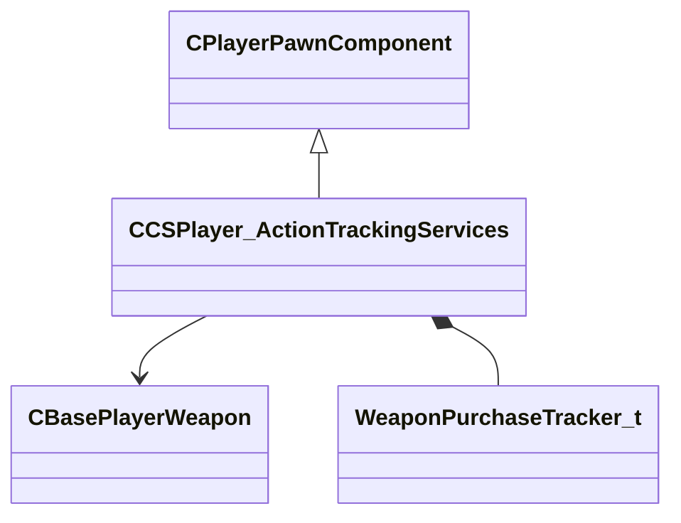

[Schemas](../../schemas.md) / [server](../server.md) / CCSPlayer_ActionTrackingServices

# CCSPlayer_ActionTrackingServices

> Source: **Build 25947352** · 2026-10-15 · `windows-x86_64` · schema `0.12.0`

Component tracking scoring-relevant actions: weapon purchases and hostage rescue status.

**Kind:** class · **Size:** 896 bytes (`0x380`) · **Align:** n/a (unspecified) · **Module:** server

**Twin:** [CCSPlayer_ActionTrackingServices (client)](../client/CCSPlayer_ActionTrackingServices.md)

**Inherits from:** [CPlayerPawnComponent](../server/CPlayerPawnComponent.md)

**Relationships:**

## Memory layout

7 fields (5 declared here, 2 inherited). Offsets are absolute from the object base.

| Offset | Field | Type | From | Annotations |
|--------|-------|------|------|-------------|
| `0x8` | `__m_pChainEntity` | [CNetworkVarChainer](../entity2/CNetworkVarChainer.md) | [CPlayerPawnComponent](../server/CPlayerPawnComponent.md) | `MNotSaved` |
| `0x30` | `m_pComponentGraphController` | [CAnimGraphControllerPtr](../server/CAnimGraphControllerPtr.md) | [CPlayerPawnComponent](../server/CPlayerPawnComponent.md) |  |
| `0x1f8` | `m_hLastWeaponBeforeC4AutoSwitch` | CHandle< [CBasePlayerWeapon](../server/CBasePlayerWeapon.md) > |  |  |
| `0x224` | `m_bIsRescuing` | bool |  | True while the player is escorting a hostage to the rescue zone. |
| `0x228` | `m_weaponPurchasesThisMatch` | [WeaponPurchaseTracker_t](../server/WeaponPurchaseTracker_t.md) |  | WeaponPurchaseTracker_t recording which weapons were bought during the match (used for match-stats). |
| `0x298` | `m_weaponPurchasesThisRound` | [WeaponPurchaseTracker_t](../server/WeaponPurchaseTracker_t.md) |  | WeaponPurchaseTracker_t recording which weapons were bought this round (used for in-round stats and economy tracking). |
| `0x308` | `m_weaponCarryOverIntoThisRound` | [WeaponPurchaseTracker_t](../server/WeaponPurchaseTracker_t.md) |  |  |
