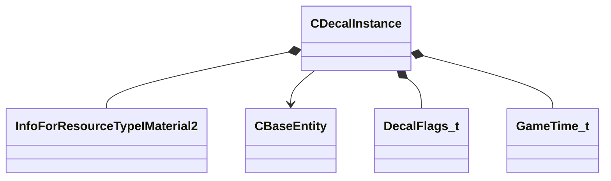

[Schemas](../../schemas.md) / [server](../server.md) / CDecalInstance

# CDecalInstance

> Source: **Build 26144732** · 2026-10-22 · `windows-x86_64` · schema `0.12.0`

**Kind:** class · **Size:** 264 bytes (`0x108`) · **Align:** 8 · **Module:** server

**Relationships:**

## Memory layout

28 fields (28 declared here, 0 inherited). Offsets are absolute from the object base.

| Offset | Field | Type | From | Annotations |
|--------|-------|------|------|-------------|
| `0x0` | `m_sDecalGroup` | CGlobalSymbol |  |  |
| `0x8` | `m_hMaterial` | CStrongHandle< [InfoForResourceTypeIMaterial2](../resourcesystem/InfoForResourceTypeIMaterial2.md) > |  |  |
| `0x10` | `m_sSequenceName` | CUtlStringToken |  |  |
| `0x14` | `m_hEntity` | CHandle< [CBaseEntity](../server/CBaseEntity.md) > |  |  |
| `0x18` | `m_nBoneIndex` | int32 |  |  |
| `0x1c` | `m_nTriangleIndex` | int32 |  |  |
| `0x20` | `m_vPositionLS` | Vector |  |  |
| `0x2c` | `m_vPositionOS` | Vector |  |  |
| `0x38` | `m_vNormalLS` | Vector |  |  |
| `0x44` | `m_vNormalOS` | Vector |  |  |
| `0x50` | `m_vSAxisLS` | Vector |  |  |
| `0x5c` | `m_nFlags` | [DecalFlags_t](../server/DecalFlags_t.md) |  |  |
| `0x60` | `m_Color` | Color |  |  |
| `0x64` | `m_flWidth` | float32 |  |  |
| `0x68` | `m_flHeight` | float32 |  |  |
| `0x6c` | `m_flDepth` | float32 |  |  |
| `0x70` | `m_mTransform` | matrix3x4_t |  |  |
| `0xa0` | `m_mLocalToTriangle` | matrix3x4_t |  |  |
| `0xd0` | `m_flAnimationScale` | float32 |  |  |
| `0xd4` | `m_flAnimationStartTime` | float32 |  |  |
| `0xd8` | `m_flPlaceTime` | [GameTime_t](../entity2/GameTime_t.md) |  |  |
| `0xdc` | `m_flFadeStartTime` | float32 |  |  |
| `0xe0` | `m_flFadeDuration` | float32 |  |  |
| `0xe4` | `m_flLightingOriginOffset` | float32 |  |  |
| `0xf8` | `m_flBoundingRadiusSqr` | float32 |  |  |
| `0xfc` | `m_nSequenceIndex` | int16 |  | `MNotSaved` |
| `0xfe` | `m_bIsAdjacent` | bool |  | `MNotSaved` |
| `0xff` | `m_bDoDecalLightmapping` | bool |  |  |

KV3 class defaults

<pre>{
	&quot;m_sDecalGroup&quot;: &quot;&quot;,
	&quot;m_hMaterial&quot;: &quot;&quot;,
	&quot;m_sSequenceName&quot;: &quot;&quot;,
	&quot;m_hEntity&quot;: null,
	&quot;m_nBoneIndex&quot;: -1,
	&quot;m_nTriangleIndex&quot;: -1,
	&quot;m_vPositionLS&quot;:
	[
		0.000000,
		0.000000,
		0.000000
	],
	&quot;m_vPositionOS&quot;:
	[
		0.000000,
		0.000000,
		0.000000
	],
	&quot;m_vNormalLS&quot;:
	[
		0.000000,
		0.000000,
		0.000000
	],
	&quot;m_vNormalOS&quot;:
	[
		0.000000,
		0.000000,
		0.000000
	],
	&quot;m_vSAxisLS&quot;:
	[
		340282346638528859811704183484516925440.000000,
		340282346638528859811704183484516925440.000000,
		340282346638528859811704183484516925440.000000
	],
	&quot;m_nFlags&quot;: &quot;&quot;,
	&quot;m_Color&quot;:
	[
		0,
		0,
		0,
		0
	],
	&quot;m_flWidth&quot;: 0.000000,
	&quot;m_flHeight&quot;: 0.000000,
	&quot;m_flDepth&quot;: 0.000000,
	&quot;m_mTransform&quot;:
	[
		0.000000,
		0.000000,
		0.000000,
		0.000000,
		0.000000,
		0.000000,
		0.000000,
		0.000000,
		0.000000,
		0.000000,
		0.000000,
		0.000000
	],
	&quot;m_mLocalToTriangle&quot;:
	[
		1.000000,
		0.000000,
		0.000000,
		0.000000,
		0.000000,
		1.000000,
		0.000000,
		0.000000,
		0.000000,
		0.000000,
		1.000000,
		0.000000
	],
	&quot;m_flAnimationScale&quot;: 0.000000,
	&quot;m_flAnimationStartTime&quot;: 0.000000,
	&quot;m_flPlaceTime&quot;: null,
	&quot;m_flFadeStartTime&quot;: 0.000000,
	&quot;m_flFadeDuration&quot;: 0.000000,
	&quot;m_flLightingOriginOffset&quot;: 0.000000,
	&quot;m_flBoundingRadiusSqr&quot;: 0.000000,
	&quot;m_bDoDecalLightmapping&quot;: false
}</pre>

