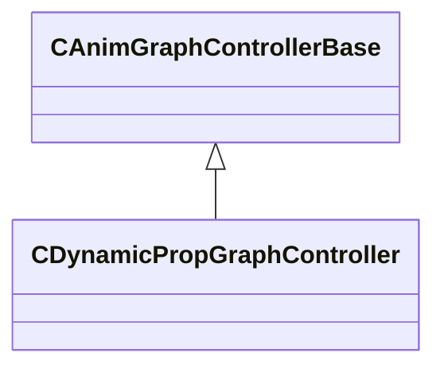

[Schemas](../../schemas.md) / [server](../server.md) / CDynamicPropGraphController

# CDynamicPropGraphController

> Source: **Build 26281801** · 2026-10-28 · `windows-x86_64` · schema `0.13.0`

**Kind:** class · **Size:** 216 bytes (`0xd8`) · **Align:** 8 · **Module:** server

**Inherits from:** [CAnimGraphControllerBase](../server/CAnimGraphControllerBase.md)

**Relationships:**

## Memory layout

2 fields (1 declared here, 1 inherited). Offsets are absolute from the object base.

| Offset | Field | Type | From | Annotations |
|--------|-------|------|------|-------------|
| `0x4c` | `m_hExternalGraph` | [ExternalAnimGraphHandle_t](../server/ExternalAnimGraphHandle_t.md) | [CAnimGraphControllerBase](../server/CAnimGraphControllerBase.md) |  |
| `0xc0` | `m_sActionState` | CAnimGraph2ParamOptionalRef< CGlobalSymbol > |  |  |

KV3 class defaults

<pre>{
	&quot;_class&quot;: &quot;CDynamicPropGraphController&quot;,
	&quot;m_hExternalGraph&quot;: 4294967295,
	&quot;m_sActionState&quot;: null
}</pre>

