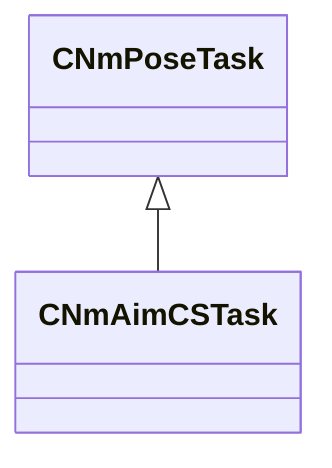

[Schemas](../../schemas.md) / [server](../server.md) / CNmAimCSTask

# CNmAimCSTask

> Source: **Build 26748068** · 2026-11-18 · `windows-x86_64` · schema `0.13.0`

**Kind:** class · **Size:** 496 bytes (`0x1f0`) · **Align:** 16 · **Module:** server

**Inherits from:** [CNmPoseTask](../animlib/CNmPoseTask.md)

**Relationships:**

## Memory layout

No schema-visible fields (496 bytes of opaque storage).
