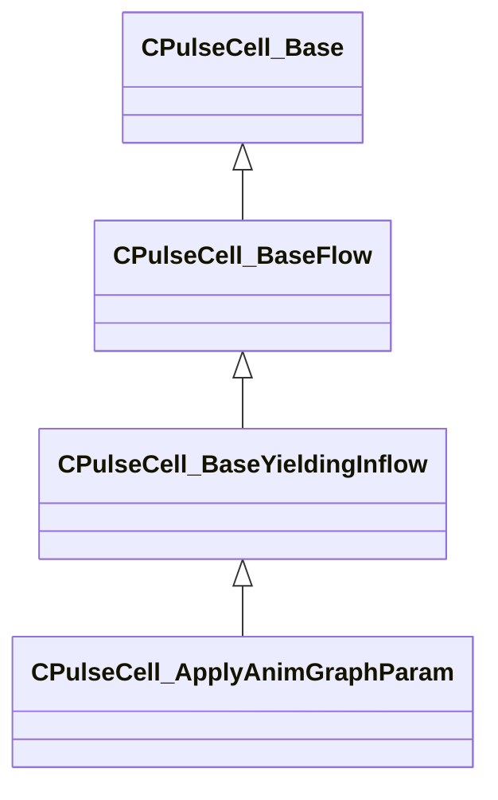

[Schemas](../../schemas.md) / [server](../server.md) / CPulseCell_ApplyAnimGraphParam

# CPulseCell_ApplyAnimGraphParam

> Source: **Build 26144732** · 2026-10-22 · `windows-x86_64` · schema `0.12.0`

**Kind:** class · **Size:** 360 bytes (`0x168`) · **Align:** 8 · **Module:** server

**Inherits from:** [CPulseCell_BaseYieldingInflow](../pulse_runtime_lib/CPulseCell_BaseYieldingInflow.md)

**Metadata:** `MPropertyDescription Sets a graph param and updates it every tick, as long as the cursor is active on this node`, `MPropertyFriendlyName Apply a graph param onto an entity`

**Relationships:**

## Memory layout

4 fields (1 declared here, 3 inherited). Offsets are absolute from the object base.

| Offset | Field | Type | From | Annotations |
|--------|-------|------|------|-------------|
| `0x8` | `m_nEditorNodeID` | [PulseDocNodeID_t](../pulse_runtime_lib/PulseDocNodeID_t.md) | [CPulseCell_Base](../pulse_runtime_lib/CPulseCell_Base.md) | `MFgdFromSchemaCompletelySkipField` |
| `0x48` | `m_BaseFlow_OnAfterCancel` | [CPulse_ResumePoint](../pulse_runtime_lib/CPulse_ResumePoint.md) | [CPulseCell_BaseYieldingInflow](../pulse_runtime_lib/CPulseCell_BaseYieldingInflow.md) | `MPulseFGDSkipField` |
| `0x90` | `m_BaseFlow_WhileActive` | [CPulse_ResumePoint](../pulse_runtime_lib/CPulse_ResumePoint.md) | [CPulseCell_BaseYieldingInflow](../pulse_runtime_lib/CPulseCell_BaseYieldingInflow.md) | `MPulseFGDSkipField` |
| `0xd8` | `m_value` | CPulseObservableExpression< CPulseVariant > |  |  |

KV3 class defaults

<pre>{
	&quot;_class&quot;: &quot;CPulseCell_ApplyAnimGraphParam&quot;,
	&quot;m_nEditorNodeID&quot;: -1,
	&quot;m_BaseFlow_OnAfterCancel&quot;:
	{
		&quot;m_SourceOutflowName&quot;: &quot;&quot;,
		&quot;m_nDestChunk&quot;: -1,
		&quot;m_nInstruction&quot;: -1
	},
	&quot;m_BaseFlow_WhileActive&quot;:
	{
		&quot;m_SourceOutflowName&quot;: &quot;&quot;,
		&quot;m_nDestChunk&quot;: -1,
		&quot;m_nInstruction&quot;: -1
	},
	&quot;m_value&quot;:
	{
		&quot;m_EvaluateConnection&quot;:
		{
			&quot;m_SourceOutflowName&quot;: &quot;&quot;,
			&quot;m_nDestChunk&quot;: -1,
			&quot;m_nInstruction&quot;: -1
		},
		&quot;m_DependentObservableVars&quot;:
		[
		],
		&quot;m_DependentObservableBlackboardReferences&quot;:
		[
		],
		&quot;m_DependentObservableTempVars&quot;:
		[
		]
	}
}</pre>

