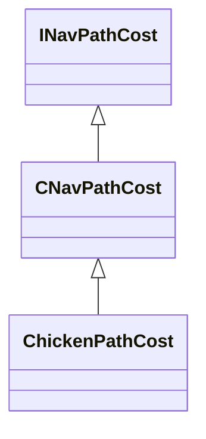

[Schemas](../../schemas.md) / [server](../server.md) / ChickenPathCost

# ChickenPathCost

> Source: **Build 25947352** · 2026-10-15 · `windows-x86_64` · schema `0.12.0`

**Kind:** class · **Size:** 48 bytes (`0x30`) · **Align:** 8 · **Module:** server

**Inherits from:** [CNavPathCost](../navlib/CNavPathCost.md)

**Relationships:**

## Memory layout

13 fields (0 declared here, 13 inherited). Offsets are absolute from the object base.

| Offset | Field | Type | From | Annotations |
|--------|-------|------|------|-------------|
| `0x8` | `m_navHull` | [NavHull_t](../navlib/NavHull_t.md) | [INavPathCost](../navlib/INavPathCost.md) |  |
| `0x10` | `m_bAllowLadders` | bool | [CNavPathCost](../navlib/CNavPathCost.md) |  |
| `0x11` | `m_bCanFly` | bool | [CNavPathCost](../navlib/CNavPathCost.md) |  |
| `0x12` | `m_bCanSwim` | bool | [CNavPathCost](../navlib/CNavPathCost.md) |  |
| `0x14` | `m_flWaterToGroundMaxHeight` | float32 | [CNavPathCost](../navlib/CNavPathCost.md) |  |
| `0x18` | `m_flGroundToWaterMaxHeight` | float32 | [CNavPathCost](../navlib/CNavPathCost.md) |  |
| `0x1c` | `m_flGroundToWaterTransitionDistance` | float32 | [CNavPathCost](../navlib/CNavPathCost.md) |  |
| `0x20` | `m_flWaterToGroundTransitionDistance` | float32 | [CNavPathCost](../navlib/CNavPathCost.md) |  |
| `0x24` | `m_flFlyingTransitionTolerance` | float32 | [CNavPathCost](../navlib/CNavPathCost.md) |  |
| `0x28` | `m_bOptimizeFlySpacePathfinds` | bool | [CNavPathCost](../navlib/CNavPathCost.md) |  |
| `0x29` | `m_bStringPullFlySpacePathfinds` | bool | [CNavPathCost](../navlib/CNavPathCost.md) |  |
| `0x2a` | `m_bSupportsTransitions` | bool | [CNavPathCost](../navlib/CNavPathCost.md) |  |
| `0x2c` | `m_flTransitionPenalty` | float32 | [CNavPathCost](../navlib/CNavPathCost.md) |  |

KV3 class defaults

<pre>{
	&quot;_class&quot;: &quot;ChickenPathCost&quot;,
	&quot;m_navHull&quot;:
	{
		&quot;m_nHullIdx&quot;: 0
	},
	&quot;m_bAllowLadders&quot;: true,
	&quot;m_bCanFly&quot;: false,
	&quot;m_bCanSwim&quot;: false,
	&quot;m_flWaterToGroundMaxHeight&quot;: 100.000000,
	&quot;m_flGroundToWaterMaxHeight&quot;: 100.000000,
	&quot;m_flGroundToWaterTransitionDistance&quot;: -1.000000,
	&quot;m_flWaterToGroundTransitionDistance&quot;: -1.000000,
	&quot;m_flFlyingTransitionTolerance&quot;: 140.000000,
	&quot;m_bOptimizeFlySpacePathfinds&quot;: true,
	&quot;m_bStringPullFlySpacePathfinds&quot;: false,
	&quot;m_bSupportsTransitions&quot;: false,
	&quot;m_flTransitionPenalty&quot;: 200.000000
}</pre>

