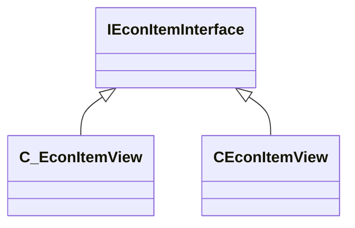

[Schemas](../../schemas.md) / [server](../server.md) / IEconItemInterface

# IEconItemInterface

> Source: **Build 25966348** · 2026-10-15 · `windows-x86_64` · schema `0.12.0`

**Kind:** class · **Size:** 8 bytes (`0x8`) · **Align:** n/a (unspecified) · **Module:** server

**Derived by:** [CEconItemView](../server/CEconItemView.md), [C_EconItemView](../client/C_EconItemView.md)

**Relationships:**

## Memory layout

No schema-visible fields (8 bytes of opaque storage).
