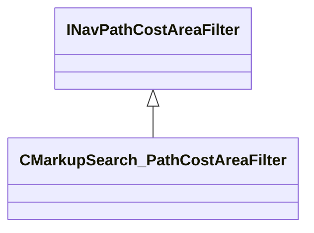

[Schemas](../../schemas.md) / [server](../server.md) / INavPathCostAreaFilter

# INavPathCostAreaFilter

> Source: **Build 26334290** · 2026-10-30 · `windows-x86_64` · schema `0.13.0`

**Kind:** class · **Size:** 8 bytes (`0x8`) · **Align:** n/a (unspecified) · **Module:** server

**Derived by:** [CMarkupSearch_PathCostAreaFilter](../server/CMarkupSearch_PathCostAreaFilter.md)

**Relationships:**

## Memory layout

No schema-visible fields (8 bytes of opaque storage).
