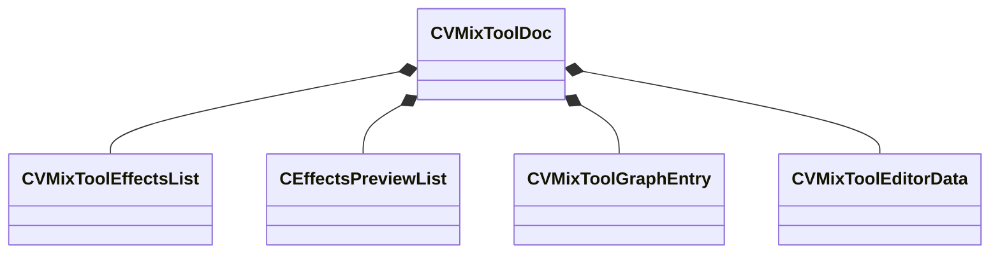

[Schemas](../../schemas.md) / [sounddoc_lib](../sounddoc_lib.md) / CVMixToolDoc

# CVMixToolDoc

> Source: **Build 25947352** · 2026-10-15 · `windows-x86_64` · schema `0.12.0`

**Kind:** class · **Size:** 112 bytes (`0x70`) · **Align:** 8 · **Module:** sounddoc_lib

**Relationships:**

## Memory layout

4 fields (4 declared here, 0 inherited). Offsets are absolute from the object base.

| Offset | Field | Type | From | Annotations |
|--------|-------|------|------|-------------|
| `0x0` | `m_dspPresets` | [CVMixToolEffectsList](../sounddoc_lib/CVMixToolEffectsList.md) |  | `MKV3TransferName dsp` |
| `0x20` | `m_effectsPreview` | [CEffectsPreviewList](../sounddoc_lib/CEffectsPreviewList.md) |  |  |
| `0x50` | `m_graphs` | CUtlVector< [CVMixToolGraphEntry](../sounddoc_lib/CVMixToolGraphEntry.md) > |  | `MKV3TransferName Graphs` |
| `0x68` | `m_editorData` | [CVMixToolEditorData](../sounddoc_lib/CVMixToolEditorData.md) |  | `MKV3TransferName Editor` |

KV3 class defaults

<pre>{
	&quot;dsp&quot;:
	{
		&quot;IsAutomaticDSP&quot;: false,
		&quot;presets&quot;:
		[
		]
	},
	&quot;m_effectsPreview&quot;:
	{
		&quot;m_previewGraphInput&quot;: &quot;&quot;,
		&quot;m_flMix&quot;: 1.000000,
		&quot;m_previewList&quot;:
		{
			&quot;m_sounds&quot;:
			[
			],
			&quot;m_bPreviewInGame&quot;: false
		}
	},
	&quot;Graphs&quot;:
	[
	],
	&quot;Editor&quot;:
	{
		&quot;SelectedGraph&quot;: -1,
		&quot;m_nSelectedEffectPreset&quot;: -1
	}
}</pre>

