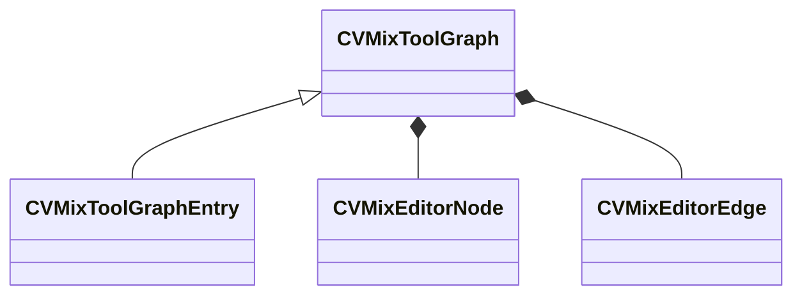

[Schemas](../../schemas.md) / [sounddoc_lib](../sounddoc_lib.md) / CVMixToolGraph

# CVMixToolGraph

> Source: **Build 26334290** · 2026-10-30 · `windows-x86_64` · schema `0.13.0`

**Kind:** class · **Size:** 72 bytes (`0x48`) · **Align:** 8 · **Module:** sounddoc_lib

**Derived by:** [CVMixToolGraphEntry](../sounddoc_lib/CVMixToolGraphEntry.md)

**Relationships:**

## Memory layout

6 fields (6 declared here, 0 inherited). Offsets are absolute from the object base.

| Offset | Field | Type | From | Annotations |
|--------|-------|------|------|-------------|
| `0x0` | `m_name` | CUtlString |  | `MKV3TransferName Name` |
| `0x8` | `m_nGraphOutputChannels` | int32 |  |  |
| `0xc` | `m_bIsMainGraph` | bool |  |  |
| `0x10` | `m_nPreviewNode` | int32 |  |  |
| `0x18` | `m_editorNodes` | CUtlVector< [CVMixEditorNode](../sounddoc_lib/CVMixEditorNode.md) > |  | `MKV3TransferName m_EditorNodes` |
| `0x30` | `m_editorEdges` | CUtlVector< [CVMixEditorEdge](../sounddoc_lib/CVMixEditorEdge.md) > |  | `MKV3TransferName m_EditorEdges` |

KV3 class defaults

<pre>{
	&quot;Name&quot;: &quot;&quot;,
	&quot;m_nGraphOutputChannels&quot;: -1,
	&quot;m_bIsMainGraph&quot;: false,
	&quot;m_nPreviewNode&quot;: 0,
	&quot;m_EditorNodes&quot;:
	[
	],
	&quot;m_EditorEdges&quot;:
	[
	]
}</pre>

