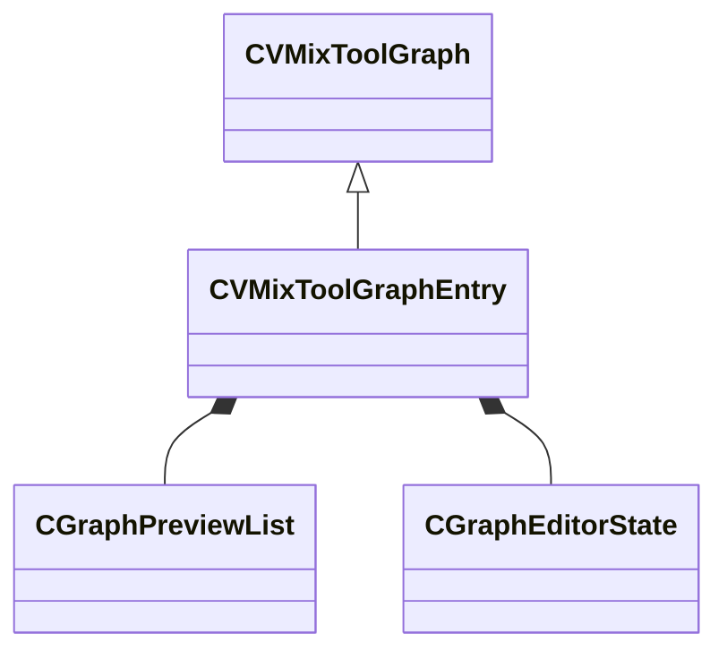

[Schemas](../../schemas.md) / [sounddoc_lib](../sounddoc_lib.md) / CVMixToolGraphEntry

# CVMixToolGraphEntry

> Source: **Build 25947352** · 2026-10-15 · `windows-x86_64` · schema `0.12.0`

**Kind:** class · **Size:** 152 bytes (`0x98`) · **Align:** 8 · **Module:** sounddoc_lib

**Inherits from:** [CVMixToolGraph](../sounddoc_lib/CVMixToolGraph.md)

**Relationships:**

## Memory layout

8 fields (2 declared here, 6 inherited). Offsets are absolute from the object base.

| Offset | Field | Type | From | Annotations |
|--------|-------|------|------|-------------|
| `0x0` | `m_name` | CUtlString | [CVMixToolGraph](../sounddoc_lib/CVMixToolGraph.md) | `MKV3TransferName Name` |
| `0x8` | `m_nGraphOutputChannels` | int32 | [CVMixToolGraph](../sounddoc_lib/CVMixToolGraph.md) |  |
| `0xc` | `m_bIsMainGraph` | bool | [CVMixToolGraph](../sounddoc_lib/CVMixToolGraph.md) |  |
| `0x10` | `m_nPreviewNode` | int32 | [CVMixToolGraph](../sounddoc_lib/CVMixToolGraph.md) |  |
| `0x18` | `m_editorNodes` | CUtlVector< [CVMixEditorNode](../sounddoc_lib/CVMixEditorNode.md) > | [CVMixToolGraph](../sounddoc_lib/CVMixToolGraph.md) | `MKV3TransferName m_EditorNodes` |
| `0x30` | `m_editorEdges` | CUtlVector< [CVMixEditorEdge](../sounddoc_lib/CVMixEditorEdge.md) > | [CVMixToolGraph](../sounddoc_lib/CVMixToolGraph.md) | `MKV3TransferName m_EditorEdges` |
| `0x48` | `m_graphPreview` | [CGraphPreviewList](../sounddoc_lib/CGraphPreviewList.md) |  |  |
| `0x70` | `m_editorState` | [CGraphEditorState](../sounddoc_lib/CGraphEditorState.md) |  | `MKV3TransferName m_EditorState` |

KV3 class defaults

<pre>{
	&quot;Name&quot;: &quot;&quot;,
	&quot;m_nGraphOutputChannels&quot;: -1,
	&quot;m_bIsMainGraph&quot;: false,
	&quot;m_nPreviewNode&quot;: 0,
	&quot;m_EditorNodes&quot;:
	[
	],
	&quot;m_EditorEdges&quot;:
	[
	],
	&quot;m_graphPreview&quot;:
	{
		&quot;m_flVolume&quot;: 1.000000,
		&quot;m_previewList&quot;:
		{
			&quot;m_sounds&quot;:
			[
			],
			&quot;m_bPreviewInGame&quot;: false
		}
	},
	&quot;m_EditorState&quot;:
	{
		&quot;m_viewConfig&quot;:
		{
			&quot;XAxis&quot;:
			{
				&quot;pos&quot;: 0.000000,
				&quot;scrollpos&quot;: 0,
				&quot;min&quot;: 0.000000,
				&quot;max&quot;: 1.000000,
				&quot;scale&quot;: 1.000000
			},
			&quot;YAxis&quot;:
			{
				&quot;pos&quot;: 0.000000,
				&quot;scrollpos&quot;: 0,
				&quot;min&quot;: 0.000000,
				&quot;max&quot;: 1.000000,
				&quot;scale&quot;: 1.000000
			}
		}
	}
}</pre>

