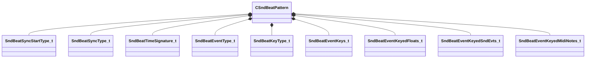

[Schemas](../../schemas.md) / [soundsystem](../soundsystem.md) / CSndBeatPattern

# CSndBeatPattern

> Source: **Build 26281801** · 2026-10-28 · `windows-x86_64` · schema `0.13.0`

**Kind:** class · **Size:** 184 bytes (`0xb8`) · **Align:** 8 · **Module:** soundsystem

**Metadata:** `MPropertyArrayElementNameKey m_name`, `MVDataAnonymousNode`, `MVDataOutlinerNameExpr m_name`

**Relationships:**

## Memory layout

17 fields (17 declared here, 0 inherited). Offsets are absolute from the object base.

| Offset | Field | Type | From | Annotations |
|--------|-------|------|------|-------------|
| `0x0` | `m_name` | CUtlString |  | `MPropertyFriendlyName Pattern Name` |
| `0xc` | `m_flSyncPriority` | float32 |  | `MPropertyFriendlyName Pattern Priority` |
| `0x10` | `m_syncStartType` | [SndBeatSyncStartType_t](../soundsystem/SndBeatSyncStartType_t.md) |  | `MPropertyFriendlyName Sync Start Type` |
| `0x14` | `m_syncType` | [SndBeatSyncType_t](../soundsystem/SndBeatSyncType_t.md) |  | `MPropertyFriendlyName Sync Type` |
| `0x18` | `m_timeSignature` | [SndBeatTimeSignature_t](../soundsystem/SndBeatTimeSignature_t.md) |  | `MPropertyFriendlyName Time Signature` |
| `0x20` | `m_flLength` | float32 |  | `MPropertyFriendlyName Length (beats)` |
| `0x24` | `m_bLooping` | bool |  | `MPropertyFriendlyName Looping` |
| `0x28` | `m_playEventType` | [SndBeatEventType_t](../soundsystem/SndBeatEventType_t.md) |  | `MPropertyFriendlyName Playback Event Type` `MPropertyStartGroup Playback` |
| `0x2c` | `m_flPlayBeatMult` | float32 |  | `MPropertyFriendlyName Playback Event Beat/Bar/Phrase/Length Multiplier` `MPropertySuppressExpr m_playEventType == eSndBeatEventTypeKeys` |
| `0x30` | `m_playKeyType` | [SndBeatKeyType_t](../soundsystem/SndBeatKeyType_t.md) |  | `MPropertyFriendlyName Key Type` `MPropertySuppressExpr m_playEventType != eSndBeatEventTypeKeys` |
| `0x38` | `m_vecPatternKeys` | CUtlVector< [SndBeatEventKeys_t](../soundsystem/SndBeatEventKeys_t.md) > |  | `MPropertySuppressExpr m_playKeyType != eSndBeatPatternTypeKeys` |
| `0x50` | `m_vecPatternFloats` | CUtlVector< [SndBeatEventKeyedFloats_t](../soundsystem/SndBeatEventKeyedFloats_t.md) > |  | `MPropertySuppressExpr m_playKeyType != eSndBeatPatternTypeKeyedFloats` |
| `0x68` | `m_vecPatternSndEvts` | CUtlVector< [SndBeatEventKeyedSndEvts_t](../soundsystem/SndBeatEventKeyedSndEvts_t.md) > |  | `MPropertySuppressExpr m_playKeyType != eSndBeatPatternTypeKeyedSndEvts` |
| `0x80` | `m_vecPatternMidi` | CUtlVector< [SndBeatEventKeyedMidiNotes_t](../soundsystem/SndBeatEventKeyedMidiNotes_t.md) > |  | `MPropertySuppressExpr m_playKeyType != eSndBeatPatternTypeKeyedMidi` |
| `0x98` | `m_syncEventType` | [SndBeatEventType_t](../soundsystem/SndBeatEventType_t.md) |  | `MPropertyFriendlyName Queue Event Type` `MPropertyStartGroup Queue` |
| `0x9c` | `m_flSyncBeatMult` | float32 |  | `MPropertyFriendlyName Queue Beat/Bar/Phrase/Length Multiplier` `MPropertySuppressExpr m_syncEventType == eSndBeatEventTypeKeys` |
| `0xa0` | `m_vecSyncPatternKeys` | CUtlVector< [SndBeatEventKeys_t](../soundsystem/SndBeatEventKeys_t.md) > |  | `MPropertySuppressExpr m_syncEventType != eSndBeatEventTypeKeys` |

KV3 class defaults

<pre>{
	&quot;m_name&quot;: &quot;&quot;,
	&quot;m_flSyncPriority&quot;: 0.000000,
	&quot;m_syncStartType&quot;: &quot;eSndBeatSyncStartTypeImmediate&quot;,
	&quot;m_syncType&quot;: &quot;eSndBeatSyncTypeReset&quot;,
	&quot;m_timeSignature&quot;:
	{
		&quot;nNumerator&quot;: 4,
		&quot;nDenominator&quot;: 4
	},
	&quot;m_flLength&quot;: 4.000000,
	&quot;m_bLooping&quot;: false,
	&quot;m_playEventType&quot;: &quot;eSndBeatEventTypeBeat&quot;,
	&quot;m_flPlayBeatMult&quot;: 1.000000,
	&quot;m_playKeyType&quot;: &quot;eSndBeatPatternTypeKeys&quot;,
	&quot;m_vecPatternKeys&quot;:
	[
	],
	&quot;m_vecPatternFloats&quot;:
	[
	],
	&quot;m_vecPatternSndEvts&quot;:
	[
	],
	&quot;m_vecPatternMidi&quot;:
	[
	],
	&quot;m_syncEventType&quot;: &quot;eSndBeatEventTypeBeat&quot;,
	&quot;m_flSyncBeatMult&quot;: 1.000000,
	&quot;m_vecSyncPatternKeys&quot;:
	[
	]
}</pre>

