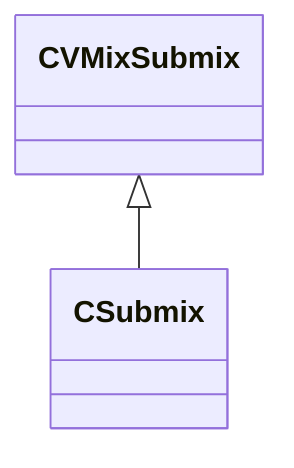

[Schemas](../../schemas.md) / [soundsystem](../soundsystem.md) / CSubmix

# CSubmix

> Source: **Build 26334290** · 2026-10-30 · `windows-x86_64` · schema `0.13.0`

**Kind:** class · **Size:** 80 bytes (`0x50`) · **Align:** 8 · **Module:** soundsystem

**Inherits from:** [CVMixSubmix](../soundsystem_lowlevel/CVMixSubmix.md)

**Relationships:**

## Memory layout

7 fields (0 declared here, 7 inherited). Offsets are absolute from the object base.

| Offset | Field | Type | From | Annotations |
|--------|-------|------|------|-------------|
| `0x0` | `m_name` | CUtlString | [CVMixSubmix](../soundsystem_lowlevel/CVMixSubmix.md) |  |
| `0x8` | `m_SendNames` | CUtlString[4] | [CVMixSubmix](../soundsystem_lowlevel/CVMixSubmix.md) |  |
| `0x2c` | `m_nSoloNameHash` | uint32 | [CVMixSubmix](../soundsystem_lowlevel/CVMixSubmix.md) |  |
| `0x30` | `m_nChannels` | int32 | [CVMixSubmix](../soundsystem_lowlevel/CVMixSubmix.md) |  |
| `0x34` | `m_nSendOperator` | [VMixSendOperator_t](../soundsystem_lowlevel/VMixSendOperator_t.md) | [CVMixSubmix](../soundsystem_lowlevel/CVMixSubmix.md) | `MPropertyFriendlyName Send Operator` |
| `0x36` | `m_nMixDownRule` | [VMixMixDownRule_t](../soundsystem_lowlevel/VMixMixDownRule_t.md) | [CVMixSubmix](../soundsystem_lowlevel/CVMixSubmix.md) |  |
| `0x37` | `m_nUpMixRule` | [VMixUpMixRule_t](../soundsystem_lowlevel/VMixUpMixRule_t.md) | [CVMixSubmix](../soundsystem_lowlevel/CVMixSubmix.md) |  |

KV3 class defaults

<pre>{
	&quot;m_name&quot;: &quot;&quot;,
	&quot;m_SendNames&quot;:
	[
		&quot;&quot;,
		&quot;&quot;,
		&quot;&quot;,
		&quot;&quot;
	],
	&quot;m_nSoloNameHash&quot;: 0,
	&quot;m_nChannels&quot;: -1,
	&quot;m_nSendOperator&quot;: &quot;NAMED_SEND&quot;,
	&quot;m_nMixDownRule&quot;: &quot;SUM&quot;,
	&quot;m_nUpMixRule&quot;: &quot;DIVIDE&quot;
}</pre>

