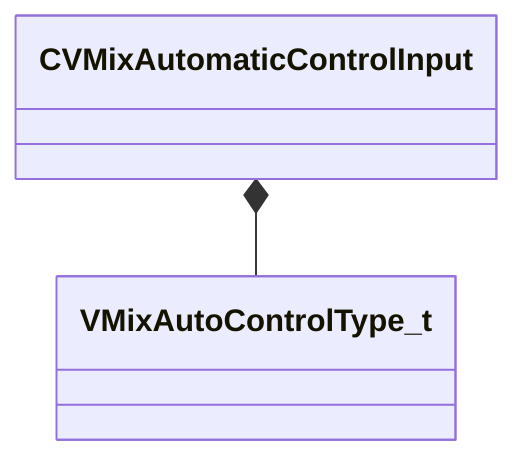

[Schemas](../../schemas.md) / [soundsystem_lowlevel](../soundsystem_lowlevel.md) / CVMixAutomaticControlInput

# CVMixAutomaticControlInput

> Source: **Build 25966348** · 2026-10-15 · `windows-x86_64` · schema `0.12.0`

**Kind:** class · **Size:** 24 bytes (`0x18`) · **Align:** 8 · **Module:** soundsystem_lowlevel

**Relationships:**

## Memory layout

3 fields (3 declared here, 0 inherited). Offsets are absolute from the object base.

| Offset | Field | Type | From | Annotations |
|--------|-------|------|------|-------------|
| `0x0` | `m_name` | CUtlString |  |  |
| `0xc` | `m_nGraphInputIndex` | int32 |  |  |
| `0x10` | `m_nControlType` | [VMixAutoControlType_t](../soundsystem_lowlevel/VMixAutoControlType_t.md) |  |  |

KV3 class defaults

<pre>{
	&quot;m_name&quot;: &quot;&quot;,
	&quot;m_nGraphInputIndex&quot;: -1,
	&quot;m_nControlType&quot;: &quot;VMIX_AUTO_SEND_LEVEL&quot;
}</pre>

