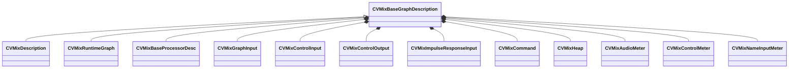

[Schemas](../../schemas.md) / [soundsystem_lowlevel](../soundsystem_lowlevel.md) / CVMixBaseGraphDescription

# CVMixBaseGraphDescription

> Source: **Build 26281801** · 2026-10-28 · `windows-x86_64` · schema `0.13.0`

**Kind:** class · **Size:** 208 bytes (`0xd0`) · **Align:** 8 · **Module:** soundsystem_lowlevel

**Derived by:** [CVMixDescription](../soundsystem/CVMixDescription.md), [CVMixRuntimeGraph](../soundsystem_lowlevel/CVMixRuntimeGraph.md)

**Relationships:**

## Memory layout

15 fields (15 declared here, 0 inherited). Offsets are absolute from the object base.

| Offset | Field | Type | From | Annotations |
|--------|-------|------|------|-------------|
| `0x0` | `m_name` | CUtlString |  | `MKV3TransferName Name` |
| `0x8` | `m_nGraphOutputChannels` | int32 |  |  |
| `0xc` | `m_bIsMainGraph` | bool |  |  |
| `0x10` | `m_processorNodes` | CUtlLeanVector< std::unique_ptr< [CVMixBaseProcessorDesc](../soundsystem_lowlevel/CVMixBaseProcessorDesc.md) > > |  | `MKV3TransferName m_Processors` |
| `0x20` | `m_graphInputs` | CUtlLeanVector< [CVMixGraphInput](../soundsystem_lowlevel/CVMixGraphInput.md) > |  |  |
| `0x30` | `m_controlTransientInputs` | CUtlLeanVector< [CVMixControlInput](../soundsystem_lowlevel/CVMixControlInput.md) > |  |  |
| `0x40` | `m_controlOutputs` | CUtlLeanVector< [CVMixControlOutput](../soundsystem_lowlevel/CVMixControlOutput.md) > |  |  |
| `0x50` | `m_impulseResponseInputs` | CUtlLeanVector< [CVMixImpulseResponseInput](../soundsystem_lowlevel/CVMixImpulseResponseInput.md) > |  |  |
| `0x60` | `m_mixCommands` | CUtlLeanVector< [CVMixCommand](../soundsystem_lowlevel/CVMixCommand.md) > |  | `MKV3TransferName m_MixCommands` |
| `0x70` | `m_heap` | [CVMixHeap](../soundsystem_lowlevel/CVMixHeap.md) |  |  |
| `0x80` | `m_audioMeters` | CUtlLeanVector< [CVMixAudioMeter](../soundsystem_lowlevel/CVMixAudioMeter.md) > |  |  |
| `0x90` | `m_controlMeters` | CUtlLeanVector< [CVMixControlMeter](../soundsystem_lowlevel/CVMixControlMeter.md) > |  |  |
| `0xa0` | `m_nameInputMeters` | CUtlLeanVector< [CVMixNameInputMeter](../soundsystem_lowlevel/CVMixNameInputMeter.md) > |  |  |
| `0xb0` | `m_additionalOutputs` | CUtlLeanVector< [CVMixAdditionalOutput](../soundsystem_lowlevel/CVMixAdditionalOutput.md) > |  |  |
| `0xc0` | `m_automaticControlInputs` | CUtlLeanVector< [CVMixAutomaticControlInput](../soundsystem_lowlevel/CVMixAutomaticControlInput.md) > |  |  |

KV3 class defaults

<pre>{
	&quot;Name&quot;: &quot;&quot;,
	&quot;m_nGraphOutputChannels&quot;: -1,
	&quot;m_bIsMainGraph&quot;: false,
	&quot;m_Processors&quot;:
	[
	],
	&quot;m_graphInputs&quot;:
	[
	],
	&quot;m_controlTransientInputs&quot;:
	[
	],
	&quot;m_controlOutputs&quot;:
	[
	],
	&quot;m_impulseResponseInputs&quot;:
	[
	],
	&quot;m_MixCommands&quot;:
	[
	],
	&quot;m_heap&quot;:
	{
		&quot;m_storage&quot;:
		[
		]
	},
	&quot;m_audioMeters&quot;:
	[
	],
	&quot;m_controlMeters&quot;:
	[
	],
	&quot;m_nameInputMeters&quot;:
	[
	],
	&quot;m_additionalOutputs&quot;:
	[
	],
	&quot;m_automaticControlInputs&quot;:
	[
	]
}</pre>

