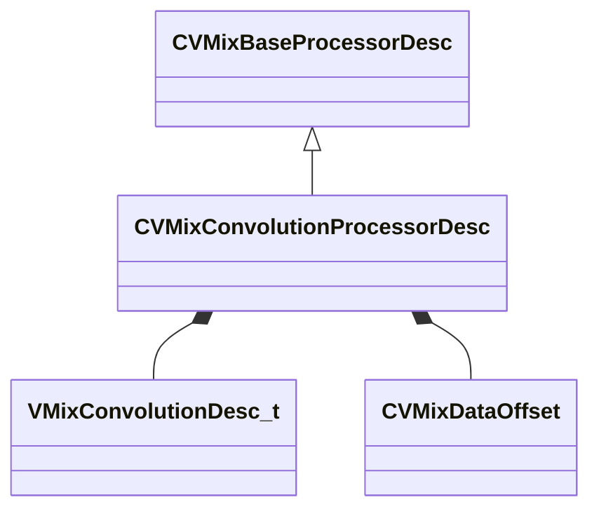

[Schemas](../../schemas.md) / [soundsystem_lowlevel](../soundsystem_lowlevel.md) / CVMixConvolutionProcessorDesc

# CVMixConvolutionProcessorDesc

> Source: **Build 26144732** · 2026-10-22 · `windows-x86_64` · schema `0.12.0`

**Kind:** class · **Size:** 80 bytes (`0x50`) · **Align:** 8 · **Module:** soundsystem_lowlevel

**Inherits from:** [CVMixBaseProcessorDesc](../soundsystem_lowlevel/CVMixBaseProcessorDesc.md)

**Relationships:**

## Memory layout

9 fields (2 declared here, 7 inherited). Offsets are absolute from the object base.

| Offset | Field | Type | From | Annotations |
|--------|-------|------|------|-------------|
| `0x8` | `m_name` | CUtlString | [CVMixBaseProcessorDesc](../soundsystem_lowlevel/CVMixBaseProcessorDesc.md) |  |
| `0x10` | `m_nDebugId` | uint32 | [CVMixBaseProcessorDesc](../soundsystem_lowlevel/CVMixBaseProcessorDesc.md) |  |
| `0x14` | `m_flxfade` | float32 | [CVMixBaseProcessorDesc](../soundsystem_lowlevel/CVMixBaseProcessorDesc.md) |  |
| `0x18` | `m_nChannels` | int32 | [CVMixBaseProcessorDesc](../soundsystem_lowlevel/CVMixBaseProcessorDesc.md) |  |
| `0x1c` | `m_bDebugBypass` | bool | [CVMixBaseProcessorDesc](../soundsystem_lowlevel/CVMixBaseProcessorDesc.md) |  |
| `0x20` | `m_paramEnable` | [CVMixParameterFloat](../soundsystem_lowlevel/CVMixParameterFloat.md) | [CVMixBaseProcessorDesc](../soundsystem_lowlevel/CVMixBaseProcessorDesc.md) |  |
| `0x24` | `m_paramMix` | [CVMixParameterFloat](../soundsystem_lowlevel/CVMixParameterFloat.md) | [CVMixBaseProcessorDesc](../soundsystem_lowlevel/CVMixBaseProcessorDesc.md) |  |
| `0x28` | `m_desc` | [VMixConvolutionDesc_t](../soundsystem_lowlevel/VMixConvolutionDesc_t.md) |  |  |
| `0x48` | `m_paramImpulseResponse` | [CVMixDataOffset](../soundsystem_lowlevel/CVMixDataOffset.md) |  |  |

KV3 class defaults

<pre>{
	&quot;_class&quot;: &quot;CVMixConvolutionProcessorDesc&quot;,
	&quot;m_name&quot;: &quot;&quot;,
	&quot;m_nDebugId&quot;: 0,
	&quot;m_flxfade&quot;: 0.100000,
	&quot;m_nChannels&quot;: -1,
	&quot;m_bDebugBypass&quot;: false,
	&quot;m_paramEnable&quot;:
	{
		&quot;m_offset&quot;:
		{
			&quot;category&quot;: &quot;NULL_POINTER&quot;,
			&quot;type&quot;: &quot;VO_CHAR&quot;,
			&quot;index&quot;: 0
		}
	},
	&quot;m_paramMix&quot;:
	{
		&quot;m_offset&quot;:
		{
			&quot;category&quot;: &quot;NULL_POINTER&quot;,
			&quot;type&quot;: &quot;VO_CHAR&quot;,
			&quot;index&quot;: 0
		}
	},
	&quot;m_desc&quot;:
	{
		&quot;m_fldbGain&quot;: -12.000000,
		&quot;m_flPreDelayMS&quot;: 0.000000,
		&quot;m_flWetMix&quot;: 1.000000,
		&quot;m_fldbLow&quot;: 0.000000,
		&quot;m_fldbMid&quot;: 0.000000,
		&quot;m_fldbHigh&quot;: 0.000000,
		&quot;m_flLowCutoffFreq&quot;: 1500.000000,
		&quot;m_flHighCutoffFreq&quot;: 7500.000000
	},
	&quot;m_paramImpulseResponse&quot;:
	{
		&quot;category&quot;: &quot;NULL_POINTER&quot;,
		&quot;type&quot;: &quot;VO_CHAR&quot;,
		&quot;index&quot;: 0
	}
}</pre>

