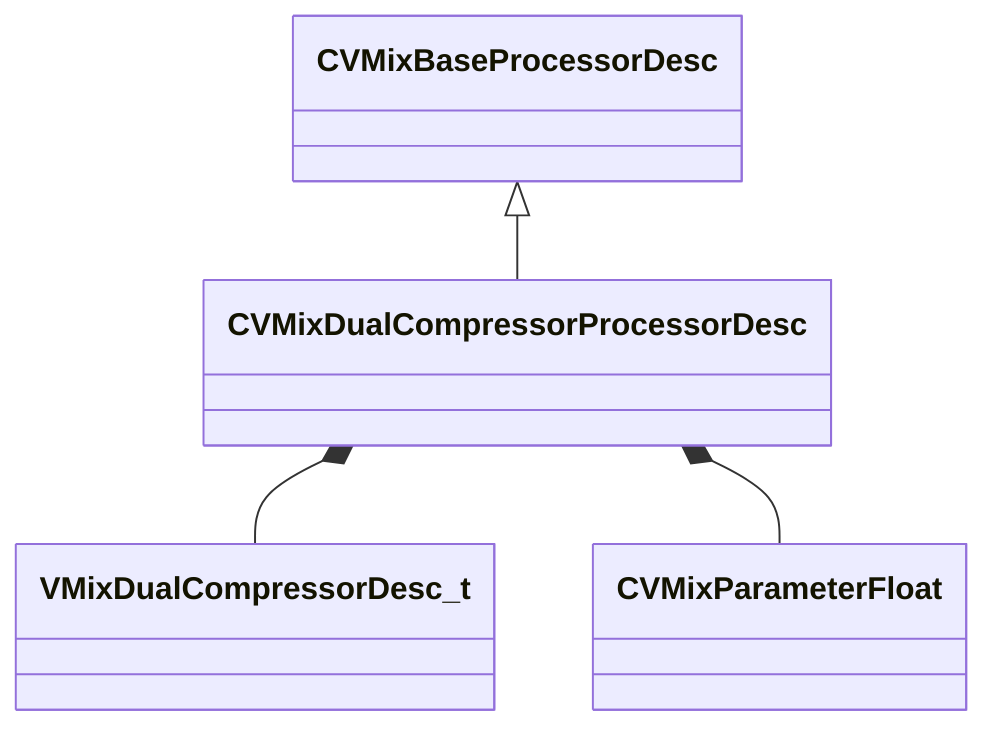

[Schemas](../../schemas.md) / [soundsystem_lowlevel](../soundsystem_lowlevel.md) / CVMixDualCompressorProcessorDesc

# CVMixDualCompressorProcessorDesc

> Source: **Build 26144732** · 2026-10-22 · `windows-x86_64` · schema `0.12.0`

**Kind:** class · **Size:** 104 bytes (`0x68`) · **Align:** 8 · **Module:** soundsystem_lowlevel

**Inherits from:** [CVMixBaseProcessorDesc](../soundsystem_lowlevel/CVMixBaseProcessorDesc.md)

**Relationships:**

## Memory layout

11 fields (4 declared here, 7 inherited). Offsets are absolute from the object base.

| Offset | Field | Type | From | Annotations |
|--------|-------|------|------|-------------|
| `0x8` | `m_name` | CUtlString | [CVMixBaseProcessorDesc](../soundsystem_lowlevel/CVMixBaseProcessorDesc.md) |  |
| `0x10` | `m_nDebugId` | uint32 | [CVMixBaseProcessorDesc](../soundsystem_lowlevel/CVMixBaseProcessorDesc.md) |  |
| `0x14` | `m_flxfade` | float32 | [CVMixBaseProcessorDesc](../soundsystem_lowlevel/CVMixBaseProcessorDesc.md) |  |
| `0x18` | `m_nChannels` | int32 | [CVMixBaseProcessorDesc](../soundsystem_lowlevel/CVMixBaseProcessorDesc.md) |  |
| `0x1c` | `m_bDebugBypass` | bool | [CVMixBaseProcessorDesc](../soundsystem_lowlevel/CVMixBaseProcessorDesc.md) |  |
| `0x20` | `m_paramEnable` | [CVMixParameterFloat](../soundsystem_lowlevel/CVMixParameterFloat.md) | [CVMixBaseProcessorDesc](../soundsystem_lowlevel/CVMixBaseProcessorDesc.md) |  |
| `0x24` | `m_paramMix` | [CVMixParameterFloat](../soundsystem_lowlevel/CVMixParameterFloat.md) | [CVMixBaseProcessorDesc](../soundsystem_lowlevel/CVMixBaseProcessorDesc.md) |  |
| `0x28` | `m_desc` | [VMixDualCompressorDesc_t](../soundsystem_lowlevel/VMixDualCompressorDesc_t.md) |  |  |
| `0x5c` | `m_outParamLevel` | [CVMixParameterFloat](../soundsystem_lowlevel/CVMixParameterFloat.md) |  |  |
| `0x60` | `m_outParamdBLevel` | [CVMixParameterFloat](../soundsystem_lowlevel/CVMixParameterFloat.md) |  |  |
| `0x64` | `m_outParamReduction` | [CVMixParameterFloat](../soundsystem_lowlevel/CVMixParameterFloat.md) |  |  |

KV3 class defaults

<pre>{
	&quot;_class&quot;: &quot;CVMixDualCompressorProcessorDesc&quot;,
	&quot;m_name&quot;: &quot;&quot;,
	&quot;m_nDebugId&quot;: 0,
	&quot;m_flxfade&quot;: 0.100000,
	&quot;m_nChannels&quot;: -1,
	&quot;m_bDebugBypass&quot;: false,
	&quot;m_paramEnable&quot;:
	{
		&quot;m_offset&quot;:
		{
			&quot;category&quot;: &quot;NULL_POINTER&quot;,
			&quot;type&quot;: &quot;VO_CHAR&quot;,
			&quot;index&quot;: 0
		}
	},
	&quot;m_paramMix&quot;:
	{
		&quot;m_offset&quot;:
		{
			&quot;category&quot;: &quot;NULL_POINTER&quot;,
			&quot;type&quot;: &quot;VO_CHAR&quot;,
			&quot;index&quot;: 0
		}
	},
	&quot;m_desc&quot;:
	{
		&quot;m_flRMSTimeMS&quot;: 300.000000,
		&quot;m_fldbKneeWidth&quot;: 0.000000,
		&quot;m_flWetMix&quot;: 1.000000,
		&quot;m_bPeakMode&quot;: false,
		&quot;m_bandDesc&quot;:
		{
			&quot;m_fldbGainInput&quot;: 0.000000,
			&quot;m_fldbGainOutput&quot;: 0.000000,
			&quot;m_fldbThresholdBelow&quot;: -40.000000,
			&quot;m_fldbThresholdAbove&quot;: -30.000000,
			&quot;m_flRatioBelow&quot;: 12.000000,
			&quot;m_flRatioAbove&quot;: 4.000000,
			&quot;m_flAttackTimeMS&quot;: 50.000000,
			&quot;m_flReleaseTimeMS&quot;: 200.000000,
			&quot;m_bEnable&quot;: false,
			&quot;m_bSolo&quot;: false
		}
	},
	&quot;m_outParamLevel&quot;:
	{
		&quot;m_offset&quot;:
		{
			&quot;category&quot;: &quot;NULL_POINTER&quot;,
			&quot;type&quot;: &quot;VO_CHAR&quot;,
			&quot;index&quot;: 0
		}
	},
	&quot;m_outParamdBLevel&quot;:
	{
		&quot;m_offset&quot;:
		{
			&quot;category&quot;: &quot;NULL_POINTER&quot;,
			&quot;type&quot;: &quot;VO_CHAR&quot;,
			&quot;index&quot;: 0
		}
	},
	&quot;m_outParamReduction&quot;:
	{
		&quot;m_offset&quot;:
		{
			&quot;category&quot;: &quot;NULL_POINTER&quot;,
			&quot;type&quot;: &quot;VO_CHAR&quot;,
			&quot;index&quot;: 0
		}
	}
}</pre>

