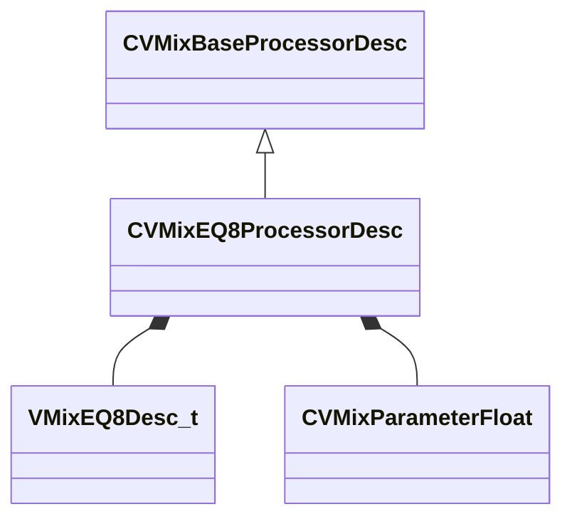

[Schemas](../../schemas.md) / [soundsystem_lowlevel](../soundsystem_lowlevel.md) / CVMixEQ8ProcessorDesc

# CVMixEQ8ProcessorDesc

> Source: **Build 25947352** · 2026-10-15 · `windows-x86_64` · schema `0.12.0`

**Kind:** class · **Size:** 208 bytes (`0xd0`) · **Align:** 8 · **Module:** soundsystem_lowlevel

**Inherits from:** [CVMixBaseProcessorDesc](../soundsystem_lowlevel/CVMixBaseProcessorDesc.md)

**Relationships:**

## Memory layout

9 fields (2 declared here, 7 inherited). Offsets are absolute from the object base.

| Offset | Field | Type | From | Annotations |
|--------|-------|------|------|-------------|
| `0x8` | `m_name` | CUtlString | [CVMixBaseProcessorDesc](../soundsystem_lowlevel/CVMixBaseProcessorDesc.md) |  |
| `0x10` | `m_nDebugId` | uint32 | [CVMixBaseProcessorDesc](../soundsystem_lowlevel/CVMixBaseProcessorDesc.md) |  |
| `0x14` | `m_flxfade` | float32 | [CVMixBaseProcessorDesc](../soundsystem_lowlevel/CVMixBaseProcessorDesc.md) |  |
| `0x18` | `m_nChannels` | int32 | [CVMixBaseProcessorDesc](../soundsystem_lowlevel/CVMixBaseProcessorDesc.md) |  |
| `0x1c` | `m_bDebugBypass` | bool | [CVMixBaseProcessorDesc](../soundsystem_lowlevel/CVMixBaseProcessorDesc.md) |  |
| `0x20` | `m_paramEnable` | [CVMixParameterFloat](../soundsystem_lowlevel/CVMixParameterFloat.md) | [CVMixBaseProcessorDesc](../soundsystem_lowlevel/CVMixBaseProcessorDesc.md) |  |
| `0x24` | `m_paramMix` | [CVMixParameterFloat](../soundsystem_lowlevel/CVMixParameterFloat.md) | [CVMixBaseProcessorDesc](../soundsystem_lowlevel/CVMixBaseProcessorDesc.md) |  |
| `0x28` | `m_desc` | [VMixEQ8Desc_t](../soundsystem_lowlevel/VMixEQ8Desc_t.md) |  |  |
| `0xc8` | `m_paramEQScale` | [CVMixParameterFloat](../soundsystem_lowlevel/CVMixParameterFloat.md) |  |  |

KV3 class defaults

<pre>{
	&quot;_class&quot;: &quot;CVMixEQ8ProcessorDesc&quot;,
	&quot;m_name&quot;: &quot;&quot;,
	&quot;m_nDebugId&quot;: 0,
	&quot;m_flxfade&quot;: 0.100000,
	&quot;m_nChannels&quot;: -1,
	&quot;m_bDebugBypass&quot;: false,
	&quot;m_paramEnable&quot;:
	{
		&quot;m_offset&quot;:
		{
			&quot;category&quot;: &quot;NULL_POINTER&quot;,
			&quot;type&quot;: &quot;VO_CHAR&quot;,
			&quot;index&quot;: 0
		}
	},
	&quot;m_paramMix&quot;:
	{
		&quot;m_offset&quot;:
		{
			&quot;category&quot;: &quot;NULL_POINTER&quot;,
			&quot;type&quot;: &quot;VO_CHAR&quot;,
			&quot;index&quot;: 0
		}
	},
	&quot;m_desc&quot;:
	{
		&quot;m_stages&quot;:
		[
			{
				&quot;m_fldbGain&quot;: 0.000000,
				&quot;m_flCutoffFreq&quot;: 1000.000000,
				&quot;m_flQ&quot;: 0.707107,
				&quot;m_nFilterType&quot;: &quot;FILTER_UNKNOWN&quot;,
				&quot;m_nFilterSlope&quot;: &quot;FILTER_SLOPE_12dB&quot;,
				&quot;m_bEnabled&quot;: true,
				&quot;m_nChannelSet&quot;: &quot;FILTER_ALL_CHANNELS&quot;
			},
			{
				&quot;m_fldbGain&quot;: 0.000000,
				&quot;m_flCutoffFreq&quot;: 1000.000000,
				&quot;m_flQ&quot;: 0.707107,
				&quot;m_nFilterType&quot;: &quot;FILTER_UNKNOWN&quot;,
				&quot;m_nFilterSlope&quot;: &quot;FILTER_SLOPE_12dB&quot;,
				&quot;m_bEnabled&quot;: true,
				&quot;m_nChannelSet&quot;: &quot;FILTER_ALL_CHANNELS&quot;
			},
			{
				&quot;m_fldbGain&quot;: 0.000000,
				&quot;m_flCutoffFreq&quot;: 1000.000000,
				&quot;m_flQ&quot;: 0.707107,
				&quot;m_nFilterType&quot;: &quot;FILTER_UNKNOWN&quot;,
				&quot;m_nFilterSlope&quot;: &quot;FILTER_SLOPE_12dB&quot;,
				&quot;m_bEnabled&quot;: true,
				&quot;m_nChannelSet&quot;: &quot;FILTER_ALL_CHANNELS&quot;
			},
			{
				&quot;m_fldbGain&quot;: 0.000000,
				&quot;m_flCutoffFreq&quot;: 1000.000000,
				&quot;m_flQ&quot;: 0.707107,
				&quot;m_nFilterType&quot;: &quot;FILTER_UNKNOWN&quot;,
				&quot;m_nFilterSlope&quot;: &quot;FILTER_SLOPE_12dB&quot;,
				&quot;m_bEnabled&quot;: true,
				&quot;m_nChannelSet&quot;: &quot;FILTER_ALL_CHANNELS&quot;
			},
			{
				&quot;m_fldbGain&quot;: 0.000000,
				&quot;m_flCutoffFreq&quot;: 1000.000000,
				&quot;m_flQ&quot;: 0.707107,
				&quot;m_nFilterType&quot;: &quot;FILTER_UNKNOWN&quot;,
				&quot;m_nFilterSlope&quot;: &quot;FILTER_SLOPE_12dB&quot;,
				&quot;m_bEnabled&quot;: true,
				&quot;m_nChannelSet&quot;: &quot;FILTER_ALL_CHANNELS&quot;
			},
			{
				&quot;m_fldbGain&quot;: 0.000000,
				&quot;m_flCutoffFreq&quot;: 1000.000000,
				&quot;m_flQ&quot;: 0.707107,
				&quot;m_nFilterType&quot;: &quot;FILTER_UNKNOWN&quot;,
				&quot;m_nFilterSlope&quot;: &quot;FILTER_SLOPE_12dB&quot;,
				&quot;m_bEnabled&quot;: true,
				&quot;m_nChannelSet&quot;: &quot;FILTER_ALL_CHANNELS&quot;
			},
			{
				&quot;m_fldbGain&quot;: 0.000000,
				&quot;m_flCutoffFreq&quot;: 1000.000000,
				&quot;m_flQ&quot;: 0.707107,
				&quot;m_nFilterType&quot;: &quot;FILTER_UNKNOWN&quot;,
				&quot;m_nFilterSlope&quot;: &quot;FILTER_SLOPE_12dB&quot;,
				&quot;m_bEnabled&quot;: true,
				&quot;m_nChannelSet&quot;: &quot;FILTER_ALL_CHANNELS&quot;
			},
			{
				&quot;m_fldbGain&quot;: 0.000000,
				&quot;m_flCutoffFreq&quot;: 1000.000000,
				&quot;m_flQ&quot;: 0.707107,
				&quot;m_nFilterType&quot;: &quot;FILTER_UNKNOWN&quot;,
				&quot;m_nFilterSlope&quot;: &quot;FILTER_SLOPE_12dB&quot;,
				&quot;m_bEnabled&quot;: true,
				&quot;m_nChannelSet&quot;: &quot;FILTER_ALL_CHANNELS&quot;
			}
		]
	},
	&quot;m_paramEQScale&quot;:
	{
		&quot;m_offset&quot;:
		{
			&quot;category&quot;: &quot;NULL_POINTER&quot;,
			&quot;type&quot;: &quot;VO_CHAR&quot;,
			&quot;index&quot;: 0
		}
	}
}</pre>

