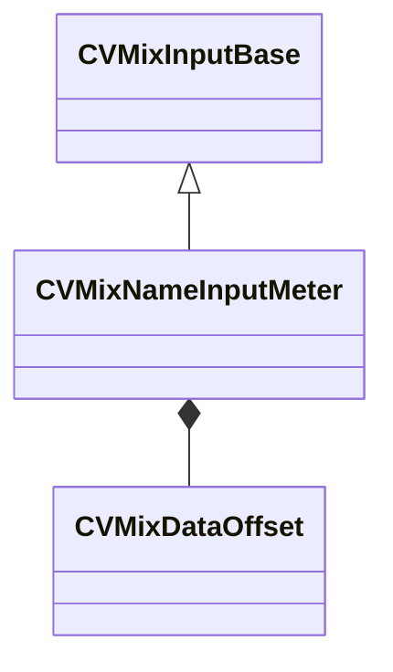

[Schemas](../../schemas.md) / [soundsystem_lowlevel](../soundsystem_lowlevel.md) / CVMixNameInputMeter

# CVMixNameInputMeter

> Source: **Build 26281801** · 2026-10-28 · `windows-x86_64` · schema `0.13.0`

**Kind:** class · **Size:** 24 bytes (`0x18`) · **Align:** 8 · **Module:** soundsystem_lowlevel

**Inherits from:** [CVMixInputBase](../soundsystem_lowlevel/CVMixInputBase.md)

**Relationships:**

## Memory layout

2 fields (1 declared here, 1 inherited). Offsets are absolute from the object base.

| Offset | Field | Type | From | Annotations |
|--------|-------|------|------|-------------|
| `0x0` | `m_name` | CUtlString | [CVMixInputBase](../soundsystem_lowlevel/CVMixInputBase.md) |  |
| `0x10` | `m_nValueIndex` | [CVMixDataOffset](../soundsystem_lowlevel/CVMixDataOffset.md) |  |  |

KV3 class defaults

<pre>{
	&quot;m_name&quot;: &quot;GameInput&quot;,
	&quot;m_nValueIndex&quot;:
	{
		&quot;category&quot;: &quot;NULL_POINTER&quot;,
		&quot;type&quot;: &quot;VO_CHAR&quot;,
		&quot;index&quot;: 0
	}
}</pre>

