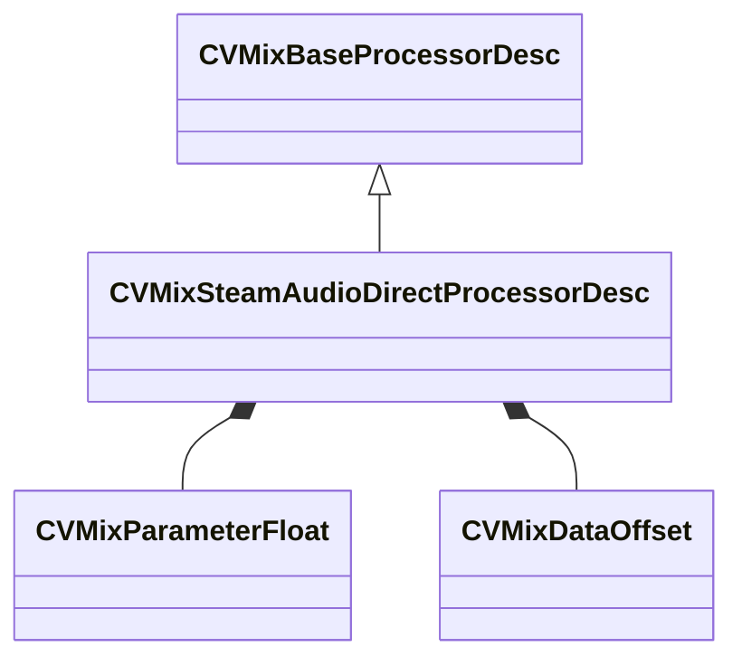

[Schemas](../../schemas.md) / [soundsystem_lowlevel](../soundsystem_lowlevel.md) / CVMixSteamAudioDirectProcessorDesc

# CVMixSteamAudioDirectProcessorDesc

> Source: **Build 25966348** · 2026-10-15 · `windows-x86_64` · schema `0.12.0`

**Kind:** class · **Size:** 144 bytes (`0x90`) · **Align:** 8 · **Module:** soundsystem_lowlevel

**Inherits from:** [CVMixBaseProcessorDesc](../soundsystem_lowlevel/CVMixBaseProcessorDesc.md)

**Relationships:**

## Memory layout

32 fields (25 declared here, 7 inherited). Offsets are absolute from the object base.

| Offset | Field | Type | From | Annotations |
|--------|-------|------|------|-------------|
| `0x8` | `m_name` | CUtlString | [CVMixBaseProcessorDesc](../soundsystem_lowlevel/CVMixBaseProcessorDesc.md) |  |
| `0x10` | `m_nDebugId` | uint32 | [CVMixBaseProcessorDesc](../soundsystem_lowlevel/CVMixBaseProcessorDesc.md) |  |
| `0x14` | `m_flxfade` | float32 | [CVMixBaseProcessorDesc](../soundsystem_lowlevel/CVMixBaseProcessorDesc.md) |  |
| `0x18` | `m_nChannels` | int32 | [CVMixBaseProcessorDesc](../soundsystem_lowlevel/CVMixBaseProcessorDesc.md) |  |
| `0x1c` | `m_bDebugBypass` | bool | [CVMixBaseProcessorDesc](../soundsystem_lowlevel/CVMixBaseProcessorDesc.md) |  |
| `0x20` | `m_paramEnable` | [CVMixParameterFloat](../soundsystem_lowlevel/CVMixParameterFloat.md) | [CVMixBaseProcessorDesc](../soundsystem_lowlevel/CVMixBaseProcessorDesc.md) |  |
| `0x24` | `m_paramMix` | [CVMixParameterFloat](../soundsystem_lowlevel/CVMixParameterFloat.md) | [CVMixBaseProcessorDesc](../soundsystem_lowlevel/CVMixBaseProcessorDesc.md) |  |
| `0x28` | `m_paramPositionX` | [CVMixParameterFloat](../soundsystem_lowlevel/CVMixParameterFloat.md) |  |  |
| `0x2c` | `m_paramPositionY` | [CVMixParameterFloat](../soundsystem_lowlevel/CVMixParameterFloat.md) |  |  |
| `0x30` | `m_paramPositionZ` | [CVMixParameterFloat](../soundsystem_lowlevel/CVMixParameterFloat.md) |  |  |
| `0x34` | `m_paramRightX` | [CVMixParameterFloat](../soundsystem_lowlevel/CVMixParameterFloat.md) |  |  |
| `0x38` | `m_paramRightY` | [CVMixParameterFloat](../soundsystem_lowlevel/CVMixParameterFloat.md) |  |  |
| `0x3c` | `m_paramRightZ` | [CVMixParameterFloat](../soundsystem_lowlevel/CVMixParameterFloat.md) |  |  |
| `0x40` | `m_paramUpX` | [CVMixParameterFloat](../soundsystem_lowlevel/CVMixParameterFloat.md) |  |  |
| `0x44` | `m_paramUpY` | [CVMixParameterFloat](../soundsystem_lowlevel/CVMixParameterFloat.md) |  |  |
| `0x48` | `m_paramUpZ` | [CVMixParameterFloat](../soundsystem_lowlevel/CVMixParameterFloat.md) |  |  |
| `0x4c` | `m_paramAheadX` | [CVMixParameterFloat](../soundsystem_lowlevel/CVMixParameterFloat.md) |  |  |
| `0x50` | `m_paramAheadY` | [CVMixParameterFloat](../soundsystem_lowlevel/CVMixParameterFloat.md) |  |  |
| `0x54` | `m_paramAheadZ` | [CVMixParameterFloat](../soundsystem_lowlevel/CVMixParameterFloat.md) |  |  |
| `0x58` | `m_paramApplyDistanceAttenuation` | [CVMixParameterFloat](../soundsystem_lowlevel/CVMixParameterFloat.md) |  |  |
| `0x5c` | `m_paramApplyAirAbsorption` | [CVMixParameterFloat](../soundsystem_lowlevel/CVMixParameterFloat.md) |  |  |
| `0x60` | `m_paramApplyDirectivity` | [CVMixParameterFloat](../soundsystem_lowlevel/CVMixParameterFloat.md) |  |  |
| `0x64` | `m_paramApplyOcclusion` | [CVMixParameterFloat](../soundsystem_lowlevel/CVMixParameterFloat.md) |  |  |
| `0x68` | `m_paramApplyTransmission` | [CVMixParameterFloat](../soundsystem_lowlevel/CVMixParameterFloat.md) |  |  |
| `0x6c` | `m_paramDipoleWeight` | [CVMixParameterFloat](../soundsystem_lowlevel/CVMixParameterFloat.md) |  |  |
| `0x70` | `m_paramDipolePower` | [CVMixParameterFloat](../soundsystem_lowlevel/CVMixParameterFloat.md) |  |  |
| `0x74` | `m_paramOcclusion` | [CVMixParameterFloat](../soundsystem_lowlevel/CVMixParameterFloat.md) |  |  |
| `0x78` | `m_paramTransmissionLow` | [CVMixParameterFloat](../soundsystem_lowlevel/CVMixParameterFloat.md) |  |  |
| `0x7c` | `m_paramTransmissionMid` | [CVMixParameterFloat](../soundsystem_lowlevel/CVMixParameterFloat.md) |  |  |
| `0x80` | `m_paramTransmissionHigh` | [CVMixParameterFloat](../soundsystem_lowlevel/CVMixParameterFloat.md) |  |  |
| `0x84` | `m_paramBand` | [CVMixParameterFloat](../soundsystem_lowlevel/CVMixParameterFloat.md) |  |  |
| `0x88` | `m_paramTransmission` | [CVMixDataOffset](../soundsystem_lowlevel/CVMixDataOffset.md) |  |  |

KV3 class defaults

<pre>{
	&quot;_class&quot;: &quot;CVMixSteamAudioDirectProcessorDesc&quot;,
	&quot;m_name&quot;: &quot;&quot;,
	&quot;m_nDebugId&quot;: 0,
	&quot;m_flxfade&quot;: 0.100000,
	&quot;m_nChannels&quot;: -1,
	&quot;m_bDebugBypass&quot;: false,
	&quot;m_paramEnable&quot;:
	{
		&quot;m_offset&quot;:
		{
			&quot;category&quot;: &quot;NULL_POINTER&quot;,
			&quot;type&quot;: &quot;VO_CHAR&quot;,
			&quot;index&quot;: 0
		}
	},
	&quot;m_paramMix&quot;:
	{
		&quot;m_offset&quot;:
		{
			&quot;category&quot;: &quot;NULL_POINTER&quot;,
			&quot;type&quot;: &quot;VO_CHAR&quot;,
			&quot;index&quot;: 0
		}
	},
	&quot;m_paramPositionX&quot;:
	{
		&quot;m_offset&quot;:
		{
			&quot;category&quot;: &quot;NULL_POINTER&quot;,
			&quot;type&quot;: &quot;VO_CHAR&quot;,
			&quot;index&quot;: 0
		}
	},
	&quot;m_paramPositionY&quot;:
	{
		&quot;m_offset&quot;:
		{
			&quot;category&quot;: &quot;NULL_POINTER&quot;,
			&quot;type&quot;: &quot;VO_CHAR&quot;,
			&quot;index&quot;: 0
		}
	},
	&quot;m_paramPositionZ&quot;:
	{
		&quot;m_offset&quot;:
		{
			&quot;category&quot;: &quot;NULL_POINTER&quot;,
			&quot;type&quot;: &quot;VO_CHAR&quot;,
			&quot;index&quot;: 0
		}
	},
	&quot;m_paramRightX&quot;:
	{
		&quot;m_offset&quot;:
		{
			&quot;category&quot;: &quot;NULL_POINTER&quot;,
			&quot;type&quot;: &quot;VO_CHAR&quot;,
			&quot;index&quot;: 0
		}
	},
	&quot;m_paramRightY&quot;:
	{
		&quot;m_offset&quot;:
		{
			&quot;category&quot;: &quot;NULL_POINTER&quot;,
			&quot;type&quot;: &quot;VO_CHAR&quot;,
			&quot;index&quot;: 0
		}
	},
	&quot;m_paramRightZ&quot;:
	{
		&quot;m_offset&quot;:
		{
			&quot;category&quot;: &quot;NULL_POINTER&quot;,
			&quot;type&quot;: &quot;VO_CHAR&quot;,
			&quot;index&quot;: 0
		}
	},
	&quot;m_paramUpX&quot;:
	{
		&quot;m_offset&quot;:
		{
			&quot;category&quot;: &quot;NULL_POINTER&quot;,
			&quot;type&quot;: &quot;VO_CHAR&quot;,
			&quot;index&quot;: 0
		}
	},
	&quot;m_paramUpY&quot;:
	{
		&quot;m_offset&quot;:
		{
			&quot;category&quot;: &quot;NULL_POINTER&quot;,
			&quot;type&quot;: &quot;VO_CHAR&quot;,
			&quot;index&quot;: 0
		}
	},
	&quot;m_paramUpZ&quot;:
	{
		&quot;m_offset&quot;:
		{
			&quot;category&quot;: &quot;NULL_POINTER&quot;,
			&quot;type&quot;: &quot;VO_CHAR&quot;,
			&quot;index&quot;: 0
		}
	},
	&quot;m_paramAheadX&quot;:
	{
		&quot;m_offset&quot;:
		{
			&quot;category&quot;: &quot;NULL_POINTER&quot;,
			&quot;type&quot;: &quot;VO_CHAR&quot;,
			&quot;index&quot;: 0
		}
	},
	&quot;m_paramAheadY&quot;:
	{
		&quot;m_offset&quot;:
		{
			&quot;category&quot;: &quot;NULL_POINTER&quot;,
			&quot;type&quot;: &quot;VO_CHAR&quot;,
			&quot;index&quot;: 0
		}
	},
	&quot;m_paramAheadZ&quot;:
	{
		&quot;m_offset&quot;:
		{
			&quot;category&quot;: &quot;NULL_POINTER&quot;,
			&quot;type&quot;: &quot;VO_CHAR&quot;,
			&quot;index&quot;: 0
		}
	},
	&quot;m_paramApplyDistanceAttenuation&quot;:
	{
		&quot;m_offset&quot;:
		{
			&quot;category&quot;: &quot;NULL_POINTER&quot;,
			&quot;type&quot;: &quot;VO_CHAR&quot;,
			&quot;index&quot;: 0
		}
	},
	&quot;m_paramApplyAirAbsorption&quot;:
	{
		&quot;m_offset&quot;:
		{
			&quot;category&quot;: &quot;NULL_POINTER&quot;,
			&quot;type&quot;: &quot;VO_CHAR&quot;,
			&quot;index&quot;: 0
		}
	},
	&quot;m_paramApplyDirectivity&quot;:
	{
		&quot;m_offset&quot;:
		{
			&quot;category&quot;: &quot;NULL_POINTER&quot;,
			&quot;type&quot;: &quot;VO_CHAR&quot;,
			&quot;index&quot;: 0
		}
	},
	&quot;m_paramApplyOcclusion&quot;:
	{
		&quot;m_offset&quot;:
		{
			&quot;category&quot;: &quot;NULL_POINTER&quot;,
			&quot;type&quot;: &quot;VO_CHAR&quot;,
			&quot;index&quot;: 0
		}
	},
	&quot;m_paramApplyTransmission&quot;:
	{
		&quot;m_offset&quot;:
		{
			&quot;category&quot;: &quot;NULL_POINTER&quot;,
			&quot;type&quot;: &quot;VO_CHAR&quot;,
			&quot;index&quot;: 0
		}
	},
	&quot;m_paramDipoleWeight&quot;:
	{
		&quot;m_offset&quot;:
		{
			&quot;category&quot;: &quot;NULL_POINTER&quot;,
			&quot;type&quot;: &quot;VO_CHAR&quot;,
			&quot;index&quot;: 0
		}
	},
	&quot;m_paramDipolePower&quot;:
	{
		&quot;m_offset&quot;:
		{
			&quot;category&quot;: &quot;NULL_POINTER&quot;,
			&quot;type&quot;: &quot;VO_CHAR&quot;,
			&quot;index&quot;: 0
		}
	},
	&quot;m_paramOcclusion&quot;:
	{
		&quot;m_offset&quot;:
		{
			&quot;category&quot;: &quot;NULL_POINTER&quot;,
			&quot;type&quot;: &quot;VO_CHAR&quot;,
			&quot;index&quot;: 0
		}
	},
	&quot;m_paramTransmissionLow&quot;:
	{
		&quot;m_offset&quot;:
		{
			&quot;category&quot;: &quot;NULL_POINTER&quot;,
			&quot;type&quot;: &quot;VO_CHAR&quot;,
			&quot;index&quot;: 0
		}
	},
	&quot;m_paramTransmissionMid&quot;:
	{
		&quot;m_offset&quot;:
		{
			&quot;category&quot;: &quot;NULL_POINTER&quot;,
			&quot;type&quot;: &quot;VO_CHAR&quot;,
			&quot;index&quot;: 0
		}
	},
	&quot;m_paramTransmissionHigh&quot;:
	{
		&quot;m_offset&quot;:
		{
			&quot;category&quot;: &quot;NULL_POINTER&quot;,
			&quot;type&quot;: &quot;VO_CHAR&quot;,
			&quot;index&quot;: 0
		}
	},
	&quot;m_paramBand&quot;:
	{
		&quot;m_offset&quot;:
		{
			&quot;category&quot;: &quot;NULL_POINTER&quot;,
			&quot;type&quot;: &quot;VO_CHAR&quot;,
			&quot;index&quot;: 0
		}
	},
	&quot;m_paramTransmission&quot;:
	{
		&quot;category&quot;: &quot;NULL_POINTER&quot;,
		&quot;type&quot;: &quot;VO_CHAR&quot;,
		&quot;index&quot;: 0
	}
}</pre>

