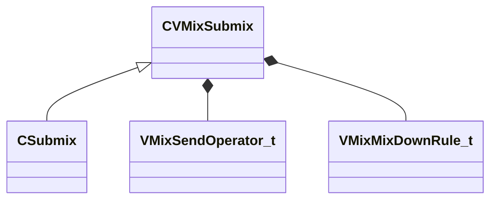

[Schemas](../../schemas.md) / [soundsystem_lowlevel](../soundsystem_lowlevel.md) / CVMixSubmix

# CVMixSubmix

> Source: **Build 25966348** · 2026-10-15 · `windows-x86_64` · schema `0.12.0`

**Kind:** class · **Size:** 56 bytes (`0x38`) · **Align:** 8 · **Module:** soundsystem_lowlevel

**Derived by:** [CSubmix](../soundsystem/CSubmix.md)

**Relationships:**

## Memory layout

6 fields (6 declared here, 0 inherited). Offsets are absolute from the object base.

| Offset | Field | Type | From | Annotations |
|--------|-------|------|------|-------------|
| `0x0` | `m_name` | CUtlString |  |  |
| `0x8` | `m_SendNames` | CUtlString[4] |  |  |
| `0x2c` | `m_nSoloNameHash` | uint32 |  |  |
| `0x30` | `m_nChannels` | int32 |  |  |
| `0x34` | `m_nSendOperator` | [VMixSendOperator_t](../soundsystem_lowlevel/VMixSendOperator_t.md) |  | `MPropertyFriendlyName Send Operator` |
| `0x36` | `m_nMixDownRule` | [VMixMixDownRule_t](../soundsystem_lowlevel/VMixMixDownRule_t.md) |  |  |

KV3 class defaults

<pre>{
	&quot;m_name&quot;: &quot;&quot;,
	&quot;m_SendNames&quot;:
	[
		&quot;&quot;,
		&quot;&quot;,
		&quot;&quot;,
		&quot;&quot;
	],
	&quot;m_nSoloNameHash&quot;: 0,
	&quot;m_nChannels&quot;: -1,
	&quot;m_nSendOperator&quot;: &quot;NAMED_SEND&quot;,
	&quot;m_nMixDownRule&quot;: &quot;SUM&quot;
}</pre>

