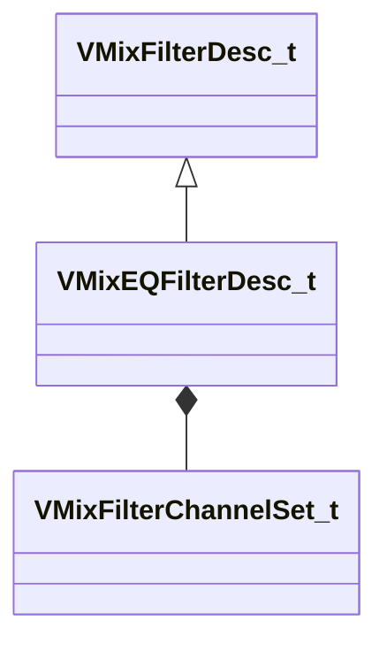

[Schemas](../../schemas.md) / [soundsystem_lowlevel](../soundsystem_lowlevel.md) / VMixEQFilterDesc_t

# VMixEQFilterDesc_t

> Source: **Build 26144732** · 2026-10-22 · `windows-x86_64` · schema `0.12.0`

**Kind:** class · **Size:** 20 bytes (`0x14`) · **Align:** 4 · **Module:** soundsystem_lowlevel

**Inherits from:** [VMixFilterDesc_t](../soundsystem_lowlevel/VMixFilterDesc_t.md)

**Relationships:**

## Memory layout

7 fields (1 declared here, 6 inherited). Offsets are absolute from the object base.

| Offset | Field | Type | From | Annotations |
|--------|-------|------|------|-------------|
| `0x0` | `m_fldbGain` | float32 | [VMixFilterDesc_t](../soundsystem_lowlevel/VMixFilterDesc_t.md) |  |
| `0x4` | `m_flCutoffFreq` | float32 | [VMixFilterDesc_t](../soundsystem_lowlevel/VMixFilterDesc_t.md) |  |
| `0x8` | `m_flQ` | float32 | [VMixFilterDesc_t](../soundsystem_lowlevel/VMixFilterDesc_t.md) |  |
| `0xc` | `m_nFilterType` | [VMixFilterType_t](../soundsystem_lowlevel/VMixFilterType_t.md) | [VMixFilterDesc_t](../soundsystem_lowlevel/VMixFilterDesc_t.md) |  |
| `0xd` | `m_nFilterSlope` | [VMixFilterSlope_t](../soundsystem_lowlevel/VMixFilterSlope_t.md) | [VMixFilterDesc_t](../soundsystem_lowlevel/VMixFilterDesc_t.md) |  |
| `0xe` | `m_bEnabled` | bool | [VMixFilterDesc_t](../soundsystem_lowlevel/VMixFilterDesc_t.md) |  |
| `0x10` | `m_nChannelSet` | [VMixFilterChannelSet_t](../soundsystem_lowlevel/VMixFilterChannelSet_t.md) |  |  |

KV3 class defaults

<pre>{
	&quot;m_fldbGain&quot;: 0.000000,
	&quot;m_flCutoffFreq&quot;: 1000.000000,
	&quot;m_flQ&quot;: 0.707107,
	&quot;m_nFilterType&quot;: &quot;FILTER_UNKNOWN&quot;,
	&quot;m_nFilterSlope&quot;: &quot;FILTER_SLOPE_12dB&quot;,
	&quot;m_bEnabled&quot;: true,
	&quot;m_nChannelSet&quot;: &quot;FILTER_ALL_CHANNELS&quot;
}</pre>

