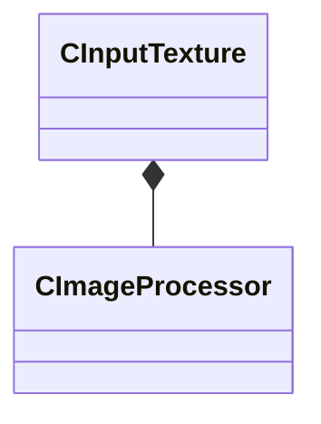

[Schemas](../../schemas.md) / [texturelib](../texturelib.md) / CInputTexture

# CInputTexture

> Source: **Build 26334290** · 2026-10-30 · `windows-x86_64` · schema `0.13.0`

**Kind:** class · **Size:** 88 bytes (`0x58`) · **Align:** 8 · **Module:** texturelib

**Relationships:**

## Memory layout

11 fields (11 declared here, 0 inherited). Offsets are absolute from the object base.

| Offset | Field | Type | From | Annotations |
|--------|-------|------|------|-------------|
| `0x0` | `m_name` | CUtlString |  |  |
| `0x8` | `m_fileName` | CUtlString |  |  |
| `0x10` | `m_colorSpace` | CUtlString |  |  |
| `0x18` | `m_fileExt` | CUtlString |  |  |
| `0x20` | `m_nMinBitsPerChannel` | int32 |  |  |
| `0x28` | `m_typeString` | CUtlString |  |  |
| `0x30` | `m_bPassThroughToCompiledVtex` | bool |  |  |
| `0x34` | `m_n3DSliceCount` | int32 |  |  |
| `0x38` | `m_n3DSliceWidth` | int32 |  |  |
| `0x3c` | `m_n3DSliceHeight` | int32 |  |  |
| `0x40` | `m_imageProcessorArray` | CUtlVector< [CImageProcessor](../texturelib/CImageProcessor.md) > |  |  |

KV3 class defaults

<pre>{
	&quot;m_name&quot;: &quot;&quot;,
	&quot;m_fileName&quot;: &quot;&quot;,
	&quot;m_colorSpace&quot;: &quot;&quot;,
	&quot;m_fileExt&quot;: &quot;&quot;,
	&quot;m_nMinBitsPerChannel&quot;: -1,
	&quot;m_typeString&quot;: &quot;&quot;,
	&quot;m_bPassThroughToCompiledVtex&quot;: false,
	&quot;m_n3DSliceCount&quot;: -1,
	&quot;m_n3DSliceWidth&quot;: -1,
	&quot;m_n3DSliceHeight&quot;: -1,
	&quot;m_imageProcessorArray&quot;:
	[
	]
}</pre>

