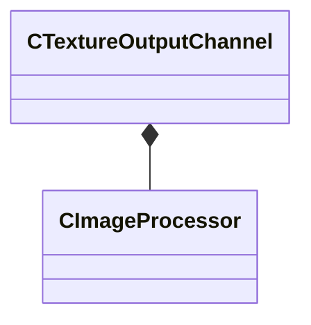

[Schemas](../../schemas.md) / [texturelib](../texturelib.md) / CTextureOutputChannel

# CTextureOutputChannel

> Source: **Build 25947352** · 2026-10-15 · `windows-x86_64` · schema `0.12.0`

**Kind:** class · **Size:** 80 bytes (`0x50`) · **Align:** 8 · **Module:** texturelib

**Relationships:**

## Memory layout

5 fields (5 declared here, 0 inherited). Offsets are absolute from the object base.

| Offset | Field | Type | From | Annotations |
|--------|-------|------|------|-------------|
| `0x0` | `m_srcChannels` | CUtlString |  |  |
| `0x8` | `m_dstChannels` | CUtlString |  |  |
| `0x10` | `m_mipAlgorithm` | [CImageProcessor](../texturelib/CImageProcessor.md) |  |  |
| `0x30` | `m_outputColorSpace` | CUtlString |  |  |
| `0x38` | `m_inputTextureArray` | CUtlVector< CUtlString > |  |  |

KV3 class defaults

<pre>{
	&quot;m_srcChannels&quot;: &quot;&quot;,
	&quot;m_dstChannels&quot;: &quot;&quot;,
	&quot;m_mipAlgorithm&quot;:
	{
		&quot;m_algorithm&quot;: &quot;&quot;,
		&quot;m_stringArg&quot;: &quot;&quot;,
		&quot;m_vFloat4Arg&quot;:
		[
			0.000000,
			0.000000,
			0.000000,
			0.000000
		]
	},
	&quot;m_outputColorSpace&quot;: &quot;&quot;,
	&quot;m_inputTextureArray&quot;:
	[
	]
}</pre>

